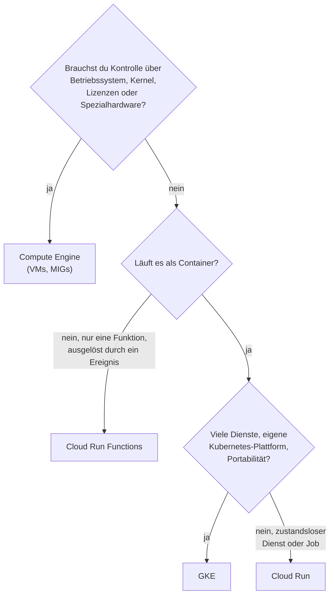
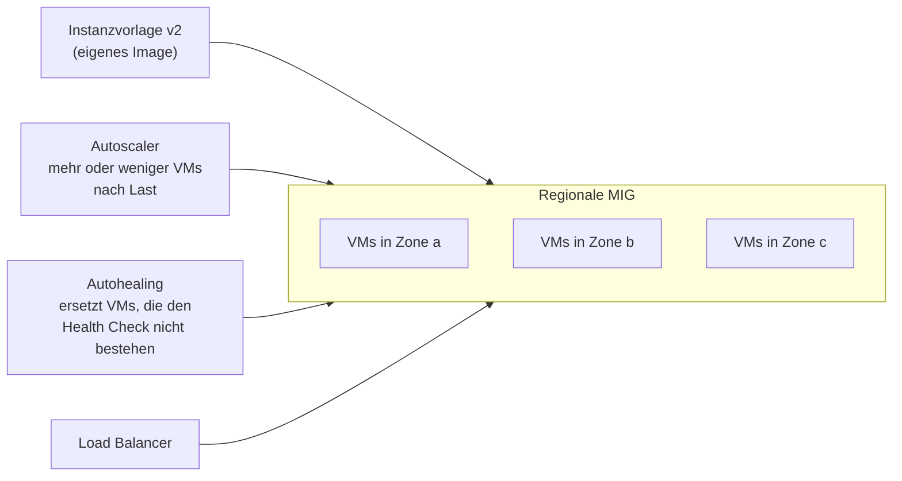
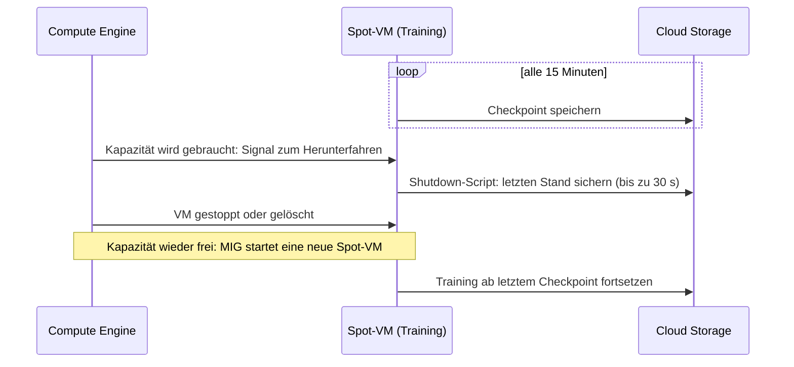
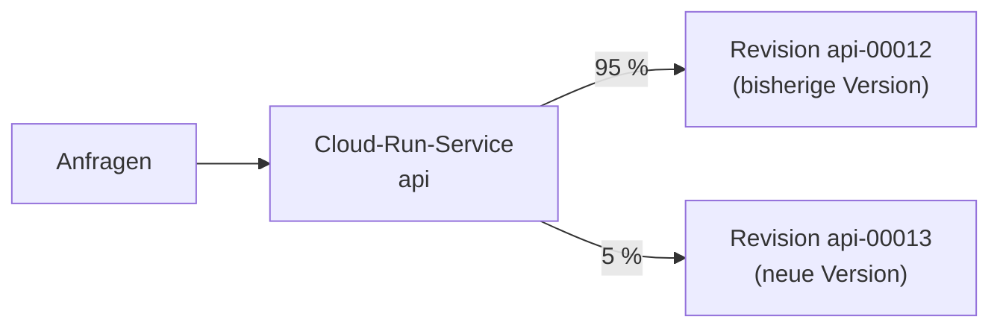

# Compute und Serverless

Lernnotiz zur Prüfung Professional Cloud Architect (PCA). Compute Engine ist das Thema, das in den Prüfungsfragen am
häufigsten vorkommt, oft als Teil einer größeren Architektur. Diese Notiz beantwortet zuerst die Grundfrage „Wo läuft
mein Code?“ und geht dann durch Compute Engine (VMs, Images, Managed Instance Groups, Spot, Sole-Tenant) und die
Serverless-Dienste (Cloud Run, Cloud Run Functions, App Engine). GKE hat eine eigene Notiz: [gke.md](gke.md).

*Stand 2026-11-15. Spot-VMs, der Vergleich App Engine und Cloud Run sowie GPUs auf Cloud Run am selben Tag an der
Google-Cloud-Doku geprüft (siehe [Quellen](#13-quellen)). Speicheroptionen im Detail stehen in [data.md](data.md),
Snapshots und Disaster Recovery in [operations.md](operations.md).*

---

## Inhalt

- [0. Das Bild zuerst: Wo läuft mein Code?](#0-das-bild-zuerst-wo-läuft-mein-code)
- [1. Eine VM besteht aus vier Teilen](#1-eine-vm-besteht-aus-vier-teilen)
- [2. Images, Instanzvorlagen und Skripte](#2-images-instanzvorlagen-und-skripte)
- [3. Managed Instance Groups](#3-managed-instance-groups)
- [4. Spot-VMs](#4-spot-vms)
- [5. Sole-Tenant Nodes](#5-sole-tenant-nodes)
- [6. Platten an der VM](#6-platten-an-der-vm)
- [7. VMs betreiben: Agent, Patches, Zugang](#7-vms-betreiben-agent-patches-zugang)
- [8. GPUs und TPUs](#8-gpus-und-tpus)
- [9. Serverless: Cloud Run, Functions, App Engine](#9-serverless-cloud-run-functions-app-engine)
- [10. Kosten](#10-kosten)
- [11. Prüfungssignale: Spickzettel](#11-prüfungssignale-spickzettel)
- [12. Alte und neue Namen](#12-alte-und-neue-namen)
- [13. Quellen](#13-quellen)

---

## 0. Das Bild zuerst: Wo läuft mein Code?

Ein ML-Team betreibt fünf sehr verschiedene Dinge, und jedes landet auf einer anderen Plattform:

| Teil | Eigenschaft | Plattform |
|---|---|---|
| **Training** eines Bildmodells, nachts, 8 GPUs, darf unterbrochen werden | Batch, fehlertolerant, teure Hardware | **Spot-VMs** mit GPUs und Checkpoints |
| **Lizenzserver** einer alten Simulationssoftware, Lizenz an physische Kerne gebunden | eigenes Betriebssystem, Lizenzbedingungen | **Compute Engine auf Sole-Tenant Nodes** |
| **Web-API** für Vorhersagen, tagsüber viel, nachts nichts | zustandsloser Container, HTTP | **Cloud Run** (skaliert auf null) |
| **Vorschaubilder** erzeugen, sobald ein Bild im Bucket landet | kleines Stück Code, durch ein Ereignis ausgelöst | **Cloud Run Functions** |
| **Plattform** mit 30 Microservices, mehreren Teams, eigener Service Mesh | viele Container, Kubernetes-Know-how vorhanden | **GKE** (siehe [gke.md](gke.md)) |

Die Entscheidung folgt fast immer denselben Fragen:

*App Engine fehlt bewusst: Für neue Anwendungen empfiehlt Google Cloud Run (Abschnitt 9).*

**Faustregel:** So viel verwalten lassen wie möglich. Je weiter rechts im Baum, desto weniger Betrieb (Patches,
Skalierung, Kapazität), aber auch weniger Kontrolle. Compute Engine ist richtig, wenn man die Kontrolle wirklich
braucht, nicht aus Gewohnheit.

---

## 1. Eine VM besteht aus vier Teilen

Eine Compute-Engine-VM ist die Kombination aus **Maschinentyp** (CPU und Speicher), **Image** (Betriebssystem auf
der Boot-Platte), **Platten** und **Netzwerkkarte(n)**.

**Maschinenfamilien:**

| Familie | Beispiele | wofür |
|---|---|---|
| **General purpose** | E2 (günstig), N2, N4, C3, C4 | Web-Server, Anwendungen, die meisten Workloads |
| **Compute-optimized** | C2, H3 | hohe Leistung pro Kern, HPC, Spiele-Server |
| **Memory-optimized** | M-Serie | sehr große In-Memory-Datenbanken (z. B. SAP HANA) |
| **Accelerator-optimized** | A-Serie, G2 | GPUs für Training und Inferenz |

Passt keine Größe, gibt es **Custom Machine Types** mit frei gewählter Zahl von vCPUs und Speicher. Wie groß eine VM
sein muss, weiß man oft erst im Betrieb: Man startet mit einer Größe ähnlich der bisherigen On-Prem-VM, installiert
den Monitoring-Agent und lässt sich vom **Rightsizing-Recommender** Empfehlungen geben.

**Von Google gewartet:** Bei Wartungsarbeiten am Host zieht Google laufende VMs per **Live Migration** auf einen anderen
Host um, ohne Neustart. Für mehr Sicherheit gibt es **Shielded VMs** (geprüfter Bootvorgang) und **Confidential VMs**
(verschlüsselter Arbeitsspeicher, siehe [security.md](security.md#7-verschlüsselung-und-schlüssel)).

---

## 2. Images, Instanzvorlagen und Skripte

**Images.** Eine VM startet von einem Image: einem öffentlichen (Debian, Ubuntu, Windows Server …) oder einem
**eigenen Image**, das man aus einer konfigurierten Platte erstellt. **Image Families** zeigen immer auf die neueste
Version eines Images.

**Der wichtigste Zielkonflikt: Wann wird installiert?**

| Ansatz | Start einer neuen VM | Wann |
|---|---|---|
| **Startup Script** installiert Pakete beim Booten | langsam (Minuten), abhängig von externen Paketquellen | wenig Abhängigkeiten, häufige Änderungen |
| **eigenes Image** mit allem vorinstalliert („gebacken“) | schnell (Sekunden) | viele Abhängigkeiten, Autoscaling muss schnell reagieren |

Für Autoscaling zählt die Startzeit: Eine VM, die fünf Minuten installiert, hilft bei einer Lastspitze zu spät.
Deshalb lautet die typische Antwort: eigenes Image mit allen Abhängigkeiten, daraus eine Instanzvorlage, daraus eine
MIG.

**Instanzvorlage (Instance Template).** Beschreibt eine VM vollständig: Maschinentyp, Image, Platten, Netzwerk,
Service Account, Metadaten. Vorlagen sind **unveränderlich**; eine neue Version der Anwendung bedeutet eine neue
Vorlage.

**Metadaten und Skripte.** `startup-script` läuft bei jedem Start, `shutdown-script` beim Herunterfahren. Das
Shutdown-Script ist wichtig bei Spot-VMs (Abschnitt 4): Dort sichert die Anwendung ihren Zustand, bevor die VM
gestoppt wird.

---

## 3. Managed Instance Groups

Eine **Managed Instance Group (MIG)** erzeugt aus einer Instanzvorlage viele gleiche VMs und hält sie am Leben. Sie
kann drei Dinge, die einzelne VMs nicht können:

**Zonal oder regional.** Eine **zonale MIG** steht in einer Zone; fällt die Zone aus, ist alles weg. Eine
**regionale MIG** verteilt die VMs über mehrere Zonen einer Region und übersteht den Ausfall einer Zone. Für
Produktion ist die regionale MIG hinter einem Load Balancer die Standardantwort für „hochverfügbar über Zonen“.

**Autoscaling.** Der Autoscaler fügt VMs hinzu oder entfernt sie, gesteuert durch ein Signal:

| Signal | Beispiel |
|---|---|
| CPU-Auslastung | Ziel 60 % über alle VMs |
| Kapazität am Load Balancer | Anfragen pro Sekunde pro VM |
| Cloud-Monitoring-Metrik | Speicherauslastung (braucht den Ops Agent auf den VMs), Länge einer Pub/Sub-Warteschlange |
| Zeitplan | vor dem erwarteten Ansturm am Montagmorgen hochskalieren |

Zwei Fallen aus der Praxis:

- **Speicher als Signal:** Die Metrik des Agents hat für jeden Speicherzustand (`used`, `free`, `cached` …) eine eigene
  Zeitreihe. Soll bei „mehr als 80 % belegt“ skaliert werden, muss der Filter auf `state = used` stehen (oder
  gleichwertig: `free` mit Ziel 20 %).
- **Die Obergrenze:** Steigt die Latenz, obwohl der Autoscaler aktiv ist, steht die MIG oft schon auf ihrer
  **maximalen Instanzzahl**. Dann hilft nur, das Maximum zu erhöhen (und Quotas zu prüfen).

**Autohealing** ersetzt VMs, die einen Health Check nicht bestehen. Wichtig ist ein ausreichend langer **Initial
Delay**, sonst ersetzt die MIG VMs, die noch starten (Details und die typische Neustart-Schleife in
[networking.md](networking.md#11-health-checks-und-autohealing)).

**Neue Version ausrollen.** Man gibt der MIG eine neue Instanzvorlage. Wie schnell die VMs ersetzt werden, bestimmt
der Update-Typ:

| Update-Typ | Verhalten | wann |
|---|---|---|
| **Proactive** | MIG ersetzt die VMs aktiv, schrittweise (`maxSurge`, `maxUnavailable`) | normale Releases |
| **Opportunistic** | MIG ersetzt eine VM erst, wenn sie ohnehin neu erstellt wird (Autoscaling, Autohealing) | unkritische Änderungen ohne Eile |
| **Canary** | zwei Vorlagen in einer MIG, z. B. 10 % auf v2 | neue Version erst an wenigen VMs prüfen |

**Stateful MIGs** behalten Namen, Platten und IPs einzelner VMs auch beim Ersetzen, für Anwendungen mit Zustand
(z. B. eine Datenbank-Replik pro VM).

---

## 4. Spot-VMs

**Spot-VMs** nutzen freie Kapazität in Googles Rechenzentren, mit **bis zu 91 % Rabatt**. Der Preis dafür: Google
kann sie **jederzeit** zurückholen, und es gibt **keine SLA**. Sie sind die neue Form der früheren *preemptible VMs*;
anders als diese (höchstens 24 Stunden Laufzeit) haben Spot-VMs keine Höchstlaufzeit.

- Nach dem Signal bleiben **bis zu 30 Sekunden** (best effort) für das Shutdown-Script.
- Die **Termination Action** legt fest, ob die VM gestoppt (`STOP`, Standard) oder gelöscht (`DELETE`) wird.
- Geeignet für Arbeit, die eine Unterbrechung verträgt: Batch, Rendering, CI-Tests, ML-Training mit **Checkpoints**.
  Ungeeignet für Datenbanken und alles mit Nutzerverkehr ohne Ausweichkapazität.
- In einer MIG ersetzt die Gruppe zurückgeholte VMs automatisch, sobald wieder Kapazität da ist.

---

## 5. Sole-Tenant Nodes

Ein **Sole-Tenant Node** ist ein physischer Server, auf dem nur VMs des eigenen Projekts laufen. Zwei Gründe dafür:

- **Lizenzen (Bring Your Own License):** Manche Lizenzen, z. B. für Windows Server oder SQL Server, sind an physische
  Kerne oder Server gebunden. Wer vorhandene Lizenzen mitnehmen will, importiert das Image und startet die VMs auf
  Sole-Tenant Nodes.
- **Isolation und Compliance:** Vorgaben verlangen, dass Workloads nicht mit fremden Kunden auf einer Hardware
  laufen, oder dass bestimmte Workloads auf bestimmten Servern laufen. Per **Node Affinity Labels** steuert man,
  welche VM auf welchem Node landet.

Sole-Tenant Nodes kosten den ganzen Server, egal wie viele VMs darauf laufen.

---

## 6. Platten an der VM

| Speicher | Eigenschaft | wann |
|---|---|---|
| **Persistent Disk / Hyperdisk** (zonal) | Netzwerkplatte, überlebt die VM, Größe und Leistung einstellbar | Boot- und Datenplatten |
| **Regional Persistent Disk** | synchron in zwei Zonen gespiegelt | VM soll nach Zonenausfall in einer anderen Zone mit denselben Daten starten |
| **Local SSD** | physisch am Host, sehr schnell, **flüchtig** | Caches, Scratch-Daten; nach Stopp oder Ausfall weg |
| **Filestore** | NFS-Dateifreigabe für viele VMs | gemeinsame Dateien für eine VM-Flotte |

**Zonenausfall ohne Datenverlust:** Instanzvorlage für die Anwendung plus Regional Persistent Disk für die Daten. Fällt
die Zone aus, startet man eine neue VM aus der Vorlage in der zweiten Zone und hängt die regionale Platte an (per
Force-Attach).

Speicheroptionen im Vergleich (auch Cloud Storage und Datenbanken) stehen in [data.md](data.md), Snapshots und Backups
in [operations.md](operations.md).

---

## 7. VMs betreiben: Agent, Patches, Zugang

- **Ops Agent:** sammelt Logs und Metriken aus dem Gastsystem (z. B. Speicherauslastung, Syslog, Anwendungslogs).
  Ohne Agent sieht Cloud Monitoring nur, was der Hypervisor von außen messen kann (CPU, Netzwerk, Platte), aber keinen
  Speicher. Admin-Activity-Logs der Google-APIs kommen dagegen ohne Agent.
- **VM Manager (OS Config):** Patch-Management für Hunderte VMs mit Zeitplänen, Inventar der installierten Pakete,
  OS-Richtlinien. Standardantwort auf „Betriebssysteme vieler VMs regelmäßig patchen“.
- **OS Login:** SSH-Zugang über IAM-Rollen statt über SSH-Schlüssel in den Metadaten; Zugang endet, wenn das Konto
  gesperrt wird.
- **Zugang ohne externe IP:** IAP TCP Forwarding (siehe [networking.md](networking.md#3-firewall-wer-darf-mit-wem-sprechen)).
- **Zeitpläne:** **Instance Schedules** starten und stoppen VMs zu festen Zeiten, z. B. Entwicklungsumgebungen nur zu
  Bürozeiten. Für komplexere Logik: Cloud Scheduler löst eine Cloud Run Function aus.

---

## 8. GPUs und TPUs

> **Anknüpfung an ML-Praxis.** Für Training und Inferenz gibt es **accelerator-optimized** Maschinen mit GPUs (A-Serie,
> G2) und TPUs (über Vertex AI, GKE oder direkt als TPU-VMs). Drei Dinge entscheiden über Kosten und Verfügbarkeit:
>
> - **Kapazität ist knapp.** Für planbare Last sichert man GPUs mit **Reservierungen** (auch geteilt zwischen
>   Projekten, siehe [gke.md](gke.md)); für Batch-Jobs, die warten können, gibt es den **Dynamic Workload
>   Scheduler**, der Kapazität bündelt bereitstellt.
> - **Spot-GPUs** kosten einen Bruchteil, brauchen aber Checkpoints (Abschnitt 4).
> - **Inferenz ohne eigene VMs:** Cloud Run kann inzwischen GPUs (NVIDIA L4, RTX PRO 6000) nutzen und auch dann auf
>   null skalieren (Abschnitt 9).

---

## 9. Serverless: Cloud Run, Functions, App Engine

Serverless heißt: Man gibt Code oder einen Container ab, Google kümmert sich um Server, Skalierung und Patches. Man
zahlt (meist) nur, solange Anfragen verarbeitet werden.

### Cloud Run

Cloud Run führt **Container** aus und skaliert sie nach Anfragen, **bis auf null**.

- **Services** beantworten HTTP-Anfragen; **Jobs** laufen bis zum Ende (Batch); **Functions** sind die
  Funktions-Variante (siehe unten).
- **Concurrency:** Eine Instanz bearbeitet standardmäßig bis zu **80 Anfragen gleichzeitig**; das spart Instanzen
  gegenüber „eine Anfrage pro Instanz“.
- **Timeout:** Standard 5 Minuten, einstellbar bis **60 Minuten**.
- **Kaltstart:** Skaliert ein Dienst von null hoch, dauert die erste Anfrage länger. Abhilfe: **Mindestinstanzen**
  (kosten dafür auch ohne Anfragen).
- **Ins VPC:** Direct VPC egress; **mehrere Regionen hinter einer IP:** Serverless NEGs am globalen Load Balancer (beides
  in [networking.md](networking.md)).

**Revisionen und Traffic-Splitting.** Jedes Deployment erzeugt eine unveränderliche **Revision**. Den Verkehr kann man
prozentual auf Revisionen verteilen, z. B. erst 5 % auf die neue Version (Canary), dann schrittweise mehr, und bei
Problemen sofort zurück:

### Cloud Run Functions

Ein einzelnes Stück Code (Python, Node.js, Go …), das auf ein **Ereignis** reagiert: eine HTTP-Anfrage, eine Datei in
Cloud Storage, eine Pub/Sub-Nachricht, ein Ereignis aus Eventarc. Es skaliert auf null und passt für kleine,
ereignisgetriebene Aufgaben und für ein schnelles MVP, das nur zu Bürozeiten genutzt wird.

### App Engine

Die älteste Serverless-Plattform von Google. Für neue Anwendungen empfiehlt Google inzwischen **Cloud Run**. In
Prüfungsfragen taucht App Engine trotzdem oft auf:

| | App Engine **standard** | App Engine **flexible** | Cloud Run |
|---|---|---|---|
| Deployment | Quellcode, vorgegebene Runtimes | Quellcode oder eigener Container | Quellcode oder Container |
| skaliert auf null | ja | nein (mindestens 2 Instanzen) | ja |
| Timeout | 10 Min. (automatische Skalierung) | 60 Min. | bis 60 Min. |
| typisch in Fragen | schnelle Skalierung, wenig Betrieb | eigene Bibliotheken, VPN/VPC-Zugang | moderne Standardwahl |

**Versionen und Traffic-Splitting** gibt es auch bei App Engine: Eine neue Version wird deployt, ohne Verkehr zu
bekommen (`--no-promote`), und dann schrittweise oder auf einmal freigeschaltet. Das macht App Engine in älteren
Fragen zur Antwort auf „Entwickler stellen Versionen bereit, der Betrieb schaltet sie frei“.

### Drumherum: Zeitpläne, Aufgaben, Abläufe

| Dienst | wofür |
|---|---|
| **Cloud Scheduler** | Cron in der Cloud: löst zu festen Zeiten HTTP-Aufrufe oder Pub/Sub-Nachrichten aus |
| **Cloud Tasks** | Warteschlange für einzelne Aufgaben mit Wiederholung und Ratenbegrenzung |
| **Eventarc** | leitet Ereignisse aus Google-Diensten an Cloud Run weiter |
| **Workflows** | mehrere Schritte und Dienste in einer festen Reihenfolge orchestrieren |

Zuverlässige zeitgesteuerte Verarbeitung entsteht so: Cloud Scheduler schreibt nach Plan in ein Pub/Sub-Topic, ein
Dienst abonniert es und arbeitet die Nachrichten ab. Fällt der Dienst kurz aus, bleiben die Nachrichten erhalten.

---

## 10. Kosten

| Hebel | Was er bringt |
|---|---|
| **Spot-VMs** | bis zu 91 % günstiger für unterbrechbare Arbeit |
| **Committed Use Discounts (CUD)** | Rabatt für eine Zusage über 1 oder 3 Jahre (pro Ressource oder pro Ausgaben) |
| **Sustained Use Discounts** | automatischer Rabatt bei Dauerbetrieb für manche Maschinenfamilien |
| **Rightsizing** | Recommender schlägt kleinere Maschinentypen vor, wenn VMs dauerhaft wenig ausgelastet sind |
| **Leerlauf finden** | Recommender listet ungenutzte VMs und Platten (`gcloud recommender …`) |
| **Zeitpläne** | Entwicklungs-VMs nachts und am Wochenende stoppen (Instance Schedules) |
| **Autoscaling** | nur so viele VMs wie die Last braucht, statt für die Spitze zu planen |
| **Serverless** | Cloud Run und Functions kosten nichts, solange keine Anfragen kommen (ohne Mindestinstanzen) |

Gestoppte VMs kosten keine Rechenleistung mehr, ihre Platten aber weiter. Sole-Tenant Nodes und reservierte Kapazität
kosten auch ungenutzt.

---

## 11. Prüfungssignale: Spickzettel

| Wenn die Frage sagt … | … ist die Antwort meist |
|---|---|
| viele Paketabhängigkeiten, neue VMs sollen schnell starten | eigenes Image mit allem, daraus Instanzvorlage und MIG |
| zustandslose Anwendung, tagsüber viel, nachts wenig | eigenes Image, Instanzvorlage, MIG mit Autoscaling |
| hochverfügbar über Zonen | regionale MIG (über alle Zonen) hinter Load Balancer |
| nach Speicherauslastung skalieren | Ops Agent, Monitoring-Metrik mit `state = used` als Signal |
| Latenz steigt, Autoscaler läuft schon | maximale Instanzzahl der MIG erhöhen |
| unkritisches Update ohne Eile | Rolling Update im Modus Opportunistic |
| VMs der MIG starten ständig neu | Autohealing bzw. Initial Delay prüfen, Check zur Diagnose abschalten |
| Batch-Jobs, die nicht zeitkritisch sind, günstig | Spot-VMs (früher preemptible) |
| Anwendung vor dem Abschalten sauber beenden | Shutdown-Script in den Metadaten |
| GPU-Batch günstig und robust | Spot-VMs mit Persistent Disk und Checkpoints |
| Windows-Lizenzen mitnehmen | Image importieren, VMs auf Sole-Tenant Nodes |
| Workload muss auf bestimmten Servern laufen | Sole-Tenant Nodes mit Node Affinity Labels |
| nach Zonenausfall in anderer Zone mit Daten neu starten | Instanzvorlage plus Regional Persistent Disk |
| Größe der VM unklar | ähnlich wie bisher starten, Monitoring-Agent, Rightsizing-Empfehlungen |
| viele Linux-VMs patchen | VM Manager mit Patch-Jobs |
| Speicher- und Systemlogs der VMs sammeln | Ops Agent (früher Logging-/Monitoring-Agent) |
| Dev- und Staging-VMs nur zu Bürozeiten | Instance Schedules (oder Cloud Scheduler plus Function) |
| zuverlässige zeitgesteuerte Verarbeitung | Cloud Scheduler → Pub/Sub → verarbeitender Dienst |
| zustandsloser Container, schwankende Last, schrittweise Releases | Cloud Run mit Traffic-Splitting zwischen Revisionen |
| MVP nur zu Bürozeiten, minimale Kosten | Cloud Run Functions (oder Cloud Run) |
| HTTP-API mit schneller Skalierung, wenig Betrieb (ältere Frage) | App Engine standard |
| App Engine soll ins Rechenzentrum per VPN (ältere Frage) | App Engine flexible (heute auch Serverless VPC Access) |
| nach Lift-and-Shift modernisieren | GKE mit Containern oder App Engine bzw. Cloud Run |

---

## 12. Alte und neue Namen

| In älteren Fragen | Heute |
|---|---|
| preemptible VMs | Spot-VMs |
| Cloud Functions | Cloud Run Functions |
| Stackdriver Logging-/Monitoring-Agent | Ops Agent |
| App Engine Cron | Cloud Scheduler |
| Cloud Run for Anthos | Knative serving auf GKE |
| Deployment Manager | Terraform oder Infrastructure Manager |
| OS patch management | VM Manager (Patch) |

---

## 13. Quellen

- [Machine families](https://docs.cloud.google.com/compute/docs/machine-resource) ·
  [Custom images](https://docs.cloud.google.com/compute/docs/images/create-custom) ·
  [Instance templates](https://docs.cloud.google.com/compute/docs/instance-templates)
- [Managed instance groups](https://docs.cloud.google.com/compute/docs/instance-groups) ·
  [Autoscaling](https://docs.cloud.google.com/compute/docs/autoscaler) ·
  [Updating MIGs](https://docs.cloud.google.com/compute/docs/instance-groups/updating-migs)
- [Spot VMs](https://docs.cloud.google.com/compute/docs/instances/spot)
  (geprüft 2026-11-15: bis zu 91 %, keine SLA, bis zu 30 s zum Herunterfahren, keine Höchstlaufzeit)
- [Sole-tenant nodes](https://docs.cloud.google.com/compute/docs/nodes/sole-tenant-nodes) ·
  [Regional Persistent Disk](https://docs.cloud.google.com/compute/docs/disks/high-availability-regional-persistent-disk)
- [Ops Agent](https://docs.cloud.google.com/stackdriver/docs/solutions/agents/ops-agent) ·
  [VM Manager](https://docs.cloud.google.com/compute/docs/vm-manager) ·
  [Instance schedules](https://docs.cloud.google.com/compute/docs/instances/schedule-instance-start-stop)
- [Cloud Run](https://docs.cloud.google.com/run/docs/overview/what-is-cloud-run) ·
  [GPUs on Cloud Run](https://docs.cloud.google.com/run/docs/configuring/services/gpu)
  (geprüft 2026-11-15: L4 und RTX PRO 6000, Skalierung auf null)
- [App Engine vs. Cloud Run](https://docs.cloud.google.com/appengine/migration-center/run/compare-gae-with-run)
  (geprüft 2026-11-15: Google empfiehlt Cloud Run für neue Nutzer; Timeouts und Concurrency)
- [Cloud Scheduler](https://docs.cloud.google.com/scheduler/docs/overview) ·
  [Committed use discounts](https://docs.cloud.google.com/compute/docs/instances/committed-use-discounts-overview)
