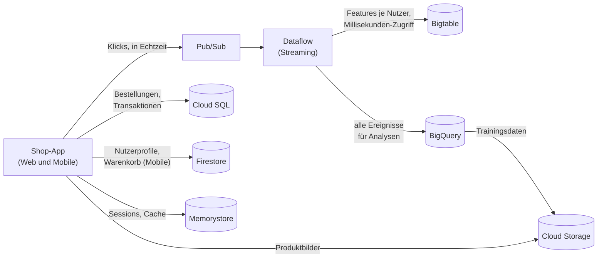
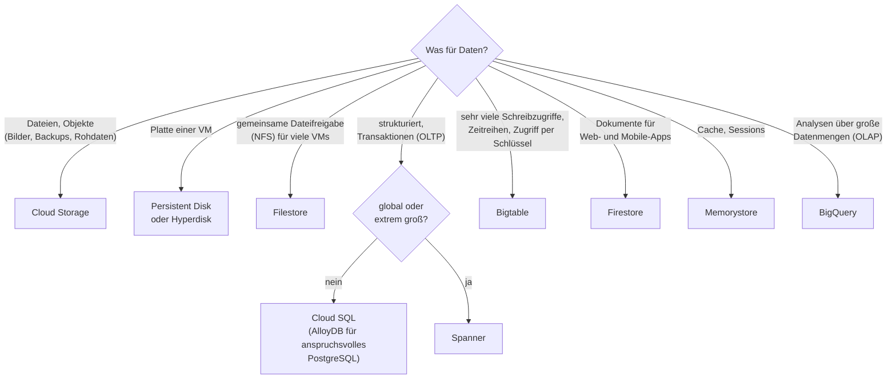
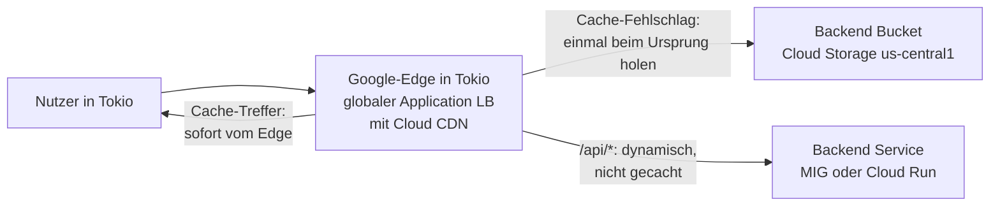
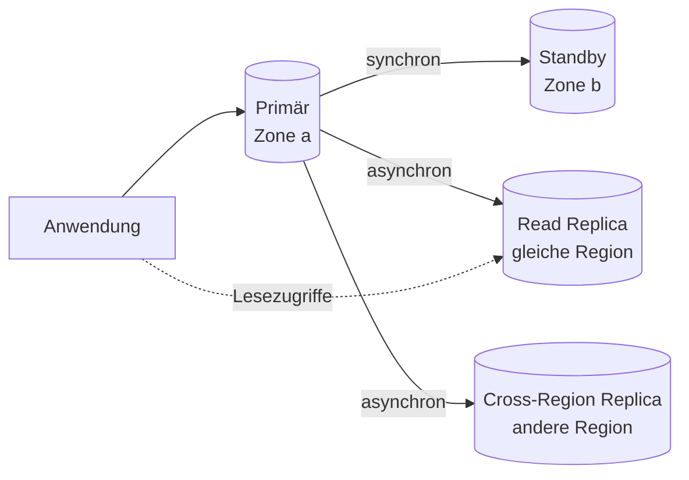
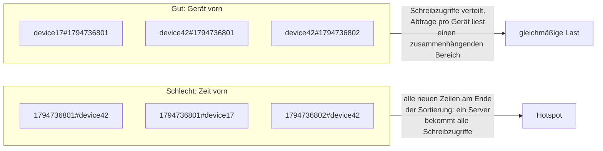
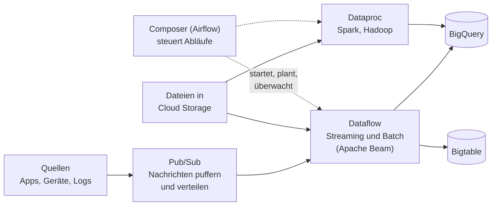

# Data: Speicher, Datenbanken und Analytics

Lernnotiz zur Prüfung Professional Cloud Architect (PCA). Die häufigste Datenfrage in der Prüfung lautet in vielen
Varianten: **Welcher Speicher passt zu diesen Daten?** Diese Notiz beginnt deshalb mit einem Entscheidungsbaum und geht
dann durch die drei Bereiche: Speicher (Cloud Storage, Platten, Filestore, Datentransfer), Datenbanken (Cloud SQL,
AlloyDB, Spanner, Bigtable, Firestore, Memorystore) und Analytics (BigQuery, Pub/Sub, Dataflow, Dataproc).

*Stand 2026-11-15. Speicherklassen und Spanner-Verfügbarkeit am selben Tag an der Google-Cloud-Doku geprüft (siehe
[Quellen](#14-quellen)). Zugriffsschutz (Signed URLs, Uniform Bucket-Level Access, autorisierte Views) steht in
[security.md](security.md), Backups, Disaster Recovery und Datenbank-Migration in [operations.md](operations.md).*

---

## Inhalt

**Grundlagen**

- [0. Das Bild zuerst: die Daten eines Empfehlungssystems](#0-das-bild-zuerst-die-daten-eines-empfehlungssystems)
- [1. Welcher Speicher wofür](#1-welcher-speicher-wofür)

**Teil 1: Speicher**

- [2. Cloud Storage](#2-cloud-storage)
- [3. Daten nach Google Cloud bringen](#3-daten-nach-google-cloud-bringen)
- [4. Platten und Dateifreigaben](#4-platten-und-dateifreigaben)

**Teil 2: Datenbanken**

- [5. Relational: Cloud SQL, AlloyDB, Spanner](#5-relational-cloud-sql-alloydb-spanner)
- [6. NoSQL: Bigtable und Firestore](#6-nosql-bigtable-und-firestore)
- [7. Cache: Memorystore](#7-cache-memorystore)

**Teil 3: Analytics**

- [8. BigQuery](#8-bigquery)
- [9. Datenpipelines: Pub/Sub, Dataflow, Dataproc](#9-datenpipelines-pubsub-dataflow-dataproc)

**Zum Nachschlagen**

- [10. Kosten](#10-kosten)
- [11. Prüfungssignale: Spickzettel](#11-prüfungssignale-spickzettel)
- [12. Alte und neue Namen](#12-alte-und-neue-namen)
- [13. Ein Rechenbeispiel zum Datentransfer](#13-ein-rechenbeispiel-zum-datentransfer)
- [14. Quellen](#14-quellen)

---

## 0. Das Bild zuerst: die Daten eines Empfehlungssystems

Ein Onlineshop baut ein Empfehlungssystem. Dabei fallen sehr verschiedene Daten an, und jede Art landet in einem
anderen Speicher:

| Daten | Eigenschaft | Speicher |
|---|---|---|
| Klick-Ereignisse in Echtzeit | sehr viele Schreibzugriffe, Zugriff über einen Schlüssel | Pub/Sub → Dataflow → **Bigtable** |
| alle Ereignisse für Analysen und Training | riesige Mengen, SQL-Abfragen über alles | **BigQuery** |
| Bestellungen | Transaktionen, relational, eine Region | **Cloud SQL** |
| Nutzerprofile in der App | Dokumente, Synchronisation mit Mobilgeräten | **Firestore** |
| Sessions | flüchtig, sehr schnell, von allen Servern lesbar | **Memorystore** |
| Produktbilder, Trainingsdateien, Archive | Dateien beliebiger Größe | **Cloud Storage** (Bilder ausgeliefert über Cloud CDN) |

---

## 1. Welcher Speicher wofür

| Dienst | Datenmodell | Skalierung | typische Latenz | typisch |
|---|---|---|---|---|
| **Cloud Storage** | Objekte | praktisch unbegrenzt | Millisekunden bis Sekunden | Dateien, Data Lake, Backups |
| **Cloud SQL** | relational (MySQL, PostgreSQL, SQL Server) | vertikal, eine Region | Millisekunden | klassische Web-Anwendungen |
| **AlloyDB** | relational (PostgreSQL-kompatibel) | vertikal plus Lese-Pools | Millisekunden | PostgreSQL mit hoher Last, auch Analysen |
| **Spanner** | relational, global, stark konsistent | horizontal, mehrere Regionen | Millisekunden | globale Transaktionen, sehr viele Schreibzugriffe |
| **Bigtable** | breite Spalten, ein Schlüssel | horizontal, TB bis PB | einstellige Millisekunden | Zeitreihen, IoT, Klickdaten, ML-Features |
| **Firestore** | Dokumente | automatisch, serverless | Millisekunden | Mobile- und Web-Apps |
| **Memorystore** | Schlüssel-Wert im Speicher | vertikal, Cluster | unter einer Millisekunde | Cache, Sessions |
| **BigQuery** | Tabellen, spaltenorientiert | serverless, PB | Sekunden | Data Warehouse, Analysen |

**Zwei Wörter, die man unterscheiden muss:**

- **OLTP** (Online Transaction Processing): viele kleine Lese- und Schreibzugriffe, z. B. eine Bestellung anlegen.
  Datenbanken: Cloud SQL, AlloyDB, Spanner, Firestore.
- **OLAP** (Online Analytical Processing): wenige große Abfragen über sehr viele Zeilen, z. B. „Umsatz pro Land und
  Monat der letzten fünf Jahre“. Dafür: BigQuery.

---

## 2. Cloud Storage

Cloud Storage speichert **Objekte** (Dateien beliebiger Größe) in **Buckets**. Lesen nach Schreiben ist **stark
konsistent**: Wer ein Objekt geschrieben hat, liest sofort die neue Version.

### Standort

| Standorttyp | Daten liegen | wann |
|---|---|---|
| **Region** | in einer Region | Daten nahe an den VMs, die sie verarbeiten; Datenresidenz |
| **Dual-Region** | in zwei bestimmten Regionen | Hochverfügbarkeit und Notfall-Wiederherstellung mit fester Region |
| **Multi-Region** | verteilt über ein großes Gebiet (z. B. EU, US) | weltweit oder kontinental verteilte Nutzer, z. B. Software-Downloads |

### Speicherklassen

Die Klasse bestimmt das Verhältnis von Speicher- zu Abrufkosten. Seltener genutzte Klassen sind billiger im Speichern,
aber teurer beim Abruf und haben eine **Mindestspeicherdauer**: Wer früher löscht, zahlt trotzdem bis zum Ende.

| Klasse | Mindestdauer | Abrufgebühr | Verfügbarkeit (Region / Dual- oder Multi-Region) | typisch |
|---|---|---|---|---|
| **Standard** | keine | nein | 99,9 % / 99,95 % | häufig genutzte Daten |
| **Nearline** | 30 Tage | ja | 99,0 % / 99,9 % | etwa einmal im Monat gelesen (Backups) |
| **Coldline** | 90 Tage | ja | 99,0 % / 99,9 % | etwa einmal im Quartal |
| **Archive** | 365 Tage | ja | 99,0 % / 99,9 % | Aufbewahrung, selten oder nie gelesen |

Alle Klassen liefern Daten in Millisekunden; „Archive“ heißt nicht, dass man Stunden warten muss (anders als bei
Bandarchiven).

### Daten über ihre Lebenszeit verwalten

- **Lifecycle-Regeln** ändern die Klasse oder löschen Objekte automatisch, z. B. „nach 30 Tagen nach Nearline, nach
  365 Tagen nach Archive, nach 7 Jahren löschen“. Standardantwort auf „Backups älter als 90 Tage entfernen“ und
  „Kosten senken für Daten, die mit der Zeit seltener gelesen werden“.
- **Autoclass** verschiebt Objekte automatisch zwischen den Klassen, je nachdem, wie oft sie gelesen werden; gut, wenn
  das Zugriffsmuster unbekannt ist.
- **Object Versioning** behält alte Versionen, wenn ein Objekt überschrieben oder gelöscht wird. Schutz gegen
  versehentliches Löschen; mit einer Lifecycle-Regel löscht man alte Versionen nach einer Frist.
- **Retention Policy** verhindert, dass Objekte vor Ablauf einer Frist gelöscht oder geändert werden. Mit **Bucket
  Lock** wird die Richtlinie **unwiderruflich** gesperrt (WORM: write once, read many). Prüfungsmuster: „Dokumente
  müssen fünf Jahre unveränderbar aufbewahrt werden“ heißt Retention Policy über fünf Jahre plus Lock.

### Zugriff und Leistung

- Zugriffsschutz mit Uniform Bucket-Level Access, Signed URLs und CORS: [security.md](security.md#9-sensible-daten-schützen).
  Schutz vor Datenabfluss mit VPC Service Controls: [networking.md](networking.md#5-private-wege-zu-google-und-zu-diensten).
- **Fehler 429 oder 5xx** bei vielen Anfragen: Wiederholen mit **abgeschnittenem exponentiellem Backoff** (1 s, 2 s,
  4 s … plus Zufall, mit Obergrenze).
- Sehr hohe Schreibraten auf **fortlaufende Objektnamen** (Zeitstempel am Anfang) bündeln sich auf einem Bereich; eine
  zufällige Vorsilbe verteilt die Last.
- **Cloud Storage FUSE** (`gcsfuse`) bindet einen Bucket wie ein Verzeichnis ein, z. B. damit ein Trainingsskript
  Bilder direkt aus dem Bucket liest.

### Medien schnell ausliefern: Cloud Storage plus Cloud CDN

Bilder, Musik und Videos liegen am besten in **Cloud Storage**. Schnell abrufbar für Nutzer weltweit werden sie aber
erst durch **Cloud CDN** davor. Ohne CDN läuft jeder Abruf bis zum Bucket in seiner Region: Nutzer in Asien warten auf
einen Bucket in Iowa, und ein beliebtes Video wird tausendfach vom selben Ursprung geholt.

So sieht die Kette aus:

1. Die Medien liegen in einem Bucket.
2. Der Bucket hängt als **Backend Bucket** an einem **globalen externen Application Load Balancer**. Die URL Map
   schickt z. B. `/media/*` an den Bucket und `/api/*` an die Anwendung.
3. Am Backend Bucket schaltet man **Cloud CDN** ein. Der erste Abruf einer Datei an einem Edge-Standort holt sie aus
   dem Bucket (Cache-Fehlschlag), alle weiteren kommen direkt vom Edge (Cache-Treffer). Wie lange eine Datei im Cache
   bleibt, steuern Cache-Modus, TTL und der `Cache-Control`-Header.
4. Private Inhalte (z. B. nur für zahlende Nutzer) schützt man mit **Signed URLs** oder **Signed Cookies** von Cloud
   CDN.

Die Medien laufen dabei **nicht durch die eigenen VMs**. Bucket und CDN liefern direkt aus, die Anwendung kümmert sich
nur um die dynamischen Inhalte. Medien über VMs auszuliefern, die den Bucket per `gcsfuse` oder eine
Filestore-Freigabe einbinden, ist in Prüfungsfragen deshalb meist die falsche Antwort.

| Bedarf | Lösung |
|---|---|
| Bilder, CSS, JS, Musik und Downloads einer Website für Nutzer weltweit | **Cloud CDN** am globalen Application LB, Bucket als Backend Bucket |
| Video-Streaming (live oder auf Abruf) und sehr große Dateien für sehr viele Zuschauer | **Media CDN**, speziell für Medien-Streaming gebaut, mit Cloud Storage als Ursprung |
| Dateien hochverfügbar und nahe an mehreren Regionen, auch ohne Website | **Multi-Region-Bucket** (für weltweite Nutzer zusätzlich Cloud CDN) |
| Medien als Trainingsdaten für GPU-VMs | **Cloud Storage FUSE** (`gcsfuse`) |
| Uploads direkt aus dem Browser in den Bucket | **Signed URL** plus CORS ([security.md](security.md#9-sensible-daten-schützen)) |

**Falle:** Media CDN ist für Streaming und große Downloads gedacht. Für die statischen Inhalte einer Website (Bilder,
CSS, JS) ist Cloud CDN die richtige Antwort, auch wenn „Media“ im Namen verlockend klingt.

Cache Keys und Trefferquote, Invalidierung und die Einbindung in den Load Balancer stehen ausführlich in
[networking.md](networking.md#13-statische-inhalte-und-cloud-cdn).

---

## 3. Daten nach Google Cloud bringen

| Situation | Werkzeug |
|---|---|
| einige GB bis TB, gute Leitung, einmalig | `gcloud storage cp` (parallel, mit Wiederaufnahme) |
| Daten bei einem anderen Cloud-Anbieter (z. B. S3) oder unter HTTP-Adressen | **Storage Transfer Service** |
| zwischen Buckets oder Regionen, auch regelmäßig nach Zeitplan | **Storage Transfer Service** |
| große Datenmengen aus dem eigenen Rechenzentrum über das Netz | **Storage Transfer Service** mit Agents im Rechenzentrum |
| sehr große Mengen (hunderte TB bis PB), Leitung zu langsam, Rechenzentrum wird aufgegeben | **Transfer Appliance**: Gerät leihen, lokal befüllen, an Google schicken |
| Datenbank migrieren | **Database Migration Service** (siehe [operations.md](operations.md)) |
| Daten aus SaaS-Diensten oder anderen Data Warehouses nach BigQuery | **BigQuery Data Transfer Service** |

Die Entscheidung zwischen Netz und Appliance ist eine Rechnung: Datenmenge geteilt durch nutzbare Bandbreite. Dauert
die Übertragung Wochen oder Monate, ist die Appliance schneller (Beispiel in [Abschnitt 13](#13-ein-rechenbeispiel-zum-datentransfer)).

Ein häufiges Muster bei Migrationen: Altdaten (Archiv) per Transfer Appliance, neue Daten laufend über das Netz
(Storage Transfer Service oder eine Pipeline).

---

## 4. Platten und Dateifreigaben

| Speicher | Eigenschaft | wann |
|---|---|---|
| **Persistent Disk** (Standard, Balanced, SSD) | Netzwerkplatte einer VM, überlebt die VM | Boot- und Datenplatten |
| **Hyperdisk** | Leistung (IOPS, Durchsatz) unabhängig von der Größe einstellbar | Datenbanken mit hohen Anforderungen |
| **Regional Persistent Disk** | synchron in zwei Zonen gespiegelt | Wiederanlauf nach Zonenausfall (siehe [compute.md](compute.md#6-platten-an-der-vm)) |
| **Local SSD** | physisch am Host, sehr schnell, flüchtig | Caches, temporäre Daten |
| **Filestore** | verwaltete NFS-Freigabe | viele VMs lesen und schreiben dieselben Dateien |

**Zwei Prüfungsdetails zu Persistent Disk:**

- Bei Persistent Disk **steigt die Leistung mit der Größe**: Eine größere SSD-Platte hat mehr IOPS. „Datenbank zu
  langsam auf der Platte“ kann heißen: Platte vergrößern.
- Eine Platte lässt sich **im laufenden Betrieb vergrößern**; danach muss man das Dateisystem erweitern (bei ext4 mit
  `resize2fs`). Verkleinern geht nicht.

**Filestore** passt, wenn eine horizontal skalierende Anwendung einen **gemeinsamen** Dateispeicher braucht (jede
Instanz liest und schreibt dieselben Dateien). Die Enterprise-Stufe ist regional und damit hochverfügbar.

---

## 5. Relational: Cloud SQL, AlloyDB, Spanner

### Cloud SQL

Verwaltetes **MySQL, PostgreSQL oder SQL Server**. Google übernimmt Installation, Patches, Backups und Replikation.

| Funktion | Wozu | Hinweis |
|---|---|---|
| **Hochverfügbarkeit (HA)** | Standby in einer anderen Zone, synchrone Replikation, automatischer Failover | schützt vor Zonenausfall, nicht vor Regionsausfall |
| **Read Replica** | Lesezugriffe verteilen | asynchron, kann manuell zur Primären befördert werden |
| **Cross-Region Replica** | Notfall-Wiederherstellung in einer anderen Region | Beförderung bei Regionsausfall |
| **Automatische Backups plus Binary Logging** | Wiederherstellung auf einen beliebigen Zeitpunkt (Point-in-Time Recovery) | bei MySQL braucht PITR das Binary Log |

Zugang aus Anwendungen: private IP über Private Services Access ([networking.md](networking.md#5-private-wege-zu-google-und-zu-diensten))
und der **Cloud SQL Auth Proxy** für IAM-basierte, verschlüsselte Verbindungen.

### AlloyDB

**PostgreSQL-kompatibel**, aber für hohe Last gebaut: getrennte Speicher- und Rechenschicht, Lese-Pools und eine
spaltenorientierte Engine für Analysen auf denselben Daten. Gut für anspruchsvolle PostgreSQL-Anwendungen, die Cloud
SQL an seine Grenzen bringen.

### Spanner

Relational mit SQL und Transaktionen, aber **horizontal skalierbar** und **über Regionen hinweg stark konsistent**.
Die Verfügbarkeit beträgt **99,99 %** in einer Region und **99,999 %** in Dual- und Multi-Region-Konfigurationen.

- **Wann:** globale Anwendungen, die überall dieselben aktuellen Daten brauchen (z. B. Kontostände, Lagerbestände),
  und Anwendungen mit sehr vielen Schreibzugriffen, für die eine einzelne Cloud-SQL-Instanz nicht reicht.
- **Falle:** Primärschlüssel, die nur wachsen (fortlaufende IDs, Zeitstempel), konzentrieren alle neuen Zeilen auf
  einen Bereich (Hotspot). Besser UUIDs oder umgedrehte Bitfolgen.

**Cloud SQL oder Spanner?** Passt die Last auf eine große Instanz in einer Region, ist Cloud SQL einfacher und
günstiger. Braucht man globale Konsistenz oder Skalierung über eine Maschine hinaus, Spanner.

---

## 6. NoSQL: Bigtable und Firestore

### Bigtable

Eine **Wide-Column-Datenbank** für sehr große Datenmengen (TB bis PB) mit einstelligen Millisekunden Latenz und sehr
hohem Durchsatz. Typisch: Zeitreihen, IoT-Sensordaten, Klickdaten, Finanzkurse, ML-Features für Echtzeit-Vorhersagen.

**Alles hängt am Row Key.** Bigtable hat genau einen Index: den Zeilenschlüssel, alphabetisch sortiert. Zeilen mit
ähnlichem Schlüssel liegen nebeneinander auf demselben Server. Daraus folgen zwei Regeln:

1. Der Schlüssel muss zu den **Abfragen** passen (z. B. „alle Messwerte von Gerät X der letzten Stunde“).
2. Neue Schreibzugriffe müssen sich **verteilen**, sonst landet alles auf einem Server (Hotspot).

*Die Zahlen sind Unix-Zeitstempel (Sekunden seit 1970); `1794736801` ist der 15. November 2026, 10:00:01 UTC.*

Weitere Eigenschaften: **Column Families** gruppieren Spalten, die man zusammen liest; Transaktionen nur **innerhalb
einer Zeile**; keine Joins, kein SQL-Optimierer für beliebige Abfragen. Für ehrliche Lasttests braucht Bigtable echte
Datenmengen, weil es sich erst mit genug Daten richtig verteilt.

### Firestore

Eine **Dokument-Datenbank**, serverless, mit starken Transaktionen. Zwei Modi:

- **Native Mode:** für Mobile- und Web-Apps, mit Echtzeit-Updates und Offline-Synchronisation auf dem Gerät.
- **Datastore Mode:** für Server-Anwendungen; Nachfolger von Cloud Datastore.

Abfragen brauchen **Indizes**; zusammengesetzte Indizes definiert man in einer Konfigurationsdatei und spielt sie ein.
Am schnellsten liest man Dokumente direkt über ihren **Schlüssel** (bei vielen Dokumenten als Batch-Get).

---

## 7. Cache: Memorystore

Verwaltetes **Redis, Valkey oder Memcached** im Arbeitsspeicher, mit Antwortzeiten unter einer Millisekunde.

- **Datenbank entlasten:** Ergebnisse häufiger Abfragen zwischenspeichern; Schlüssel z. B. ein Hash der Abfrage.
- **Sessions für viele Server:** Liegt die Session im Speicher eines einzelnen Servers, verliert der Nutzer sie, sobald
  der Load Balancer ihn auf einen anderen Server schickt. Gemeinsamer Speicher in Memorystore löst das.
- **Bestenlisten, Zähler, Ratenbegrenzung.**

Ein Cache ist kein dauerhafter Speicher: Die Wahrheit liegt in der Datenbank.

---

## 8. BigQuery

BigQuery ist ein **serverloses Data Warehouse**: Man lädt Daten in Tabellen und fragt sie mit SQL ab, ohne Server zu
verwalten. Speicher und Rechenleistung sind getrennt; eine Abfrage über Terabytes verteilt sich auf viele Maschinen.
Die Speicherung ist **spaltenorientiert**: Eine Abfrage liest nur die Spalten, die sie braucht.

**Daten hineinbringen:** Batch-Laden (z. B. aus Cloud Storage, kostenlos), **Streaming** in Echtzeit (Storage Write
API, oft aus Dataflow), oder Abfragen auf Daten, die woanders liegen (externe Tabellen, BigLake).

**Partitionieren und Clustern.** Eine nach Datum **partitionierte** Tabelle ist intern in Tagesstücke geteilt. Eine
Abfrage mit `WHERE datum = '2026-11-15'` liest nur dieses Stück. Das macht Abfragen schneller und billiger.
**Partition Expiration** löscht alte Partitionen automatisch (z. B. Logs nach 45 Tagen). **Clustering** sortiert
innerhalb der Partitionen nach weiteren Spalten. Das **Schema** kann wachsen: Neue Spalten hinzuzufügen ist jederzeit
möglich.

**Rechte und Projekte.** Daten und Abfragen können in verschiedenen Projekten liegen. Wer abfragt, braucht *BigQuery
Job User* (oder *User*) im Projekt, das die Abfrage bezahlt, und *BigQuery Data Viewer* auf den Datasets mit den
Daten. Rollen an Gruppen geben, z. B. eine Gruppe pro Land für Länder-Datasets. Feinere Rechte (Views ohne
personenbezogene Spalten, Policy Tags, Row-Level Security) stehen in [security.md](security.md#9-sensible-daten-schützen).

**Datenschutz:** Für Löschanfragen (DSGVO) braucht jede Person einen eindeutigen Identifikator, über den sich alle ihre
Zeilen löschen lassen.

---

## 9. Datenpipelines: Pub/Sub, Dataflow, Dataproc

### Pub/Sub

Ein Nachrichtendienst, der **Sender und Empfänger entkoppelt**: Sender veröffentlichen in ein **Topic**, Empfänger
lesen aus einer **Subscription**, jeder in seinem Tempo. Lastspitzen landen in der Warteschlange statt beim Empfänger.

- Zustellung **mindestens einmal**: Empfänger müssen mit Duplikaten umgehen können (oder Exactly-once-Zustellung
  einschalten).
- **Push** (Pub/Sub ruft einen Endpunkt auf) oder **Pull** (der Empfänger holt ab).
- **Ordering Keys** für Reihenfolge pro Schlüssel; **Dead-Letter-Topics** für Nachrichten, die immer wieder scheitern.
- **Batching** beim Sender bündelt Nachrichten für mehr Durchsatz, kostet aber Latenz. Zählt jede Millisekunde, schaltet
  man es ab oder verkleinert es.

### Dataflow

Verwaltete Ausführung von **Apache-Beam**-Pipelines. Derselbe Code verarbeitet **Batch** und **Streaming**, Dataflow
skaliert die Worker selbst. Typisch: Ereignisse aus Pub/Sub lesen, anreichern, in Zeitfenstern aggregieren und nach
BigQuery oder Bigtable schreiben. In der Pipeline kann man z. B. mit Sensitive Data Protection personenbezogene Daten
entfernen, bevor sie im Data Warehouse landen.

### Dataproc

Verwaltetes **Apache Spark und Hadoop**. Die Antwort, wenn bestehende Spark- oder Hadoop-Jobs **ohne Umschreiben** in
die Cloud sollen.

- Statt eines dauerhaften Clusters startet man **kurzlebige Cluster pro Job** und löscht sie danach.
- Daten liegen in **Cloud Storage** statt in HDFS, damit der Cluster austauschbar ist.
- **Sekundäre Worker als Spot-VMs** senken die Kosten deutlich.
- **Dataproc Serverless** führt Spark-Jobs ganz ohne Cluster aus.

### Weitere Dienste

| Dienst | wofür |
|---|---|
| **Cloud Composer** | verwaltetes Apache Airflow: Abläufe mit vielen Schritten planen und überwachen |
| **Dataprep** | Daten visuell untersuchen und bereinigen, ohne Code |
| **Data Fusion** | ETL-Pipelines grafisch bauen |
| **Application Integration** | SaaS-Systeme (z. B. Salesforce, ServiceNow) und Datenbanken verbinden und Daten umwandeln |
| **Looker** | Dashboards und Berichte auf BigQuery |

**Lambda-Muster aus der Prüfung:** Streaming-Daten (z. B. Kartenzahlungen) mit Dataflow verarbeiten, Berichte als
Batch-Analysen in BigQuery.

---

## 10. Kosten

| Hebel | Was er bringt |
|---|---|
| **Speicherklasse und Lifecycle** | selten gelesene Daten automatisch in günstigere Klassen; Mindestdauer und Abrufgebühren beachten |
| **Autoclass** | Klassenwahl automatisch, wenn das Zugriffsmuster unklar ist |
| **Standort** | Multi- und Dual-Region kosten mehr als eine Region; Datenabfluss zwischen Regionen und ins Internet kostet |
| **BigQuery-Abfragen** | On-Demand rechnet nach gelesenen Daten ab: partitionieren, clustern, nur nötige Spalten lesen, Kostenobergrenze pro Abfrage setzen |
| **BigQuery-Kapazität** | bei viel und gleichmäßiger Last feste Kapazität (Editions, Slots) statt On-Demand |
| **BigQuery Long-term Storage** | Tabellen und Partitionen, die 90 Tage nicht geändert wurden, kosten automatisch weniger |
| **Bigtable und Spanner** | kosten nach bereitgestellter Kapazität, auch ohne Last; Größe an die Last anpassen (Autoscaling) |
| **Dataproc** | kurzlebige Cluster, Spot-Worker |
| **Abrechnung auswerten** | Billing Export nach BigQuery plus Labels pro Team oder Umgebung |

---

## 11. Prüfungssignale: Spickzettel

| Wenn die Frage sagt … | … ist die Antwort meist |
|---|---|
| multi-PB-Datensatz, jederzeit per SQL analysierbar | BigQuery |
| OLAP-Berichte über große Tabellen | BigQuery |
| Klickdaten, Zeitreihen, Sensordaten, sehr viele Schreibzugriffe | Bigtable |
| Bigtable langsam, Last ungleich verteilt | Row Key überarbeiten (keine fortlaufenden Schlüssel vorn) |
| Row Key für Fahrzeugdaten | Fahrzeug-ID, Ereignis-ID, Zeitstempel (in dieser Reihenfolge) |
| schreiblastige App weltweit, relational | Spanner (mit Cloud Run in mehreren Regionen) |
| MySQL-Transaktionen, Wiederherstellung auf Zeitpunkt | automatische Backups plus Binary Logging |
| MySQL nach Cloud SQL migrieren | Database Migration Service |
| Sessions gehen bei mehreren Instanzen verloren | Session liegt lokal in einer Instanz; gemeinsamer Speicher (Memorystore) |
| Datenbank entlasten, Seiten schneller | Memorystore als Cache (dazu Cloud CDN für Bilder) |
| Web-App mit wenig Betrieb, Nutzerdaten (ältere Frage) | App Engine plus Datastore bzw. Firestore |
| Backups nach 90 Tagen löschen | Lifecycle-Regel am Bucket |
| Daten mit der Zeit seltener gelesen | Lifecycle von Standard nach Nearline, Coldline, Archive |
| Dokumente 5 Jahre unveränderbar | Retention Policy plus Bucket Lock |
| Schutz vor Überschreiben und Löschen | Object Versioning |
| Downloads für Kunden weltweit | Multi-Region-Bucket |
| beliebte Mediendateien laden langsam oder scheitern | Bucket als Backend Bucket am globalen Application LB, Cloud CDN einschalten |
| statische Inhalte weltweit schnell (Bilder, CSS, JS) | Cloud CDN am globalen externen Application LB |
| Video-Streaming für sehr viele Zuschauer | Media CDN |
| Shop mit vielen Bildern und Videos, Seiten langsam | Cloud CDN plus Memorystore |
| Cloud Storage antwortet mit 429 oder 5xx | Wiederholen mit exponentiellem Backoff |
| 10 TB einmalig hochladen | `gcloud storage cp` |
| Daten von einem anderen Cloud-Anbieter | Storage Transfer Service |
| Bucket in eine andere Region umziehen | Storage Transfer Service, danach Anwendung umstellen |
| Rechenzentrum mit PB-Daten wird aufgegeben | Transfer Appliance |
| viele Instanzen brauchen einen gemeinsamen Dateispeicher | Filestore |
| Trainingsskript soll direkt aus dem Bucket lesen | Cloud Storage FUSE (`gcsfuse`) |
| Datenbank-Platte zu langsam | Persistent Disk vergrößern (mehr IOPS) |
| Platte voll, ohne Ausfall | Platte vergrößern, dann `resize2fs` |
| Streaming-Daten verarbeiten | Pub/Sub plus Dataflow |
| Spark- und Hadoop-Jobs ohne Umbau in die Cloud | Dataproc (mit Spot-Workern) |
| unsaubere Daten aus vielen Quellen erkunden | Dateien nach Cloud Storage, Dataprep |
| SaaS-Systeme und Cloud SQL verbinden | Application Integration |
| Logs in BigQuery nur 45 Tage | partitionierte Tabellen mit Partition Expiration |
| Analysten in mehreren Projekten | Job User im Abrechnungsprojekt, Data Viewer auf den Daten-Projekten, an Gruppen |
| personenbezogene Daten vor dem Data Warehouse entfernen | Dataflow mit Sensitive Data Protection |
| DSGVO-Löschung in BigQuery | eindeutige ID pro Person, Zeilen mit dieser ID löschen |
| niedrigste Latenz bei Pub/Sub | Batching beim Sender abschalten |

---

## 12. Alte und neue Namen

| In älteren Fragen | Heute |
|---|---|
| Cloud Datastore | Firestore im Datastore Mode |
| App Engine Memcache | Memorystore |
| Multi-Regional, Regional Storage (als Klassen) | Standard-Klasse mit Standorttyp Multi-Region oder Region |
| `gsutil` | `gcloud storage` |
| Cloud DLP | Sensitive Data Protection |
| Cloud Dataprep by Trifacta | Dataprep |
| Stackdriver Logging (Logs in BigQuery) | Cloud Logging mit Sinks |

---

## 13. Ein Rechenbeispiel zum Datentransfer

Wie lange dauert es, 1 PB über eine 1-Gbit/s-Leitung zu übertragen, wenn die Leitung voll genutzt wird?

- 1 PB = 10^15 Byte = 8 × 10^15 Bit.
- 1 Gbit/s = 10^9 Bit pro Sekunde.
- 8 × 10^15 / 10^9 = 8 × 10^6 Sekunden, also etwa **93 Tage**.

In der Praxis ist die nutzbare Bandbreite geringer (anderer Verkehr, Protokoll-Overhead), es dauert also eher länger.
Eine Transfer Appliance braucht dagegen einige Tage zum Befüllen, den Versand und das Hochladen bei Google. Bei
10 TB sind es über dieselbe Leitung rund 22 Stunden: Da lohnt sich das Netz.

---

## 14. Quellen

- [Storage classes](https://docs.cloud.google.com/storage/docs/storage-classes)
  (geprüft 2026-11-15: Mindestdauern 30/90/365 Tage, Verfügbarkeiten, Autoclass) ·
  [Bucket locations](https://docs.cloud.google.com/storage/docs/locations) ·
  [Lifecycle](https://docs.cloud.google.com/storage/docs/lifecycle) ·
  [Bucket Lock](https://docs.cloud.google.com/storage/docs/bucket-lock) ·
  [Object Versioning](https://docs.cloud.google.com/storage/docs/object-versioning)
- [Request rate guidelines](https://docs.cloud.google.com/storage/docs/request-rate) ·
  [Retry strategy](https://docs.cloud.google.com/storage/docs/retry-strategy) ·
  [Cloud Storage FUSE](https://docs.cloud.google.com/storage/docs/cloud-storage-fuse/overview)
- [Data transfer options](https://docs.cloud.google.com/architecture/migration-to-google-cloud-transferring-your-large-datasets) ·
  [Storage Transfer Service](https://docs.cloud.google.com/storage-transfer/docs/overview) ·
  [Transfer Appliance](https://docs.cloud.google.com/transfer-appliance/docs/4.0/overview)
- [Persistent Disk](https://docs.cloud.google.com/compute/docs/disks/persistent-disks) ·
  [Hyperdisk](https://docs.cloud.google.com/compute/docs/disks/hyperdisks) ·
  [Filestore](https://docs.cloud.google.com/filestore/docs/overview)
- [Cloud SQL high availability](https://docs.cloud.google.com/sql/docs/mysql/high-availability) ·
  [Cloud SQL replication](https://docs.cloud.google.com/sql/docs/mysql/replication) ·
  [AlloyDB](https://docs.cloud.google.com/alloydb/docs/overview)
- [Spanner instance configurations](https://docs.cloud.google.com/spanner/docs/instance-configurations)
  (geprüft 2026-11-15: 99,99 % regional, 99,999 % dual- und multi-regional, stark konsistent) ·
  [Spanner schema design](https://docs.cloud.google.com/spanner/docs/schema-design)
- [Bigtable overview](https://docs.cloud.google.com/bigtable/docs/overview) ·
  [Bigtable schema design](https://docs.cloud.google.com/bigtable/docs/schema-design) ·
  [Firestore](https://docs.cloud.google.com/firestore/docs/overview) ·
  [Memorystore](https://docs.cloud.google.com/memorystore/docs)
- [BigQuery overview](https://docs.cloud.google.com/bigquery/docs/introduction) ·
  [Partitioned tables](https://docs.cloud.google.com/bigquery/docs/partitioned-tables) ·
  [BigQuery pricing](https://cloud.google.com/bigquery/pricing)
- [Pub/Sub overview](https://docs.cloud.google.com/pubsub/docs/overview) ·
  [Dataflow](https://docs.cloud.google.com/dataflow/docs/overview) ·
  [Dataproc](https://docs.cloud.google.com/dataproc/docs/concepts/overview) ·
  [Cloud Composer](https://docs.cloud.google.com/composer/docs/concepts/overview)
