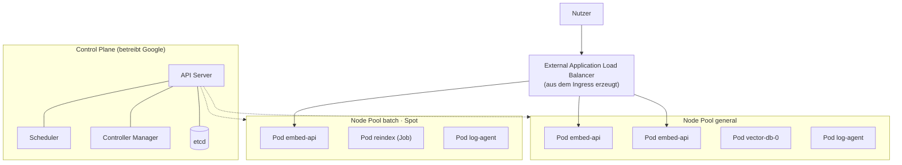
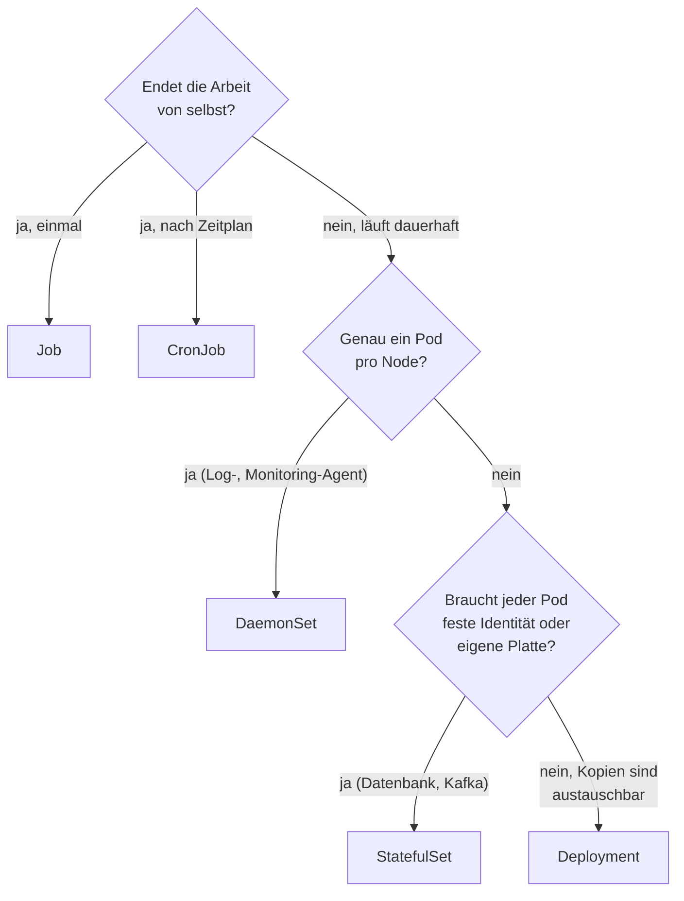
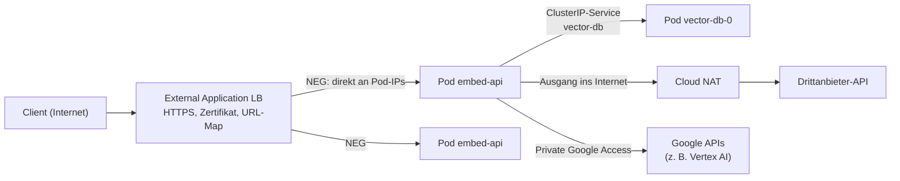
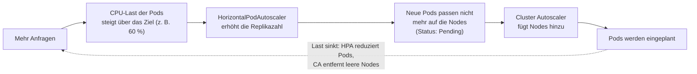
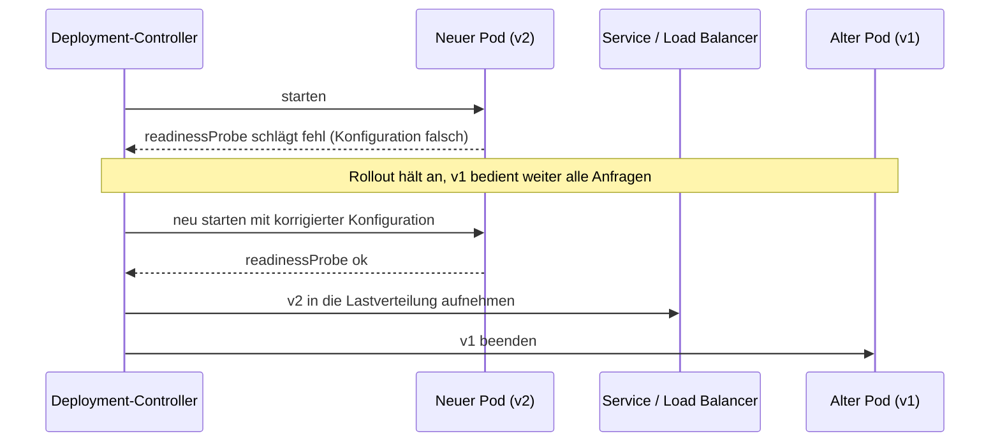
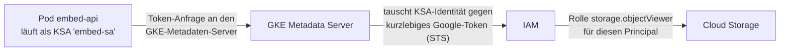
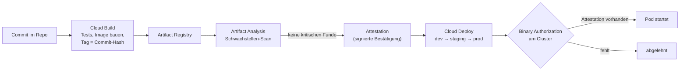
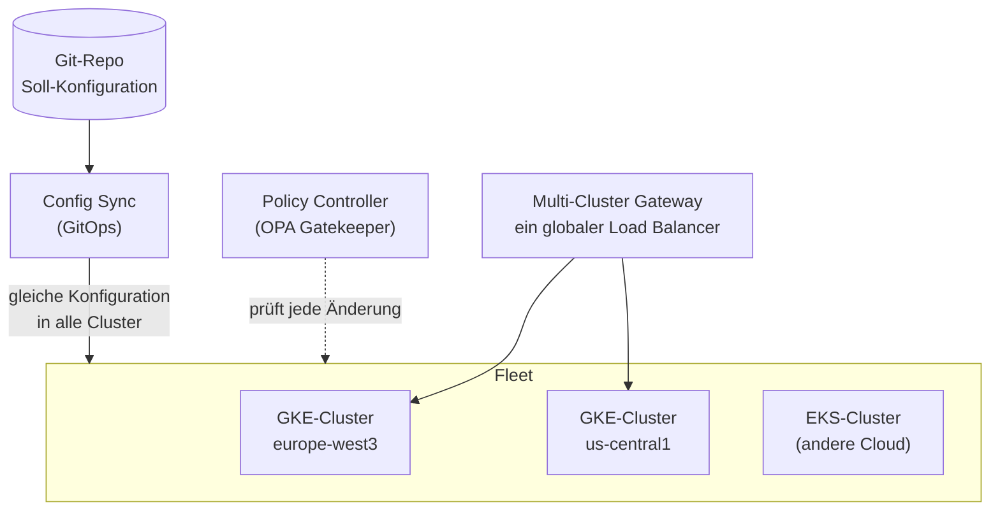

# GKE: Google Kubernetes Engine

Lernnotiz zur Prüfung Professional Cloud Architect (PCA). GKE gehört dort zu den häufigsten Themen: Architektur,
Skalierung, Rollouts, Netzwerk und Supply-Chain-Sicherheit. Die Notiz erklärt die Konzepte an einem durchgehenden
Beispiel und endet mit einem Spickzettel typischer Fragemuster.

*Stand 2026-11-15. Prüfungsfragen benutzen oft alte Namen (Google Container Engine, Stackdriver, Container Registry,
Anthos, kubemci); die heutigen Namen stehen in [Abschnitt 10](#10-alte-namen-in-den-fragen).*

---

## Inhalt

- [0. Das Bild zuerst: eine ML-Plattform auf GKE](#0-das-bild-zuerst-eine-ml-plattform-auf-gke)
- [1. Architektur: Control Plane, Nodes, Pods](#1-architektur-control-plane-nodes-pods)
- [2. Workloads: welches Objekt wofür](#2-workloads-welches-objekt-wofür)
- [3. Netzwerk: Services, Ingress, private Nodes](#3-netzwerk-services-ingress-private-nodes)
- [4. Skalierung: zwei Ebenen](#4-skalierung-zwei-ebenen)
- [5. Rollouts und Zuverlässigkeit](#5-rollouts-und-zuverlässigkeit)
- [6. Sicherheit und Supply Chain](#6-sicherheit-und-supply-chain)
- [7. CI/CD für Container](#7-cicd-für-container)
- [8. Betrieb und Observability](#8-betrieb-und-observability)
- [9. Viele Cluster: Fleet und GKE Enterprise](#9-viele-cluster-fleet-und-gke-enterprise)
- [10. Alte Namen in den Fragen](#10-alte-namen-in-den-fragen)
- [11. Prüfungssignale: Spickzettel](#11-prüfungssignale-spickzettel)
- [12. Quellen](#12-quellen)

---

## 0. Das Bild zuerst: eine ML-Plattform auf GKE

Ein konkretes Beispiel, an dem alle Begriffe hängen. Ein Team betreibt auf einem GKE-Cluster vier Dinge:

| Teil | Eigenschaft | Kubernetes-Objekt |
|---|---|---|
| **Embedding-API** (FastAPI, 3 Kopien, hinter HTTPS) | zustandslos: jede Kopie ist austauschbar | **Deployment** + **Service** + **Ingress** |
| **Vektordatenbank** (3 Knoten, jeder mit eigener Platte) | zustandsbehaftet: Knoten 0 bleibt Knoten 0 | **StatefulSet** mit Persistent Volumes |
| **Log-Agent** auf jeder Maschine | genau einer pro Node | **DaemonSet** |
| **nächtlicher Re-Index** | läuft, endet, fertig | **CronJob** (startet **Jobs**) |

Die Embedding-API skaliert mit der Last, die Vektordatenbank nicht. Der Re-Index darf auf billigen Spot-VMs laufen,
weil ein abgebrochener Lauf einfach neu startet. So sieht das im Cluster aus:

*Die Control Plane entscheidet, was wo läuft; die Nodes führen es aus. Du sprichst nur mit dem API Server
(per `kubectl`).*

---

## 1. Architektur: Control Plane, Nodes, Pods

**Pod.** Die kleinste Einheit: ein oder mehrere Container, die sich Netzwerk (eine IP) und Volumes teilen. Ein
zweiter Container im selben Pod heißt *Sidecar*, z. B. der Cloud SQL Auth Proxy neben der App.

**Node.** Eine Compute-Engine-VM, auf der Pods laufen. **Node Pool**: eine Gruppe gleich konfigurierter Nodes
(gleicher Maschinentyp, z. B. ein GPU-Pool und ein Standard-Pool). Technisch ist ein Node Pool eine Managed
Instance Group.

**Control Plane.** API Server, Scheduler, Controller und die Datenbank etcd. Bei GKE betreibt Google sie; du
siehst sie nicht als VM.

**Der wichtigste Mechanismus: Soll und Ist.** Du schreibst in YAML, was sein *soll* („3 Kopien von embed-api“).
Controller vergleichen das ständig mit dem *Ist* und gleichen es an. Stirbt ein Pod, startet der Controller einen
neuen. Fast jede Prüfungsantwort zu Selbstheilung, Rollouts und Skalierung folgt aus diesem einen Prinzip.

**Werkzeuge**:

- `gcloud container clusters …` verwaltet den **Cluster** als Google-Cloud-Ressource (anlegen, Node Pools,
  Autoscaling einschalten, Upgrades).
- `kubectl …` verwaltet **Kubernetes-Objekte im Cluster** (Deployments, Services, Rollouts).

### Standard vs. Autopilot

| | Standard | Autopilot |
|---|---|---|
| Nodes und Node Pools | verwaltest du | verwaltet Google (Node Auto-Provisioning) |
| Abrechnung | pro Node (VM), auch wenn er halb leer ist | pro Pod, nach dessen Resource Requests |
| Freiheit | volle Kontrolle (Maschinentypen, privilegierte Pods, eigene DaemonSets) | eingeschränkt, dafür sichere Voreinstellungen |
| Prüfungssignal | „volle Kontrolle“, spezielle Node-Konfiguration | „Team neu bei Kubernetes“, „Betriebsaufwand senken“ |

### Zonal vs. regional

- **Zonaler Cluster:** eine Control-Plane-Kopie in einer Zone. Während eines Control-Plane-Upgrades ist die API kurz
  nicht erreichbar.
- **Regionaler Cluster:** Control Plane und Nodes über drei Zonen verteilt. Fällt eine Zone aus, läuft der
  Cluster weiter. Für Produktion die Standardantwort, wenn nach Hochverfügbarkeit gefragt wird.
- **Mehrere Regionen** brauchen **mehrere Cluster** plus Multi-Cluster-Routing (Abschnitt 9).

---

## 2. Workloads: welches Objekt wofür

- **Deployment** verwaltet ein ReplicaSet, das die Zahl der Pod-Kopien hält. Standard für zustandslose Dienste
 .
- **StatefulSet** gibt jedem Pod einen festen Namen mit Nummer (`vector-db-0`, `vector-db-1`), der Neustarts und
  Umzüge überlebt, und jedem Pod sein eigenes Persistent Volume (`volumeClaimTemplates`). Prüfungssignal:
  feste Hostnamen, auch wenn Pods skaliert oder neu gestartet werden.
- **DaemonSet** startet auf jedem Node genau einen Pod, auch auf neu hinzukommenden Nodes.
- **Job / CronJob** für Batch: läuft bis zum Erfolg, wiederholt bei Fehlern.

**Speicher.** Ein Pod schreibt nicht dauerhaft in sein Dateisystem; das ist nach einem Neustart weg. Dauerhafte
Daten liegen auf einem **PersistentVolume** (bei GKE eine Persistent Disk über den CSI-Treiber), angefordert per
**PersistentVolumeClaim**. Für zonale Ausfallsicherheit gibt es Regional Persistent Disks. Für Dateifreigaben, die
viele Pods gleichzeitig beschreiben, Filestore.

---

## 3. Netzwerk: Services, Ingress, private Nodes

### Das Problem, das Services lösen

Pods kommen und gehen, und jeder neue Pod bekommt eine neue IP. Ein anderer Dienst kann sich diese IPs nicht merken.
Ein **Service** gibt einer Gruppe von Pods (ausgewählt über Labels) eine **feste IP und einen DNS-Namen**, z. B.
`embed-api.default.svc.cluster.local`, und verteilt die Anfragen auf die gerade gesunden Pods.

| Typ | Erreichbar von | Was GKE anlegt | Wofür |
|---|---|---|---|
| `ClusterIP` (Standard) | nur im Cluster | nichts außerhalb | Microservice zu Microservice |
| `NodePort` | Port auf jedem Node | nichts | selten direkt; Baustein für Load Balancer |
| `LoadBalancer` | außen (oder intern per Annotation) | Passthrough Network Load Balancer (L4) | TCP/UDP-Dienste, nicht-HTTP |
| **Ingress** | außen, HTTP(S) | External Application Load Balancer (L7) | HTTPS, URL-Pfade, Zertifikate |
| **Gateway** (Gateway API) | außen oder intern, L7 | Application Load Balancer, auch über mehrere Cluster | Nachfolger von Ingress, Multi-Cluster |

**Container-native Load Balancing.** Der Load Balancer schickt Anfragen über **Network Endpoint Groups (NEGs)**
direkt an die Pod-IPs statt erst an einen Node, der weiterleitet. Das spart einen Sprung und verteilt gleichmäßiger.
Möglich ist das, weil Pods in **VPC-nativen Clustern** echte VPC-IPs haben (siehe unten).

### VPC-native Cluster (Alias-IPs)

In einem VPC-nativen Cluster hat das Subnetz der Nodes zwei **sekundäre IP-Bereiche**: einen für Pods, einen für
Services. Pod-IPs sind damit normale VPC-Adressen. Folgen:

- Andere VMs, Peering-Netze und On-Prem (über VPN/Interconnect) erreichen Pods direkt.
- Firewall-Regeln und NEGs funktionieren auf Pod-Ebene.
- **IP-Planung zählt:** Pods verbrauchen viele Adressen. Ein zu kleiner Pod-Bereich begrenzt, wie viele Nodes der
  Cluster haben kann. Das ist eine typische Falle bei Shared VPC.

### Private Nodes und der Zugang zur Control Plane

Heute beschreibt die GKE-Doku das als **Netzwerkisolation** mit zwei getrennten Fragen; die Prüfungsfragen sagen
dazu meist noch „private cluster“.

1. **Nodes:** *Private Nodes* haben nur interne IPs und sind von außen nicht erreichbar. Weil sie keine externe IP
   haben, kommen sie **ohne Cloud NAT nicht ins Internet** (z. B. zu einer Drittanbieter-API). Google-APIs
   erreichen sie über Private Google Access.
2. **Control Plane:** Empfohlen ist der **DNS-basierte Endpunkt**: ein fester DNS-Name, Zugriff über IAM, ohne
   Bastion-Host. Daneben gibt es **IP-basierte Endpunkte** (extern und intern, oder nur intern). Für IP-basierte
   Endpunkte gilt: **Authorized Networks** einschalten, eine IP-Firewall vor der Control Plane mit bis zu 100
   Bereichen. Die Prüfungsantwort für „maximal abgeschottet“ ist der private Endpunkt plus Authorized Networks
  .

**Folge für CI/CD:** Ein Deploy-Werkzeug im Internet erreicht einen privaten Endpunkt nicht. Lösung: ein **Cloud
Build Private Pool**, der per Peering im selben VPC hängt, und Cloud Deploy nutzt diesen Pool.

**Datenbanken anbinden.** Für Cloud SQL läuft der **Cloud SQL Auth Proxy** als Sidecar im Pod: Er authentifiziert
über IAM und verschlüsselt die Verbindung. Bei Verbindungsproblemen liest man die Logs von App, Proxy und Cloud SQL
.

---

## 4. Skalierung: zwei Ebenen

Das wichtigste Missverständnis zuerst: **Der Cluster Autoscaler schaut nicht auf die CPU-Last.** Er fügt Nodes hinzu,
wenn Pods **nicht eingeplant werden können**, weil ihre *Requests* auf keinen Node mehr passen. Die CPU-Last bringt
nur der **HorizontalPodAutoscaler** ins Spiel. Deshalb braucht „skaliere Nodes nach CPU-Last“ beides.

**Ein Rechenbeispiel.** Jeder embed-api-Pod fordert `cpu: 500m` an (eine halbe vCPU). Angenommen, auf einem Node
sind nach Systemreserven 3,5 vCPU nutzbar. Dann passen 7 Pods auf einen Node. Will der HPA 10 Pods, bleiben 3 im
Status *Pending*, und erst *das* löst den Cluster Autoscaler aus: Er startet einen zweiten Node. Fordert der Pod zu
wenig an (z. B. `100m`, braucht aber 400m), packt der Scheduler zu viele Pods auf einen Node, die Pods bremsen sich
gegenseitig, und der Cluster Autoscaler merkt nichts.

| Werkzeug | Ändert | Auslöser |
|---|---|---|
| **HorizontalPodAutoscaler (HPA)** | Zahl der Pods | CPU, Speicher, eigene oder externe Metriken |
| **VerticalPodAutoscaler (VPA)** | Requests eines Pods | gemessener Verbrauch (macht Requests passend) |
| **Cluster Autoscaler** | Zahl der Nodes im Node Pool | Pods im Status Pending; leere Nodes werden entfernt |
| **Node Auto-Provisioning** | legt passende Node Pools an | Pods, für die es keinen passenden Pool gibt (bei Autopilot immer an) |

**Externe Metriken.** Ein Pub/Sub-Konsument, der in Filestore schreibt, ist durch I/O begrenzt; seine CPU bleibt
niedrig, CPU-Skalierung greift nie. Richtig ist der HPA auf die Metrik
`subscription/num_undelivered_messages`, also auf die Länge der Warteschlange.

**Requests und Limits**:

- **Request:** was der Scheduler für den Pod reserviert. Grundlage für Einplanung und Cluster Autoscaler.
- **Limit:** Obergrenze. Über dem CPU-Limit wird gedrosselt, über dem Speicher-Limit wird der Container beendet
  (OOMKilled).
- Setzt man nur ein Limit, setzt Kubernetes den Request gleich dem Limit. Das reserviert oft zu viel. Faustregel:
  Requests knapp über dem typischen Verbrauch.

**Kosten**: Ein fester Pool von 200 Nodes ist teuer. HPA für die Pods plus Cluster Autoscaler für die Nodes
passt die Kapazität der Last an. Fehlertolerante Batch-Jobs laufen auf einem **Spot-VM-Node-Pool**.

> **Anknüpfung an ML-Praxis.** Für GPU-Inferenz skaliert man selten nach CPU, sondern nach Warteschlangenlänge oder
> Anfragen pro Sekunde (externe oder eigene Metrik). Training auf Spot-GPUs braucht Checkpoints, weil Spot-Nodes
> jederzeit zurückgeholt werden können. Knappe GPUs sichert man mit **Reservierungen**; eine *Shared Reservation* in
> einem eigenen Projekt können Produktion und Entwicklung gemeinsam nutzen.

---

## 5. Rollouts und Zuverlässigkeit

Ein **Rolling Update** ersetzt alte Pods schrittweise durch neue. Ausgelöst wird es, indem man das Image im
Deployment ändert, z. B. `kubectl set image deployment/echo-deployment app=…:v2`. Zwei Parameter steuern das
Tempo: `maxSurge` (wie viele zusätzliche Pods kurz erlaubt sind) und `maxUnavailable` (wie viele fehlen dürfen).
Zurück geht es mit `kubectl rollout undo`.

Damit das ohne Ausfall klappt, muss Kubernetes wissen, **wann ein neuer Pod wirklich bereit ist**. Dafür gibt es
Probes:

| Probe | Frage | Folge bei Fehlschlag |
|---|---|---|
| **readinessProbe** | Darf der Pod Anfragen bekommen? | Pod bekommt keinen Verkehr; der Rollout wartet, alte Pods laufen weiter |
| **livenessProbe** | Lebt der Container noch? | Container wird neu gestartet |
| **startupProbe** | Ist der langsame Start fertig? | schützt langsam startende Apps vor der Liveness-Probe |

*Ohne readinessProbe gilt ein Pod als bereit, sobald der Container läuft. Ein falsch konfigurierter v2-Pod bekäme
sofort Verkehr, und v1 würde abgebaut.*

**Fehlersuche bei Neustarts.** Starten alle Pods alle paar Sekunden neu (*CrashLoopBackOff*), steht der Grund fast
immer im Log des Containers. GKE schickt alles, was Container nach stdout und stderr schreiben, an Cloud Logging
.

**Weitere Mittel:** *PodDisruptionBudgets* begrenzen, wie viele Pods bei Wartung gleichzeitig fehlen dürfen.
Canary-Releases (erst wenige Prozent Verkehr auf v2) gehen mit Cloud Deploy oder einem Service Mesh. Vor dem Start
prüft man die Kapazität mit einem echten **Lasttest**, nicht mit Schätzungen.

---

## 6. Sicherheit und Supply Chain

### Workload Identity: Pods ohne Schlüssel

**Problem:** Eine App im Pod will Cloud Storage lesen. Ein Service-Account-Schlüssel als Datei im Container ist ein
Geheimnis, das ausläuft, kopiert werden kann und rotiert werden muss.

**Lösung:** **Workload Identity Federation for GKE**. Der Pod läuft mit einem Kubernetes-Service-Account (KSA). Google
Cloud erkennt diesen KSA als IAM-Principal, und man gibt ihm IAM-Rollen direkt (oder lässt ihn einen Google-Service-
Account verwenden). Die App bekommt kurzlebige Tokens über den Metadaten-Server, wie überall sonst in Google Cloud.
Kein Schlüssel verlässt Google.

Für Workloads **außerhalb** von Google Cloud (On-Prem, andere Kubernetes-Cluster) gibt es **Workload Identity
Federation** mit einem externen Identitätsanbieter, z. B. Active Directory; ebenfalls ohne Schlüssel.

**IAM vs. RBAC.** IAM regelt, wer den *Cluster* verwalten darf (Google-Cloud-Ebene). Kubernetes-RBAC regelt, wer
*im* Cluster welche Objekte ändern darf (z. B. nur im Namespace `team-a`). Beide gelten zusammen.

### Supply Chain: nur geprüfte Images in Produktion

- **Binary Authorization** erzwingt am Cluster eine Richtlinie: Ein Image läuft nur mit den nötigen Attestations,
  z. B. „Tests bestanden“ und „Scan sauber“. Damit kann niemand ein ungeprüftes Image direkt in Produktion
  deployen.
- **Artifact Analysis** scannt Images in Artifact Registry auf bekannte Schwachstellen; Cloud Build erzeugt dazu
  Provenance-Metadaten (SLSA). Dazu gehört: von Google gepflegte, schlanke Basis-Images verwenden und schon
  vor dem Build scannen (Shift-left).

### Weitere Härtung

- **Shielded GKE Nodes:** Secure Boot und Integritätsprüfung der Node-VMs.
- **Confidential GKE Nodes:** Speicher der Nodes zur Laufzeit verschlüsselt, z. B. für Training auf sensiblen Daten
 .
- **Audit-Trail:** Cloud Audit Logs für die Google-Cloud-Ebene plus GKE Audit Logging für die Kubernetes-API
 .
- **Compliance:** GKE und Google Cloud liefern die Bausteine für eine PCI-DSS-konforme Umgebung; die Konformität
  selbst bleibt Aufgabe des Kunden (Shared Responsibility).

---

## 7. CI/CD für Container

Die Kette ist in fast allen CI/CD-Fragen dieselbe:

1. Push ins Repository löst einen **Cloud-Build-Trigger** aus.
2. Erst schnelle Unit-Tests, dann **ein** Image bauen.
3. Image mit dem **Commit-Hash** taggen, nicht mit `latest`. Nur so ist jede Produktionsversion eindeutig einem
   Commit zugeordnet und auditierbar.
4. Image nach **Artifact Registry** pushen.
5. **Cloud Deploy** befördert *dasselbe* Image durch die Umgebungen; getestet wird in Staging, nicht neu gebaut.

**Dockerfile schneller machen**: kleines Basis-Image (z. B. Alpine oder distroless) und die Reihenfolge der
Schichten beachten. Erst Abhängigkeiten installieren, dann den Quellcode kopieren. So bleibt die teure
Abhängigkeitsschicht im Cache, wenn sich nur der Code ändert.

**Open-Source-Bausteine**: Wer Portabilität verlangt, bekommt Kubernetes (GKE), Helm für Pakete und Jenkins
für CI/CD.

**Infrastruktur als Code im Kubernetes-Stil**: **Config Connector** bildet Google-Cloud-Ressourcen (Buckets,
Cloud SQL) als Kubernetes-Objekte ab. **Config Controller** ist die verwaltete Variante davon (mit Config Sync). Wer
ohnehin in Kubernetes-YAML denkt, verwaltet so auch die Cloud-Ressourcen.

---

## 8. Betrieb und Observability

| Aufgabe | Werkzeug |
|---|---|
| Logs der Container | Cloud Logging (stdout und stderr werden automatisch eingesammelt) |
| Logging und Monitoring nachträglich einschalten | Cloud Operations for GKE per Cluster-Update, ohne Neuaufbau |
| Cluster überwachen, alarmieren | vordefinierte GKE-Dashboards in Cloud Monitoring, dann Alerting Policies |
| Prometheus-Metriken | Managed Service for Prometheus |
| Latenz über mehrere Microservices | Cloud Trace; der `traceparent`-Header muss zwischen den Diensten weitergereicht werden |
| Telemetrie zwischen Diensten, SLOs | Service Mesh: Topologie-Ansicht, SLO und Alert in der Console |
| Ausfall eines Dienstes testen | Fault Injection im Service Mesh (Istio) |

---

## 9. Viele Cluster: Fleet und GKE Enterprise

Ab mehreren Clustern (mehrere Regionen, Umgebungen oder Clouds) fasst man sie zu einer **Fleet** zusammen und
verwaltet sie gemeinsam. Diese Funktionen hießen früher **Anthos**, dann **GKE Enterprise**.

- **Config Sync** zieht die Konfiguration aus einem Git-Repository in alle Cluster und hält sie dort gleich.
  **Policy Controller** setzt Regeln durch (z. B. „keine privilegierten Container“).
- **Multi-Cluster Gateway** (früher Multi Cluster Ingress, noch früher das Werkzeug `kubemci`): ein globaler
  Application Load Balancer vor Clustern in mehreren Regionen. Nutzer landen beim nächsten gesunden Cluster
 .
- **Cloud Service Mesh** (früher Anthos Service Mesh, auf Basis von Istio): mTLS zwischen Diensten, Telemetrie,
  Traffic-Steuerung, SLOs.

---

## 10. Alte Namen in den Fragen

| In der Frage | Heute |
|---|---|
| Google Container Engine | Google Kubernetes Engine (GKE) |
| Stackdriver Logging / Monitoring | Cloud Logging / Cloud Monitoring (Cloud Operations) |
| Container Registry | Artifact Registry (Container Registry ist abgekündigt) |
| Anthos, Anthos GKE | GKE Enterprise, Fleet |
| Anthos Service Mesh | Cloud Service Mesh |
| `kubemci`, Multi Cluster Ingress | Multi-Cluster Gateway (Gateway API) |
| master, master authorized networks | Control Plane, Authorized Networks |
| private cluster | Private Nodes plus Control-Plane-Endpunkte (DNS-basiert oder IP-basiert) |
| Kritis (Signieren im CI/CD) | Attestations für Binary Authorization |

---

## 11. Prüfungssignale: Spickzettel

| Wenn die Frage sagt … | … ist die Antwort meist |
|---|---|
| Nodes nach CPU-Last hinzufügen | HPA **und** Cluster Autoscaler |
| feste Hostnamen trotz Neustart | StatefulSet |
| Update mit minimaler Ausfallzeit | Rolling Update (`kubectl set image`) |
| Rollouts verursachen Ausfälle durch Fehlkonfiguration | readinessProbe und livenessProbe |
| Pods starten ständig neu | Container-Logs in Cloud Logging lesen |
| Pub/Sub-Konsument kommt nicht hinterher, CPU niedrig | HPA auf `num_undelivered_messages` |
| Team neu bei Kubernetes, wenig Betriebsaufwand | Autopilot |
| private Nodes brauchen Internet | Cloud NAT |
| Control Plane maximal abschotten | privater Endpunkt plus Authorized Networks |
| Deploy in Cluster mit privatem Endpunkt scheitert | Cloud Build Private Pool im selben VPC |
| nur geprüfte Images in Produktion | Binary Authorization mit Attestations |
| Schwachstellen in Images finden | Artifact Analysis (plus Basis-Images von Google) |
| Deployment eindeutig einem Commit zuordnen | Image-Tag = Commit-Hash |
| Pods sollen ohne Schlüssel auf Google-APIs zugreifen | Workload Identity Federation for GKE |
| eine App in mehreren Regionen, ein Einstiegspunkt | mehrere Cluster plus Multi-Cluster Gateway |
| Konfiguration und Richtlinien über viele Cluster und Clouds | Config Sync plus Policy Controller |
| Cloud-Ressourcen als Kubernetes-YAML verwalten | Config Controller (Config Connector) |
| knappe GPUs für Produktion und Entwicklung sichern | Shared Reservation in eigenem Projekt |
| sensible Daten auch im Speicher schützen | Confidential GKE Nodes |
| lückenloser Audit-Trail | Cloud Audit Logs plus GKE Audit Logging |

---

## 12. Quellen

- [GKE overview](https://docs.cloud.google.com/kubernetes-engine/docs/concepts/kubernetes-engine-overview)
- [Autopilot overview](https://docs.cloud.google.com/kubernetes-engine/docs/concepts/autopilot-overview)
- [Cluster autoscaler](https://docs.cloud.google.com/kubernetes-engine/docs/concepts/cluster-autoscaler)
  (geprüft 2026-11-15: entscheidet nach Requests, nicht nach Auslastung)
- [Horizontal Pod autoscaling](https://docs.cloud.google.com/kubernetes-engine/docs/concepts/horizontalpodautoscaler)
- [Network isolation](https://docs.cloud.google.com/kubernetes-engine/docs/concepts/network-isolation)
  (geprüft 2026-11-15: Private Nodes, DNS-basierter Endpunkt empfohlen, Cloud NAT für Ausgang)
- [VPC-native clusters](https://docs.cloud.google.com/kubernetes-engine/docs/concepts/alias-ips)
- [Ingress](https://docs.cloud.google.com/kubernetes-engine/docs/concepts/ingress) ·
  [Gateway API](https://docs.cloud.google.com/kubernetes-engine/docs/concepts/gateway-api)
- [Workload Identity Federation for GKE](https://docs.cloud.google.com/kubernetes-engine/docs/concepts/workload-identity)
- [Binary Authorization](https://docs.cloud.google.com/binary-authorization/docs/overview)
- Kubernetes-Grundlagen: [Workloads](https://kubernetes.io/docs/concepts/workloads/) ·
  [Probes](https://kubernetes.io/docs/concepts/configuration/liveness-readiness-startup-probes/) ·
  [Resource requests and limits](https://kubernetes.io/docs/concepts/configuration/manage-resources-containers/)
