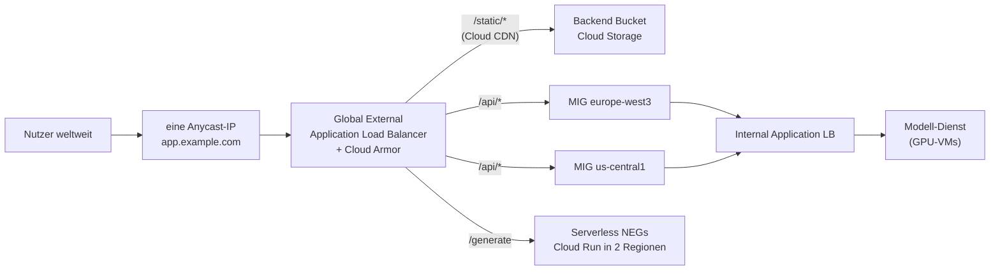
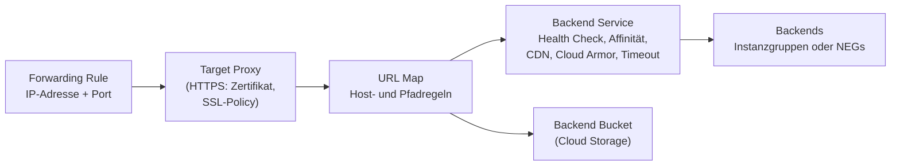
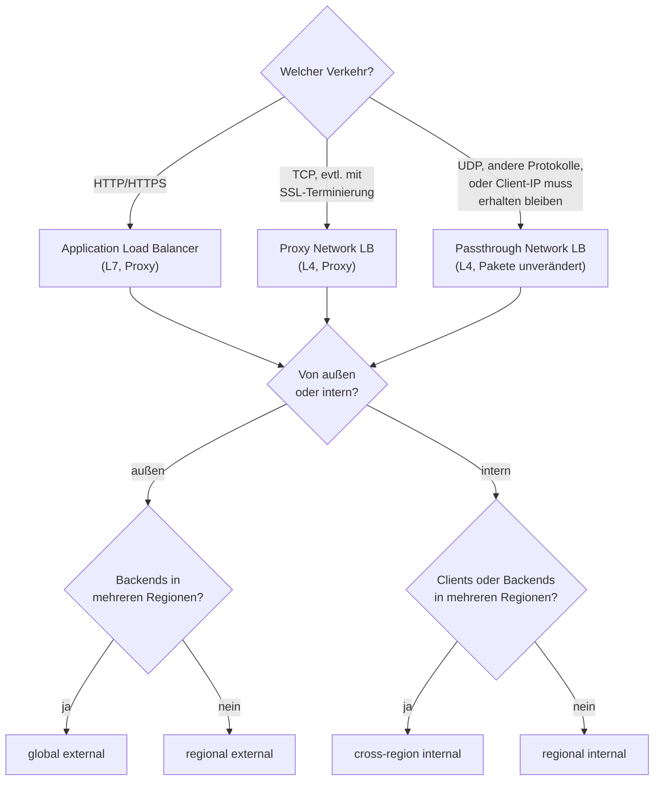
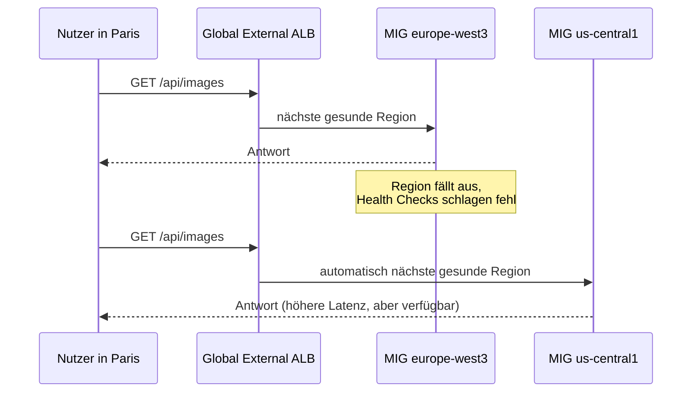

# Load Balancing: Verkehr verteilen, absichern, beschleunigen

Lernnotiz zur Prüfung Professional Cloud Architect (PCA). Load Balancer tauchen in vielen Fragen auf, oft als Teil
einer größeren Architektur: Hochverfügbarkeit über Zonen und Regionen, statische Inhalte mit CDN, Schutz mit Cloud
Armor, Cloud Run und GKE hinter einer gemeinsamen IP. Diese Notiz baut auf [vpc.md](vpc.md) auf (Netz, Firewall,
Premium Tier) und auf [gke.md](gke.md) (Ingress, Gateway, NEGs).

*Stand 2026-11-15. Load-Balancer-Typen, Health-Check-Bereiche und Cloud-Armor-Angaben am selben Tag an der
Google-Cloud-Doku geprüft (siehe [Quellen](#10-quellen)).*

---

## Inhalt

- [0. Das Bild zuerst: eine globale Bild-Generierungs-App](#0-das-bild-zuerst-eine-globale-bild-generierungs-app)
- [1. Die Bausteine eines Load Balancers](#1-die-bausteine-eines-load-balancers)
- [2. Welcher Load Balancer: die drei Familien](#2-welcher-load-balancer-die-drei-familien)
- [3. Health Checks und Autohealing](#3-health-checks-und-autohealing)
- [4. Routing: Pfade, Regionen, Failover](#4-routing-pfade-regionen-failover)
- [5. Statische Inhalte und Cloud CDN](#5-statische-inhalte-und-cloud-cdn)
- [6. Sicherheit: TLS, Cloud Armor, IAP](#6-sicherheit-tls-cloud-armor-iap)
- [7. Backends: Instanzgruppen, NEGs, Cloud Run, GKE](#7-backends-instanzgruppen-negs-cloud-run-gke)
- [8. Prüfungssignale: Spickzettel](#8-prüfungssignale-spickzettel)
- [9. Alte und neue Namen](#9-alte-und-neue-namen)
- [10. Quellen](#10-quellen)

---

## 0. Das Bild zuerst: eine globale Bild-Generierungs-App

Eine Web-App erzeugt Bilder mit einem Diffusionsmodell. Nutzer sitzen in Europa und Amerika. Die App besteht aus:

- **statischen Dateien** (HTML, JS, Beispielbilder) in einem Cloud-Storage-Bucket,
- einer **API** auf Compute-Engine-VMs in zwei Regionen (`europe-west3`, `us-central1`),
- einem **Generierungsdienst** auf Cloud Run, ebenfalls in beiden Regionen,
- einem **internen Modell-Dienst** auf GPU-VMs, den nur die API aufruft.

Alles Öffentliche soll unter **einer** Domain und **einer** IP-Adresse erreichbar sein, Nutzer sollen in der
nächstgelegenen Region landen, und die App braucht Schutz vor Angriffen.

*Ein einziger globaler Load Balancer verteilt nach Pfad auf drei Arten von Backends. Der Modell-Dienst ist nur intern
erreichbar, über einen eigenen internen Load Balancer.*

---

## 1. Die Bausteine eines Load Balancers

Ein Load Balancer in Google Cloud ist kein einzelnes Gerät, sondern eine Kette von Konfigurationsobjekten. Eine
Anfrage durchläuft sie von links nach rechts:

| Baustein | Aufgabe |
|---|---|
| **Forwarding Rule** | die öffentliche oder interne IP und der Port, unter denen der Load Balancer erreichbar ist |
| **Target Proxy** | beendet die Client-Verbindung; bei HTTPS hängt hier das Zertifikat |
| **URL Map** | entscheidet anhand von Host und Pfad, welcher Backend Service die Anfrage bekommt |
| **Backend Service** | Gruppe gleichartiger Backends mit Health Check, Lastverteilungsmodus, Session-Affinität, Timeout; hier schaltet man Cloud CDN und Cloud Armor ein |
| **Backends** | Managed Instance Groups, Network Endpoint Groups (NEGs) oder ein Backend Bucket |

Bei Passthrough-Load-Balancern (Abschnitt 2) fehlen Target Proxy und URL Map: Die Pakete gehen unverändert an die
Backends.

> **Anknüpfung an ML-Praxis.** Der **Timeout des Backend Service** ist standardmäßig 30 Sekunden. Eine LLM-Antwort,
> die länger streamt, oder eine Bildgenerierung über 30 Sekunden bricht sonst am Load Balancer ab, obwohl der Dienst
> noch arbeitet. Für solche Dienste den Timeout erhöhen oder asynchron arbeiten (Auftrag annehmen, Ergebnis später
> abholen).

---

## 2. Welcher Load Balancer: die drei Familien

Die Wahl folgt aus drei Fragen: **Welches Protokoll?** **Von außen oder intern?** **Eine Region oder mehrere?**

*Nicht jede Kombination gibt es: Den Passthrough Network Load Balancer gibt es intern nur regional, „cross-region
internal“ nur als Application oder Proxy Network Load Balancer.*

| Familie | Protokolle | Varianten | Client-IP beim Backend |
|---|---|---|---|
| **Application Load Balancer** | HTTP, HTTPS (inkl. HTTP/2, WebSockets) | global external, regional external, regional internal, cross-region internal, classic | nein (steht im Header `X-Forwarded-For`) |
| **Proxy Network Load Balancer** | TCP, optional SSL-Offload | global external, regional external, regional internal, cross-region internal, classic | nein |
| **Passthrough Network Load Balancer** | TCP, UDP, ICMP, ESP, GRE u. a. | regional external, internal (regional), global external (Preview) | **ja** |

Was man daraus ableitet:

- **Proxy** heißt: Der Load Balancer beendet die Verbindung des Clients und baut eine neue zum Backend auf. Er kann
  dadurch TLS beenden, nach Pfaden routen, cachen und Angriffe filtern. Der Preis: Das Backend sieht die IP des
  Load Balancers, nicht die des Clients.
- **Passthrough** heißt: Pakete gehen unverändert durch, das Backend antwortet direkt dem Client. Nötig für UDP (z. B.
  Spiele, VoIP) und wenn die Anwendung die echte Client-IP braucht.
- **Global** heißt: eine Anycast-IP weltweit, Nutzer landen am nächsten Google-Standort, Backends in vielen Regionen.
  Setzt das **Premium Tier** voraus (siehe [vpc.md](vpc.md)).
- **Regional** passt, wenn alle Backends in einer Region stehen oder Daten die Region nicht verlassen dürfen.
- **Classic**-Varianten sind die älteren Implementierungen; Google empfiehlt den Umstieg auf die neuen globalen.

Envoy-basierte regionale und interne Load Balancer brauchen im VPC ein **Proxy-only Subnet** pro Region, aus dem die
Proxys ihre Adressen nehmen.

---

## 3. Health Checks und Autohealing

**Health Checks** fragen regelmäßig jedes Backend ab (z. B. `GET /healthz`). Nur gesunde Backends bekommen Verkehr.
Die Prüfungen kommen von Google-Systemen aus festen Adressbereichen, und genau das ist eine häufige Falle: **Ohne
Firewall-Regel, die diese Bereiche eingehend erlaubt, gelten alle Backends als krank**, und der Load Balancer
liefert Fehler, obwohl die VMs laufen.

- Für Application und Proxy Network Load Balancer sowie den internen Passthrough-LB: `35.191.0.0/16`.
- Für den regionalen externen Passthrough-LB zusätzlich `209.85.152.0/22` und `209.85.204.0/22`.
- Ältere Doku und viele Prüfungsfragen nennen außerdem `130.211.0.0/22`; die aktuelle Doku führt diesen Bereich
  nicht mehr auf.

**Autohealing** ist etwas anderes, nutzt aber ebenfalls einen Health Check: Eine Managed Instance Group **ersetzt**
VMs, die den Check nicht bestehen. Der Unterschied:

| | Load-Balancer-Health-Check | Autohealing-Health-Check der MIG |
|---|---|---|
| Folge bei „krank“ | kein Verkehr mehr an dieses Backend | VM wird gelöscht und neu erstellt |
| typisch | häufige, strenge Prüfung | großzügiger, mit **Initial Delay** |

**Die klassische Neustart-Schleife:** Eine App braucht 90 Sekunden zum Starten, das Initial Delay steht auf 10
Sekunden. Autohealing hält jede neue VM für krank und ersetzt sie, bevor sie fertig ist. Alle VMs starten im Kreis
neu. Zur Fehlersuche schaltet man den Autohealing-Check vorübergehend ab, damit man sich auf eine VM verbinden und die
Logs lesen kann; die eigentliche Lösung ist ein passendes Initial Delay.

---

## 4. Routing: Pfade, Regionen, Failover

**Pfad- und Host-Regeln.** Die URL Map ordnet Anfragen zu: `/v1/*` an den alten API-Backend-Service, `/v2/*` an den
neuen, `/static/*` an einen Backend Bucket. So laufen zwei API-Versionen parallel unter derselben IP, demselben
Zertifikat und demselben DNS-Eintrag. Mit **gewichteter Aufteilung** (z. B. 95 % / 5 %) in der URL Map lässt sich
ein Canary-Release machen.

**Über Regionen.** Der globale externe Application Load Balancer schickt jede Anfrage an die **nächstgelegene Region
mit gesunden Backends und freier Kapazität**. Fällt eine Region aus oder ist sie voll, geht der Verkehr automatisch
in die nächste. Das ist die Standardantwort für „Anwendung in zwei Regionen, automatisches Failover“.

**Innerhalb einer Region.** Eine **regionale MIG über drei Zonen** hinter einem (regionalen oder globalen) Load
Balancer übersteht den Ausfall einer Zone. Für Anwendungen ohne HTTP und ohne Clustering (z. B. ein TCP-Dienst mit
Dateien auf der Platte) gibt es ein klassisches Muster: aktive und Standby-VM in zwei Zonen, eine **Regional
Persistent Disk** (synchron in zwei Zonen gespiegelt) und ein **Passthrough Network Load Balancer** davor.

**Sitzungen und WebSockets.** Application Load Balancer unterstützen WebSockets. Hält eine Anwendung Sitzungen im
Speicher eines Servers, hilft **Session-Affinität** (nach Client-IP, generiertem Cookie, eigenem Cookie oder Header).
Robuster ist es, Sitzungen aus dem Server herauszulegen (z. B. in Memorystore), damit jede Anfrage an jedes Backend
gehen kann.

**DNS als Alternative.** Cloud DNS kann mit **Routing-Richtlinien** (geolocation, gewichtet, Failover) ebenfalls
Verkehr verteilen. Das ist gröber (Clients cachen DNS-Antworten) und kennt keine Health-Checks auf Anfrage-Ebene;
für Web-Anwendungen ist der globale Load Balancer meist die bessere Antwort.

---

## 5. Statische Inhalte und Cloud CDN

**Backend Buckets.** Ein Cloud-Storage-Bucket kann direkt Backend eines Application Load Balancers sein. Statische
Dateien kommen dann ohne VM aus, unter derselben Domain wie die API.

**Cloud CDN** speichert Antworten an Googles Edge-Standorten nahe beim Nutzer. Man schaltet es pro Backend Service oder
Backend Bucket am globalen externen Application Load Balancer ein. Beim nächsten Abruf kommt die Datei vom Edge, das
Backend wird nicht gefragt.

**Cache Key und Trefferquote.** Der Cache merkt sich jede Antwort unter einem Schlüssel, der standardmäßig Protokoll,
Host, Pfad und Query-String enthält. Ein Bild, das einmal über `http://` und einmal über `https://` abgerufen wird,
liegt dann zweimal im Cache, und jeder erste Abruf geht ans Backend. Wer Teile aus dem Cache Key entfernt, die für
den Inhalt keine Rolle spielen (Protokoll, irrelevante Query-Parameter), erhöht die **Trefferquote**.

Weitere Hebel: Cache-Modus und TTL (wie lange ein Objekt gilt), `Cache-Control`-Header der Anwendung,
**Invalidierung** bei geänderten Inhalten, **Signed URLs** für zeitlich begrenzten Zugriff auf private Inhalte. Für
große Medien und Video-Streaming gibt es **Media CDN**.

**Typische Kombination für schnelle Seiten:** Cloud CDN für statische Inhalte und Bilder, Memorystore als Cache für
dynamische Daten der Anwendung.

---

## 6. Sicherheit: TLS, Cloud Armor, IAP

**TLS.** Der Target Proxy beendet HTTPS mit einem Zertifikat. Bequem sind **Google-verwaltete Zertifikate** (über
Certificate Manager), die Google ausstellt und erneuert. **SSL-Policies** legen fest, welche TLS-Versionen und
Cipher erlaubt sind. Für **Ende-zu-Ende-Verschlüsselung** stellt man zusätzlich das Protokoll zwischen Load Balancer
und Backend auf HTTPS (oder HTTP/2 mit TLS).

**Cloud Armor** hängt als Sicherheitsrichtlinie am Backend Service:

- **L3/L4-DDoS-Schutz** ist für Backends hinter den unterstützten Load Balancern **immer aktiv**.
- **L7-Schutz** (z. B. HTTP-Floods, SQL-Injection) braucht eine **eigene Richtlinie**: vorkonfigurierte WAF-Regeln
  gegen die OWASP Top 10, eigene Regeln (nach IP, Land, Header), Ratenbegrenzung.
- **Adaptive Protection** erkennt L7-Angriffe am Verkehrsmuster und schlägt Regeln vor; sie setzt **Cloud Armor
  Enterprise** voraus.
- Unterstützt werden u. a. alle externen Application Load Balancer, der regionale interne Application Load Balancer,
  der globale externe Proxy Network Load Balancer und der regionale externe Passthrough Network Load Balancer, dazu
  VMs mit externer IP.

**Damit niemand Cloud Armor umgeht**, darf das Backend nur über den Load Balancer erreichbar sein. Bei Cloud Run heißt
das: Ingress-Einstellung **„Internal and Cloud Load Balancing“** und den Dienst über eine Serverless NEG anbinden.
Sonst ruft ein Angreifer einfach die `run.app`-URL direkt auf.

**Identity-Aware Proxy (IAP)** am Application Load Balancer prüft vor dem Backend, ob ein Nutzer angemeldet und
berechtigt ist. Das ersetzt ein VPN für interne Web-Anwendungen.

---

## 7. Backends: Instanzgruppen, NEGs, Cloud Run, GKE

| Backend | Was dahinter steht | typisch |
|---|---|---|
| **Managed Instance Group** | VMs aus einer Vorlage, mit Autoscaling und Autohealing | klassische Web- und API-Server |
| **Zonale NEG** (`GCE_VM_IP_PORT`) | einzelne IP:Port-Paare, z. B. GKE-Pods | Container-natives Load Balancing (siehe [gke.md](gke.md)) |
| **Serverless NEG** | Cloud Run, App Engine, Cloud Run Functions | Serverless-Dienste hinter globaler IP, Cloud Armor, CDN |
| **Internet NEG** | ein Ziel außerhalb von Google Cloud | externer Ursprung hinter dem Load Balancer |
| **Hybrid NEG** | IP:Port im Rechenzentrum (über VPN/Interconnect) | On-Prem-Dienste hinter demselben Load Balancer |
| **Backend Bucket** | Cloud-Storage-Bucket | statische Inhalte, mit Cloud CDN |

**Cloud Run in mehreren Regionen:** pro Region eine Serverless NEG, alle im selben Backend Service eines globalen
externen Application Load Balancers. Nutzer landen in der nächstgelegenen Region, fällt eine aus, übernimmt die
andere.

**GKE:** Ein Ingress oder Gateway legt automatisch einen Application Load Balancer mit NEGs an. Für mehrere Cluster
in mehreren Regionen gibt es das **Multi-Cluster Gateway** (früher Multi Cluster Ingress, noch früher `kubemci`).

---

## 8. Prüfungssignale: Spickzettel

| Wenn die Frage sagt … | … ist die Antwort meist |
|---|---|
| alte und neue API-Version unter derselben IP, demselben Zertifikat | URL Map mit eigenem Backend Service pro Pfad |
| globales Routing nach URL-Pfad, verschlüsselt bis zum Backend | globaler externer Application LB (HTTPS) mit URL Map, Backend-Protokoll HTTPS |
| Load Balancer meldet alle Backends krank, VMs laufen aber | Firewall-Regel für die Health-Check-Bereiche fehlt |
| VMs der MIG starten ständig neu | Autohealing-Check bzw. Initial Delay prüfen; zur Diagnose Check vorübergehend abschalten |
| Anwendung in zwei Regionen, automatisches Failover | MIGs in beiden Regionen hinter globalem externem Application LB |
| hochverfügbar über Zonen in einer Region | regionale MIG über alle Zonen, davor Load Balancer |
| TCP-Anwendung ohne Clustering, Daten auf Platte, hochverfügbar | aktive und Standby-VM in zwei Zonen, Regional Persistent Disk, Passthrough Network LB |
| UDP oder echte Client-IP nötig | Passthrough Network Load Balancer |
| Trefferquote im CDN erhöhen | Cache Key anpassen (z. B. Protokoll weglassen) |
| statische Dateien und Medien schnell weltweit ausliefern | Cloud CDN am externen Application LB, Backend Bucket |
| Seiten schneller, dynamische Daten und Bilder | Cloud CDN plus Memorystore |
| DDoS auf L3/L4 und L7 | Cloud Armor mit vorkonfigurierten und eigenen Regeln |
| aller Verkehr zu Cloud Run muss durch Cloud Armor | Cloud-Run-Ingress „Internal and Cloud Load Balancing“, Serverless NEG am Load Balancer |
| Microservices auf Cloud Run in mehreren Regionen hinter einer IP | Serverless NEGs pro Region im Backend Service eines globalen Application LB |
| GKE-App in mehreren Regionen, ein Einstiegspunkt | Multi-Cluster Gateway |
| interne Web-App ohne VPN für Mitarbeitende | Identity-Aware Proxy am Application LB |
| lange laufende Anfragen brechen nach 30 s ab | Timeout des Backend Service erhöhen |

---

## 9. Alte und neue Namen

| In älteren Fragen | Heute |
|---|---|
| HTTP(S) Load Balancer, HTTPS Load Balancer | (global oder regional) external Application Load Balancer |
| Internal HTTP(S) Load Balancer | internal Application Load Balancer |
| TCP Proxy, SSL Proxy Load Balancer | Proxy Network Load Balancer |
| Network Load Balancer (Target Pools) | external Passthrough Network Load Balancer (mit Backend Service) |
| Internal TCP/UDP Load Balancer | internal Passthrough Network Load Balancer |
| kubemci, Multi Cluster Ingress | Multi-Cluster Gateway |
| Health-Check-Bereiche `130.211.0.0/22` und `35.191.0.0/16` | aktuelle Doku: `35.191.0.0/16` (plus Sonderbereiche für externe Passthrough-LBs) |

---

## 10. Quellen

- [Choose a load balancer](https://docs.cloud.google.com/load-balancing/docs/choosing-load-balancer)
  (geprüft 2026-11-15: drei Familien, Proxy vs. Passthrough, global vs. regional, Premium Tier)
- [Load balancing overview](https://docs.cloud.google.com/load-balancing/docs/load-balancing-overview) ·
  [Backend services](https://docs.cloud.google.com/load-balancing/docs/backend-service) ·
  [URL maps](https://docs.cloud.google.com/load-balancing/docs/url-map-concepts)
- [Health checks](https://docs.cloud.google.com/load-balancing/docs/health-check-concepts)
  (geprüft 2026-11-15: Quellbereiche) ·
  [Autohealing for MIGs](https://docs.cloud.google.com/compute/docs/instance-groups/autohealing-instances-in-migs)
- [Cloud CDN overview](https://docs.cloud.google.com/cdn/docs/overview) ·
  [Cache keys](https://docs.cloud.google.com/cdn/docs/caching#cache-keys)
- [Cloud Armor overview](https://docs.cloud.google.com/armor/docs/cloud-armor-overview)
  (geprüft 2026-11-15: unterstützte Load Balancer, L3/L4 immer an, Adaptive Protection nur mit Enterprise)
- [Serverless NEGs](https://docs.cloud.google.com/load-balancing/docs/negs/serverless-neg-concepts) ·
  [Cloud Run ingress settings](https://docs.cloud.google.com/run/docs/securing/ingress)
- [Identity-Aware Proxy](https://docs.cloud.google.com/iap/docs/concepts-overview) ·
  [Cloud DNS routing policies](https://docs.cloud.google.com/dns/docs/routing-policies-overview)
