# Networking: VPC, Verbindungen und Load Balancing

Lernnotiz zur Prüfung Professional Cloud Architect (PCA). Netzwerk ist dort das größte Themenfeld. Die Notiz beginnt
mit dem Schichtenmodell (L3, L4, L7), weil es erklärt, was Firewall, Load Balancer und Cloud Armor jeweils sehen
können. Danach folgen das VPC-Netz mit Firewall, privaten Zugängen und hybriden Verbindungen (Teil 1) und Load
Balancing mit CDN und Cloud Armor (Teil 2). Das Netzwerk innerhalb von GKE (Services, Ingress, private Nodes) steht
in [gke.md](gke.md).

*Stand 2026-11-15. Zahlen zu VPN, Interconnect, privaten Zugängen, Load-Balancer-Typen, Health-Check-Bereichen und
Cloud Armor am selben Tag an der Google-Cloud-Doku geprüft (siehe [Quellen](#19-quellen)). Zusammengeführt
aus den früheren Notizen `vpc.md` und `loadbalancing.md`.*

---

## Inhalt

**Grundlagen**

- [0. Das Bild zuerst: eine ML-Plattform mit Rechenzentrum](#0-das-bild-zuerst-eine-ml-plattform-mit-rechenzentrum)
- [1. Schichtenmodell: L3, L4 und L7](#1-schichtenmodell-l3-l4-und-l7)

**Teil 1: Das Netz**

- [2. Das Grundmodell: globales Netz, regionale Subnetze](#2-das-grundmodell-globales-netz-regionale-subnetze)
- [3. Firewall: wer darf mit wem sprechen](#3-firewall-wer-darf-mit-wem-sprechen)
- [4. Mehrere Netze verbinden: Shared VPC, Peering und mehr](#4-mehrere-netze-verbinden-shared-vpc-peering-und-mehr)
- [5. Private Wege zu Google und zu Diensten](#5-private-wege-zu-google-und-zu-diensten)
- [6. Hybride Verbindungen: VPN und Interconnect](#6-hybride-verbindungen-vpn-und-interconnect)
- [7. Leitplanken für die ganze Organisation](#7-leitplanken-für-die-ganze-organisation)

**Teil 2: Load Balancing**

- [8. Load Balancing, das Bild zuerst: eine globale Bild-Generierungs-App](#8-load-balancing-das-bild-zuerst-eine-globale-bild-generierungs-app)
- [9. Die Bausteine eines Load Balancers](#9-die-bausteine-eines-load-balancers)
- [10. Welcher Load Balancer: die drei Familien](#10-welcher-load-balancer-die-drei-familien)
- [11. Health Checks und Autohealing](#11-health-checks-und-autohealing)
- [12. Routing: Pfade, Regionen, Failover](#12-routing-pfade-regionen-failover)
- [13. Statische Inhalte und Cloud CDN](#13-statische-inhalte-und-cloud-cdn)
- [14. Sicherheit: TLS, Cloud Armor, IAP](#14-sicherheit-tls-cloud-armor-iap)
- [15. Backends: Instanzgruppen, NEGs, Cloud Run, GKE](#15-backends-instanzgruppen-negs-cloud-run-gke)

**Zum Nachschlagen**

- [16. Kosten](#16-kosten)
- [17. Prüfungssignale: Spickzettel](#17-prüfungssignale-spickzettel)
- [18. Alte und neue Namen](#18-alte-und-neue-namen)
- [19. Quellen](#19-quellen)

---

## 0. Das Bild zuerst: eine ML-Plattform mit Rechenzentrum

Ein Unternehmen hat ein Rechenzentrum in Frankfurt und baut eine ML-Plattform auf Google Cloud. Die Anforderungen:

1. Ein **Netzwerk-Team** verwaltet das Netz zentral; die ML-Teams sollen VMs anlegen, aber keine Firewall-Regeln
   ändern.
2. Keine VM hat eine **externe IP-Adresse**. Trotzdem müssen Trainings-VMs Daten aus Cloud Storage lesen und Pakete
   aus dem Internet laden.
3. Eine **Cloud-SQL-Datenbank** und ein **Cloud-Run-Dienst** sollen nur über private IPs erreichbar sein.
4. Das **Rechenzentrum** schickt große Datenmengen nach Google Cloud, privat und hochverfügbar.

Jede Anforderung hat ihren eigenen Baustein. So hängen sie zusammen:

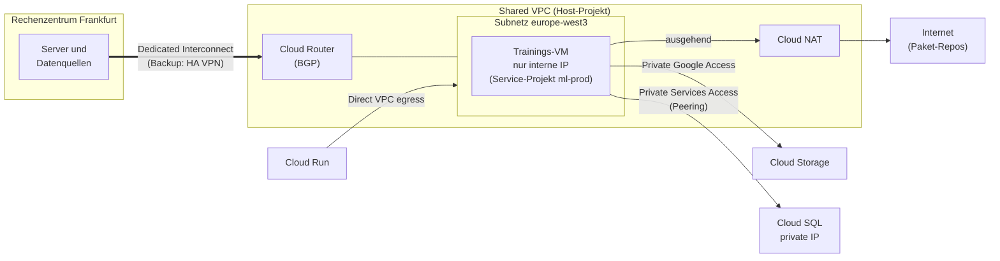

| Anforderung | Baustein | Abschnitt |
|---|---|---|
| zentrales Netz, Teams ohne Netzrechte | Shared VPC | 4 |
| Google-APIs ohne externe IP | Private Google Access | 5 |
| Internet nur ausgehend | Cloud NAT | 5 |
| Cloud SQL nur privat | Private Services Access | 5 |
| Cloud Run ins VPC | Direct VPC egress | 5 |
| Rechenzentrum anbinden | Interconnect, HA VPN, Cloud Router | 6 |

---

## 1. Schichtenmodell: L3, L4 und L7

Viele Begriffe in diesem Dokument hängen an einer Frage: **Auf welcher Schicht arbeitet ein Baustein?** Daraus folgt,
was er sehen und worüber er entscheiden kann. Netzwerker beschreiben das mit dem OSI-Modell aus sieben Schichten. Für
Cloud-Architektur reichen drei davon (L3, L4, L7), dazu L2 und L1 für Interconnect.

### Das Bild zuerst: ein Aufruf in drei Umschlägen

Ein Browser ruft `https://app.example.com/api/images` auf. Unterwegs steckt die Anfrage in drei Umschlägen, einer im
anderen. Jede Station auf dem Weg öffnet nur so viele Umschläge, wie sie für ihre Aufgabe braucht.

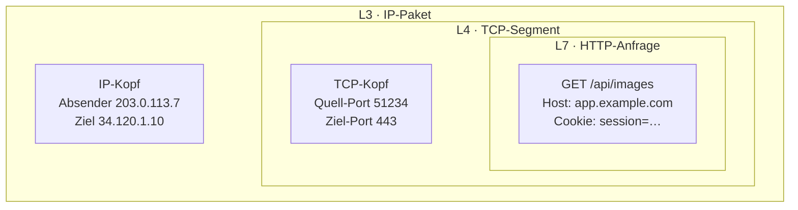

*Bei HTTPS ist der innerste Umschlag zusätzlich mit TLS verschlossen. Wer den Pfad lesen will, braucht den
Schlüssel, also das Zertifikat.*

| Schicht | Name | Steht auf dem Umschlag | Im Beispiel | Frage, die sie beantwortet |
|---|---|---|---|---|
| **L7** | Anwendung | Methode, Pfad, Host, Header, Cookies | `GET /api/images`, `Host: app.example.com` | *Was* will der Client? |
| **L4** | Transport | Quell- und Ziel-Port, TCP oder UDP | TCP, Port 443 | *Welches Programm* auf der Maschine, und wie zuverlässig? |
| **L3** | Netzwerk | Absender- und Ziel-IP-Adresse | `203.0.113.7` → `34.120.1.10` | *Welche Maschine*, und auf welchem Weg dorthin? |

Ein Vergleich mit der Post: L3 ist die Adresse des Gebäudes, L4 die Abteilung im Gebäude (und ob als Einschreiben
mit Empfangsbestätigung, TCP, oder als einfacher Brief, UDP), L7 der Inhalt des Briefs. Darunter liegen **L2** (der
Rahmen auf einer einzelnen Leitung, z. B. Ethernet mit einer VLAN-Nummer) und **L1** (die Leitung selbst, z. B. die
Glasfaser eines Dedicated Interconnect).

### Die Regel, die alles erklärt

**Ein Baustein kann nur nach dem entscheiden, was auf seiner Schicht und darunter sichtbar ist.** Eine
Firewall-Regel sieht IP-Adressen und Ports, aber nicht den Pfad `/api/images`. Ein Load Balancer, der nach Pfaden
verteilen soll, muss den HTTP-Umschlag öffnen; bei HTTPS heißt das, er muss TLS beenden und braucht dafür das
Zertifikat.

Daraus folgen viele typische Prüfungsantworten:

- **Nach URL-Pfad oder Host verteilen** (`/v1` hierhin, `/v2` dorthin): Das geht nur mit einem L7-Load-Balancer,
  dem Application Load Balancer (Abschnitt 10).
- **SQL-Injection oder Cross-Site-Scripting abwehren:** Der Angriff steckt im L7-Inhalt. VPC-Firewall-Regeln sehen
  ihn nicht, Cloud Armor mit WAF-Regeln schon (Abschnitt 14).
- **Einen UDP-Dienst verteilen** (Spiel, VoIP, DNS): UDP ist ein L4-Protokoll ohne Verbindung. Ein
  HTTP-Load-Balancer kann damit nichts anfangen, nur der Passthrough Network Load Balancer.
- **Die echte Client-IP beim Backend:** Ein Proxy (auf L7 oder L4) beendet die Verbindung des Clients und baut eine
  neue auf. Das Backend sieht als L3-Absender den Proxy; die Original-IP steht nur noch im L7-Header
  `X-Forwarded-For`. Ein Passthrough-Load-Balancer lässt den L3-Umschlag unverändert.
- **DDoS-Angriffe gibt es auf jeder Schicht.** SYN-Floods und UDP-Fluten zielen auf L3/L4, HTTP-Fluten auf L7.
  Cloud Armor wehrt L3/L4-Angriffe immer ab; für L7 braucht man eigene Regeln.
- **Verschlüsseln geht auf verschiedenen Schichten:** HA VPN (IPsec) verschlüsselt ganze L3-Pakete, MACsec auf einem
  Interconnect verschlüsselt auf L2, TLS (HTTPS) sitzt zwischen L4 und L7.

### Was sieht welche Station?

Derselbe Aufruf auf dem Weg durch Google Cloud:

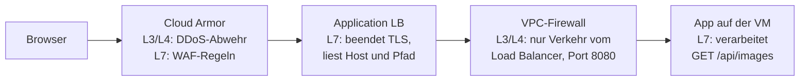

| Schicht | Bausteine in Google Cloud |
|---|---|
| **L7** | Application Load Balancer mit URL Map, Cloud CDN, Cloud Armor (WAF-Regeln), Identity-Aware Proxy, GKE Ingress und Gateway, Service Mesh |
| **L4** | Proxy und Passthrough Network Load Balancer, Ports und Protokolle in Firewall-Regeln, Cloud NAT (übersetzt Adressen und Ports) |
| **L3** | VPC-Routen, IP-Bereiche in Firewall-Regeln, VPC Peering, Cloud VPN (IPsec), Cloud Router (lernt L3-Routen per BGP), Private Service Connect |
| **L2/L1** | Cloud Interconnect (Leitung und VLAN-Attachments), MACsec |

Die normale VPC-Firewall arbeitet auf L3/L4. Wer auch in den Inhalt schauen will (Intrusion Prevention), braucht
Cloud NGFW Enterprise oder, für Web-Anwendungen, Cloud Armor am Load Balancer.

---

## 2. Das Grundmodell: globales Netz, regionale Subnetze

**Ein VPC-Netz ist global, ein Subnetz ist regional.** Ein einziges VPC kann Subnetze in Frankfurt und in Iowa haben,
und VMs in beiden sprechen über interne IPs miteinander, ohne VPN dazwischen. Der Verkehr läuft über Googles eigenes
Netz. Das unterscheidet Google Cloud von anderen Clouds, in denen ein Netz an eine Region gebunden ist.

**Subnetze und IP-Bereiche.** Jedes Subnetz hat einen primären IP-Bereich (für VMs) und optional sekundäre Bereiche
(z. B. für GKE-Pods und -Services, siehe [gke.md](gke.md)). Ein Subnetz kann man später vergrößern, aber nicht
verkleinern.

- **Auto-Mode-VPC:** legt in jeder Region automatisch ein Subnetz aus einem festen Bereich (`10.128.0.0/9`) an.
  Bequem zum Ausprobieren, aber die Bereiche überschneiden sich mit jedem anderen Auto-Mode-VPC.
- **Custom-Mode-VPC:** Du legst die Subnetze selbst an. Für Produktion die richtige Wahl, weil sich nur so
  Überschneidungen mit On-Prem und anderen Netzen vermeiden lassen.

**IP-Planung ist die Entscheidung, die man später am schwersten ändert.** Überschneiden sich Bereiche, funktionieren
Peering und VPN nicht oder nur mit Umwegen. Deshalb: vor der ersten VM einen Adressplan machen, der On-Prem, alle
VPCs und das Wachstum von GKE einschließt.

**Routen.** Jedes VPC hat automatisch eine Route pro Subnetz und eine Standardroute ins Internet (`0.0.0.0/0`).
Dazu kommen eigene statische Routen und **dynamische Routen**, die ein Cloud Router per BGP von On-Prem lernt. Der
**dynamische Routing-Modus** des VPC entscheidet, ob gelernte Routen nur in der Region des Cloud Routers gelten
(regional) oder im ganzen VPC (global).

**Netzwerk-Tiers.** *Premium Tier* (Standard) führt den Verkehr so weit wie möglich über Googles Backbone und ist
Voraussetzung für globale Load Balancer. *Standard Tier* übergibt den Verkehr früh ans öffentliche Internet: billiger,
aber nur regional und mit schwankender Latenz.

---

## 3. Firewall: wer darf mit wem sprechen

### Wie eine Regel aussieht

Eine VPC-Firewall-Regel hat sechs Teile: **Richtung** (ingress oder egress), **Priorität** (0 bis 65535, die
*kleinere* Zahl gewinnt, Standard ist 1000), **Aktion** (allow oder deny), **Ziel** (alle VMs, VMs mit einem
Network Tag oder VMs mit einem Service Account), **Quelle bzw. Ziel-Bereich** und **Protokoll mit Ports**.

Zwei Eigenschaften muss man kennen:

- **Zustandsbehaftet (stateful):** Ist eine Verbindung in eine Richtung erlaubt, sind die Antwortpakete automatisch
  erlaubt. Man braucht keine Regel für den Rückweg.
- **Implizite Regeln** mit der niedrigsten Priorität 65535: *ausgehend alles erlaubt*, *eingehend alles verboten*.
  Ein neues Custom-VPC lässt also nichts herein, bis man es erlaubt. (Das `default`-Netz bringt zusätzlich Regeln
  für internen Verkehr, SSH, RDP und ICMP mit.)

### Ein Beispiel mit Prioritäten

Aufgabe: Alle VMs dürfen nur zum Active-Directory-Server sprechen (Ports 389 und 636), sonst nirgends hin. Weil
ausgehend implizit alles erlaubt ist, braucht man zwei Regeln:

| Priorität | Richtung | Aktion | Ziel | Wohin |
|---|---|---|---|---|
| 100 | egress | allow | alle VMs | AD-Server, TCP 389 und 636 |
| 1000 | egress | deny | alle VMs | `0.0.0.0/0`, alles |

Ein Paket zum AD-Server trifft zuerst Regel 100 und ist erlaubt. Jedes andere Paket fällt durch bis Regel 1000 und
wird verworfen. Mit vertauschten Prioritäten würde die Deny-Regel alles blockieren, auch den AD-Verkehr.

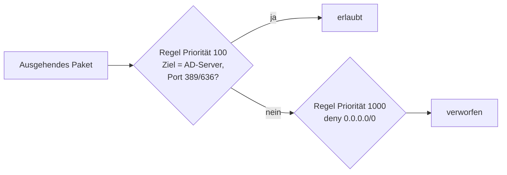

### Network Tags oder Service Accounts als Ziel

In einer Drei-Schichten-Anwendung (Web, API, Datenbank) bekommt jede Schicht ihr Ziel, und die Regeln erlauben nur
Web → API → Datenbank. IP-Adressen eignen sich dafür nicht, weil VMs beim Skalieren neue IPs bekommen.

| Ziel | Vorteil | Nachteil |
|---|---|---|
| **Network Tag** (z. B. `web`) | einfach, sofort änderbar | jeder mit Rechten an der VM kann das Tag ändern und sich damit Zugang verschaffen |
| **Service Account** der VM | an IAM gebunden: Wechseln erfordert Rechte am Service Account und ein Stoppen der VM | etwas mehr Aufwand |

Für strenge Trennung sind Service Accounts die sicherere Wahl; Prüfungsfragen mit „Sicherheit“ im Vordergrund
zielen oft darauf. In einer einzelnen Regel kann man Tags und Service Accounts nicht als Ziel mischen.

### Regeln für die ganze Organisation

- **Hierarchische Firewall-Richtlinien** hängen an Organisation oder Ordner und werden *vor* den Regeln im VPC
  ausgewertet. Neben allow und deny gibt es `goto_next` (an die nächste Ebene weiterreichen). So setzt ein
  Sicherheitsteam Regeln durch, die kein Projekt überschreiben kann.
- **Netzwerk-Firewall-Richtlinien** (global oder regional) bündeln Regeln pro VPC und können **sichere Tags**
  (Resource-Manager-Tags) verwenden, deren Vergabe per IAM kontrolliert ist.

**Kontrolle und Aufräumen:** *Firewall Rules Logging* protokolliert, welche Regel welche Verbindung erlaubt oder
blockiert hat. Darauf baut *Firewall Insights* im Network Intelligence Center auf und zeigt ungenutzte oder
verdeckte Regeln. Ohne Logging hat Firewall Insights keine Daten.

### Anmelden ohne externe IP: IAP

Wie kommt ein Admin per SSH auf eine VM ohne externe IP, ohne VPN? Mit **IAP TCP Forwarding**: Identity-Aware Proxy
prüft die Identität und tunnelt die Verbindung. Nötig sind die Rolle *IAP-secured Tunnel User* und eine
Firewall-Regel, die eingehend Port 22 aus dem IAP-Bereich `35.235.240.0/20` erlaubt. Dann reicht
`gcloud compute ssh vm-name --tunnel-through-iap`.

---

## 4. Mehrere Netze verbinden: Shared VPC, Peering und mehr

### Shared VPC: ein Netz, viele Projekte

**Problem:** Viele Teams mit eigenen Projekten, aber das Netz (Subnetze, Firewall, Verbindung ins Rechenzentrum) soll
an einer Stelle verwaltet werden.

**Lösung:** Ein **Host-Projekt** besitzt das VPC. **Service-Projekte** werden angehängt und legen ihre VMs, GKE-Cluster
usw. in die Subnetze des Host-Projekts. Netz und Anwendungen sind so administrativ getrennt:

| Wer | Rolle | Wo |
|---|---|---|
| Netzwerk-Team | *Network Admin* (und *Security Admin* für Firewall) | Host-Projekt |
| Organisations-Admin | *Shared VPC Admin* (hängt Projekte an) | Organisation oder Ordner |
| Entwicklerteams | *Network User* (darf Subnetze benutzen) plus z. B. *Compute Instance Admin* | Host-Projekt bzw. einzelne Subnetze; Service-Projekt |

Shared VPC funktioniert nur **innerhalb einer Organisation**.

### VPC Network Peering: zwei Netze direkt verbinden

Peering verbindet zwei VPCs, sodass VMs über interne IPs sprechen. Es funktioniert auch **zwischen Projekten und
Organisationen** (z. B. mit einem Partner). Jede Seite verwaltet ihr VPC und ihre Firewall weiter selbst.
Voraussetzung: Die Subnetz-Bereiche dürfen sich **nicht überschneiden**.

Die wichtigste Eigenschaft: **Peering ist nicht transitiv.**

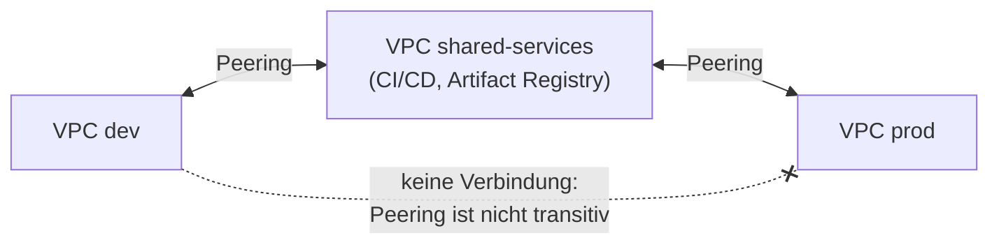

*dev und prod erreichen beide die gemeinsamen Dienste, aber nicht einander. Genau das ist oft gewünscht: Umgebungen
getrennt, gemeinsame Dienste erreichbar.*

Routen zu On-Prem (statisch oder per BGP gelernt) kann ein VPC über das Peering an den Partner exportieren. Ein
drittes gepeertes VPC erreicht man aber nie über ein Peering hinweg.

### Welcher Weg wann

| Situation | Weg |
|---|---|
| ein zentral verwaltetes Netz für viele Projekte derselben Organisation | **Shared VPC** |
| zwei VPCs, auch über Organisationsgrenzen, ohne Überschneidung | **VPC Network Peering** |
| Umgebungen getrennt, aber alle erreichen gemeinsame Dienste | Peering jeder Umgebung mit einem Shared-Services-VPC |
| eine VM muss in mehreren VPCs stehen (z. B. Firewall-Appliance) | **mehrere Netzwerkkarten** (eine pro VPC, beim Anlegen festgelegt) |
| zwei Netze mit überschneidenden Bereichen oder zwei Shared VPCs in verschiedenen Organisationen | **Cloud VPN** zwischen den Netzen, mit Cloud Router und gezielten Route-Advertisements |
| viele VPCs und Standorte sternförmig verbinden | **Network Connectivity Center** (Hub mit VPC- und Hybrid-Spokes) |

---

## 5. Private Wege zu Google und zu Diensten

Eine VM ohne externe IP will an vier Arten von Zielen. Für jedes gibt es einen eigenen Mechanismus, und genau diese
Zuordnung prüfen viele Fragen.

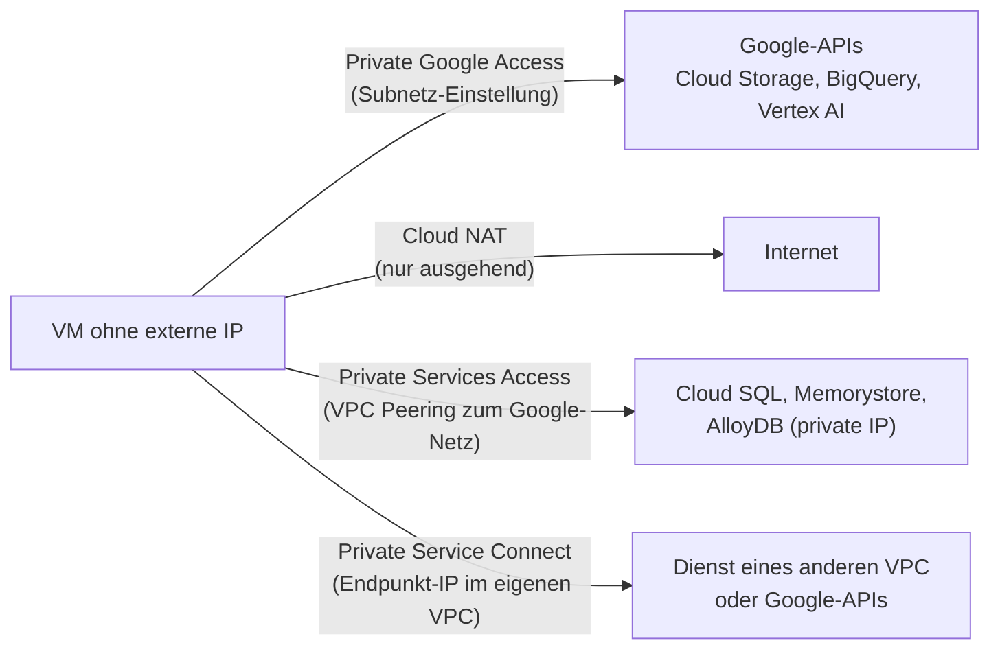

| Ziel | Mechanismus | Wie es technisch geht |
|---|---|---|
| Google-APIs | **Private Google Access** | pro Subnetz einschalten; die VM erreicht die APIs ohne externe IP |
| Internet, nur ausgehend | **Cloud NAT** | regional, am Cloud Router konfiguriert, ohne eigene Proxy-VM; man wählt, welche Subnetze NAT nutzen. Von außen kommt keine Verbindung herein |
| verwaltete Dienste mit privater IP (Cloud SQL, Memorystore, AlloyDB) | **Private Services Access** | man reserviert einen IP-Bereich; Google verbindet sein Dienst-VPC per **VPC Peering** |
| Dienst eines anderen Anbieters oder Teams, oder Google-APIs über eine eigene IP | **Private Service Connect (PSC)** | eine **Endpunkt-IP** im eigenen Subnetz leitet an den Dienst weiter; kein Peering, Überschneidungen egal |
| Cloud Run, App Engine Standard, Cloud Run Functions ins VPC | **Direct VPC egress** (bei Cloud Run empfohlen) oder **Serverless VPC Access Connector** | der Dienst bekommt einen Weg zu internen IPs im VPC |

**Warum PSC oft besser ist als Peering:** Peering verbindet ganze Netze und verlangt überschneidungsfreie Bereiche.
PSC veröffentlicht genau *einen* Dienst als eine IP im Netz des Konsumenten. Der Anbieter sieht das Netz des Kunden
nicht, und beide Seiten dürfen dieselben Adressbereiche verwenden.

**Typischer Fehler mit Serverless:** Ein Cloud-Run-Dienst erreicht eine AlloyDB oder Cloud SQL mit privater IP nicht.
Der Grund: Cloud Run läuft standardmäßig außerhalb des VPC. Lösung: Direct VPC egress einschalten.

### Private Google Access von On-Prem und VPC Service Controls

Auch Server im **Rechenzentrum** können Google-APIs über VPN oder Interconnect erreichen statt über das Internet.
Dafür gibt es zwei feste Adressbereiche, die man per DNS und Route-Advertisement ins Rechenzentrum bringt:

- `private.googleapis.com` (`199.36.153.8/30`): die meisten Google-APIs.
- `restricted.googleapis.com` (`199.36.153.4/30`): nur Dienste, die **VPC Service Controls** unterstützen.

**VPC Service Controls (VPC-SC)** ist keine Firewall für VMs. Es zieht einen **Perimeter um Projekte** und kontrolliert,
von wo aus Google-APIs wie BigQuery oder Cloud Storage benutzt werden dürfen. Ziel ist Schutz vor
**Datenabfluss**: Selbst ein gestohlenes Token kann Daten nicht in ein Projekt außerhalb des Perimeters kopieren.
Prüfungsmuster: „BigQuery-Daten dürfen nur aus dem Rechenzentrum über das VPN erreichbar sein“ heißt
**VPC Service Controls plus Private Google Access für On-Prem-Hosts** (über `restricted.googleapis.com`).

> **Anknüpfung an ML-Praxis.** Trainings-VMs und GKE-Nodes ohne externe IP lesen ihre Daten über Private Google
> Access aus Cloud Storage und laden Pakete über Cloud NAT. Ein Vertex-AI-Endpunkt lässt sich per Private Service
> Connect privat erreichbar machen. Und VPC Service Controls um die Projekte mit Trainingsdaten verhindert, dass ein
> Notebook die Daten in einen privaten Bucket außerhalb kopiert.

---

## 6. Hybride Verbindungen: VPN und Interconnect

### Cloud Router: das Bindeglied

Ein **Cloud Router** spricht BGP mit dem Router im Rechenzentrum. Beide Seiten tauschen ihre Netze aus; ändert sich
ein Subnetz, lernt die andere Seite das automatisch. Man kann gezielt steuern, welche Bereiche er ankündigt
(*custom route advertisements*). Das hilft z. B., wenn sich nach einer Firmenübernahme Bereiche überschneiden: Man
kündigt die überschneidenden Bereiche einfach nicht an.

### Cloud VPN

IPsec-verschlüsselte Tunnel über das Internet. Schnell eingerichtet, günstig, aber begrenzt in der Bandbreite.

| | **HA VPN** (empfohlen) | Classic VPN |
|---|---|---|
| SLA | **99,99 %** (bei richtiger Topologie) | 99,9 % |
| Aufbau | Gateway mit **zwei Interfaces** und zwei externen IPs; mindestens zwei Tunnel zum Peer | ein Interface, eine IP |
| Routing | nur dynamisch (BGP über Cloud Router) | nur statisch |
| Bandbreite | pro Tunnel bis 250.000 Pakete/s, je nach Paketgröße etwa 1–3 Gbps; mehr Tunnel für mehr Bandbreite | dasselbe Limit pro Tunnel |

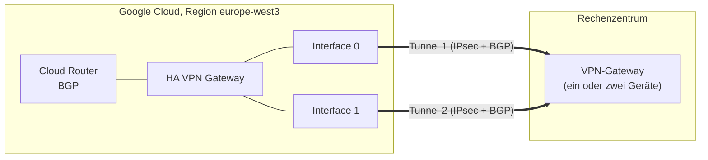

*Fällt ein Tunnel oder ein Interface aus, läuft der Verkehr über den anderen weiter. Erst zwei Tunnel ergeben die
99,99 %.*

**Ein VPN-Gateway ist regional.** Läuft eine Anwendung in einem VPC in zwei Regionen und beide sollen ins
Rechenzentrum, braucht man ein Gateway mit Tunneln in **jeder Region** (oder globales dynamisches Routing, dann
nutzen beide Regionen die Tunnel einer Region, mit dem Umweg über die Region).

### Cloud Interconnect

Eine **physische, private Verbindung** zu Googles Netz, ohne Internet dazwischen. Für große Datenmengen und
gleichmäßige Latenz.

| | **Dedicated Interconnect** | **Partner Interconnect** |
|---|---|---|
| Verbindung | eigene Leitung in einer Colocation-Einrichtung, in der Google präsent ist | über einen Netzanbieter, der schon mit Google verbunden ist |
| Bandbreite | Leitungen mit 10 oder 100 Gbps, bündelbar | 50 Mbps bis 50 Gbps pro VLAN-Attachment |
| wann | sehr viel Bandbreite und das Rechenzentrum erreicht eine Colocation | keine Colocation in Reichweite, oder weniger Bandbreite nötig |

Dazu kommt **Cross-Cloud Interconnect** für eine direkte Leitung zu einer anderen Cloud.

**Interconnect verschlüsselt nicht.** Der Verkehr ist privat, aber nicht verschlüsselt. Wer Verschlüsselung braucht,
nimmt **MACsec** oder **HA VPN über Interconnect**.

**Verfügbarkeit hängt von der Topologie ab** (Dedicated Interconnect):

- **99,9 %:** zwei Verbindungen in einer Metro, in verschiedenen *Edge Availability Domains* (getrennte
  Wartungszonen).
- **99,99 %:** mindestens **vier Verbindungen**, zwei in jeder von **zwei Metros**, in jeder Metro auf beide Edge
  Availability Domains verteilt; mindestens **zwei Cloud Router** in zwei Regionen; das VPC im **globalen**
  dynamischen Routing-Modus. (Seit Kurzem gibt es auch eine Variante mit vier Verbindungen in einer Metro und einer
  Region.)

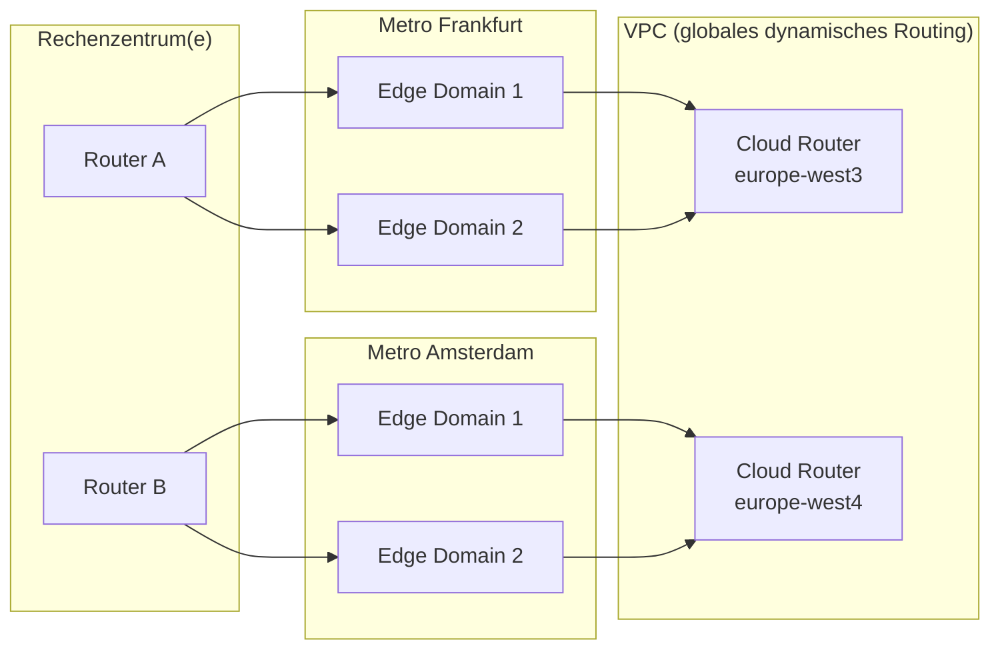

### Welche Verbindung wann

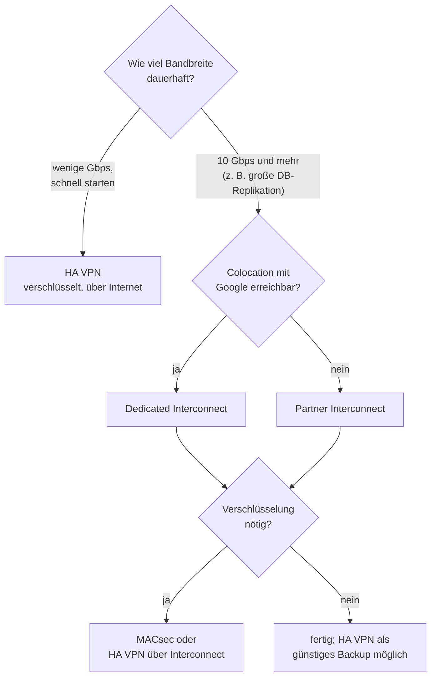

**Zwei Muster aus der Praxis:**

- **Interconnect plus VPN als Backup:** Für Disaster Recovery prüft man, dass die Replikation über Interconnect
  läuft *und* dass das VPN die Verbindung übernimmt, wenn der Interconnect ausfällt.
- **Überschneidungsfreie Bereiche** sind Voraussetzung für jede hybride Verbindung. In einer schrittweisen Migration
  bekommt Google Cloud einen Bereich, den das Rechenzentrum nicht benutzt.

---

## 7. Leitplanken für die ganze Organisation

Manche Regeln sollen in allen Projekten gelten, egal was ein Projekt-Admin tut. Dafür gibt es **Organization
Policies** (Constraints) an Organisation oder Ordner:

- `constraints/compute.vmExternalIpAccess`: nur die aufgelisteten VMs dürfen externe IPs haben, alle anderen nicht.
- `constraints/gcp.resourceLocations`: Ressourcen nur in erlaubten Regionen (z. B. nur EU).
- `constraints/compute.restrictSharedVpcHostProjects` und Verwandte: welche Projekte Shared VPC nutzen dürfen.

Zusammen mit hierarchischen Firewall-Richtlinien (Abschnitt 3) und VPC Service Controls (Abschnitt 5) ergibt das die
Leitplanken, die ein zentrales Team setzt und die einzelne Projekte nicht aufweichen können.

---

## 8. Load Balancing, das Bild zuerst: eine globale Bild-Generierungs-App

Eine Web-App erzeugt Bilder mit einem Diffusionsmodell. Nutzer sitzen in Europa und Amerika. Die App besteht aus:

- **statischen Dateien** (HTML, JS, Beispielbilder) in einem Cloud-Storage-Bucket,
- einer **API** auf Compute-Engine-VMs in zwei Regionen (`europe-west3`, `us-central1`),
- einem **Generierungsdienst** auf Cloud Run, ebenfalls in beiden Regionen,
- einem **internen Modell-Dienst** auf GPU-VMs, den nur die API aufruft.

Alles Öffentliche soll unter **einer** Domain und **einer** IP-Adresse erreichbar sein, Nutzer sollen in der
nächstgelegenen Region landen, und die App braucht Schutz vor Angriffen.

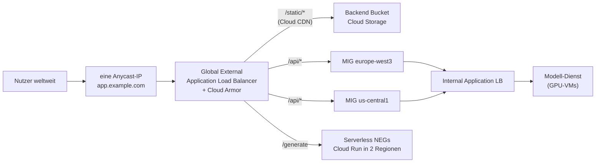

*Ein einziger globaler Load Balancer verteilt nach Pfad auf drei Arten von Backends. Der Modell-Dienst ist nur intern
erreichbar, über einen eigenen internen Load Balancer.*

---

## 9. Die Bausteine eines Load Balancers

Ein Load Balancer in Google Cloud ist kein einzelnes Gerät, sondern eine Kette von Konfigurationsobjekten. Eine
Anfrage durchläuft sie von links nach rechts:

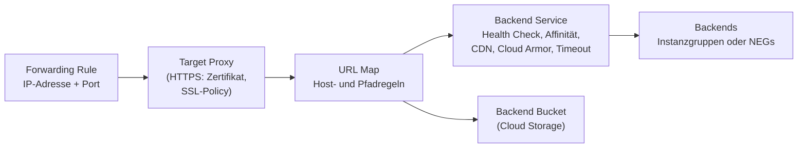

| Baustein | Aufgabe |
|---|---|
| **Forwarding Rule** | die öffentliche oder interne IP und der Port, unter denen der Load Balancer erreichbar ist |
| **Target Proxy** | beendet die Client-Verbindung; bei HTTPS hängt hier das Zertifikat |
| **URL Map** | entscheidet anhand von Host und Pfad, welcher Backend Service die Anfrage bekommt |
| **Backend Service** | Gruppe gleichartiger Backends mit Health Check, Lastverteilungsmodus, Session-Affinität, Timeout; hier schaltet man Cloud CDN und Cloud Armor ein |
| **Backends** | Managed Instance Groups, Network Endpoint Groups (NEGs) oder ein Backend Bucket |

Bei Passthrough-Load-Balancern (Abschnitt 10) fehlen Target Proxy und URL Map: Die Pakete gehen unverändert an die
Backends.

> **Anknüpfung an ML-Praxis.** Der **Timeout des Backend Service** ist standardmäßig 30 Sekunden. Eine LLM-Antwort,
> die länger streamt, oder eine Bildgenerierung über 30 Sekunden bricht sonst am Load Balancer ab, obwohl der Dienst
> noch arbeitet. Für solche Dienste den Timeout erhöhen oder asynchron arbeiten (Auftrag annehmen, Ergebnis später
> abholen).

---

## 10. Welcher Load Balancer: die drei Familien

Die Wahl folgt aus drei Fragen: **Welches Protokoll?** **Von außen oder intern?** **Eine Region oder mehrere?**

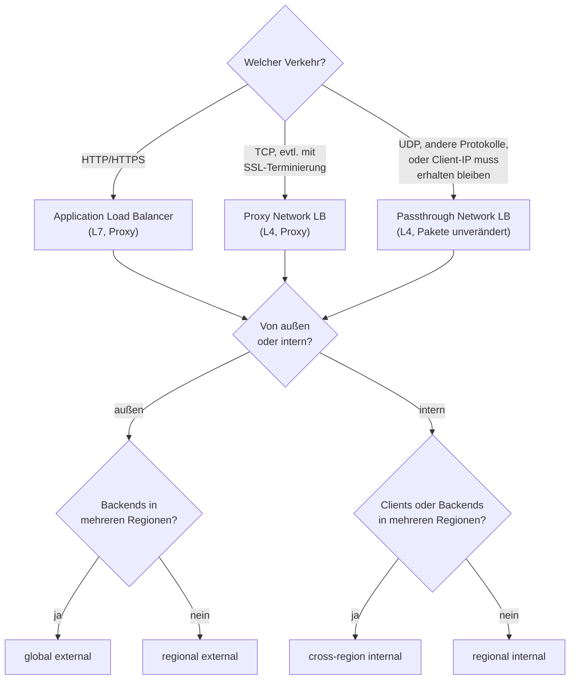

*Nicht jede Kombination gibt es: Den Passthrough Network Load Balancer gibt es intern nur regional, „cross-region
internal“ nur als Application oder Proxy Network Load Balancer.*

| Familie | Protokolle | Varianten | Client-IP beim Backend |
|---|---|---|---|
| **Application Load Balancer** | HTTP, HTTPS (inkl. HTTP/2, WebSockets) | global external, regional external, regional internal, cross-region internal, classic | nein (steht im Header `X-Forwarded-For`) |
| **Proxy Network Load Balancer** | TCP, optional SSL-Offload | global external, regional external, regional internal, cross-region internal, classic | nein |
| **Passthrough Network Load Balancer** | TCP, UDP, ICMP, ESP, GRE u. a. | regional external, internal (regional), global external (Preview) | **ja** |

Was man daraus ableitet:

- **Proxy** heißt: Der Load Balancer beendet die Verbindung des Clients und baut eine neue zum Backend auf. Er kann
  dadurch TLS beenden, nach Pfaden routen, cachen und Angriffe filtern. Der Preis: Das Backend sieht die IP des
  Load Balancers, nicht die des Clients.
- **Passthrough** heißt: Pakete gehen unverändert durch, das Backend antwortet direkt dem Client. Nötig für UDP (z. B.
  Spiele, VoIP) und wenn die Anwendung die echte Client-IP braucht.
- **Global** heißt: eine Anycast-IP weltweit, Nutzer landen am nächsten Google-Standort, Backends in vielen Regionen.
  Setzt das **Premium Tier** voraus (siehe [Abschnitt 2](#2-das-grundmodell-globales-netz-regionale-subnetze)).
- **Regional** passt, wenn alle Backends in einer Region stehen oder Daten die Region nicht verlassen dürfen.
- **Classic**-Varianten sind die älteren Implementierungen; Google empfiehlt den Umstieg auf die neuen globalen.

Envoy-basierte regionale und interne Load Balancer brauchen im VPC ein **Proxy-only Subnet** pro Region, aus dem die
Proxys ihre Adressen nehmen.

---

## 11. Health Checks und Autohealing

**Health Checks** fragen regelmäßig jedes Backend ab (z. B. `GET /healthz`). Nur gesunde Backends bekommen Verkehr.
Die Prüfungen kommen von Google-Systemen aus festen Adressbereichen, und genau das ist eine häufige Falle: **Ohne
Firewall-Regel, die diese Bereiche eingehend erlaubt, gelten alle Backends als krank**, und der Load Balancer
liefert Fehler, obwohl die VMs laufen.

- Für Application und Proxy Network Load Balancer sowie den internen Passthrough-LB: `35.191.0.0/16`.
- Für den regionalen externen Passthrough-LB zusätzlich `209.85.152.0/22` und `209.85.204.0/22`.
- Ältere Doku und viele Prüfungsfragen nennen außerdem `130.211.0.0/22`; die aktuelle Doku führt diesen Bereich
  nicht mehr auf.

**Autohealing** ist etwas anderes, nutzt aber ebenfalls einen Health Check: Eine Managed Instance Group **ersetzt**
VMs, die den Check nicht bestehen. Der Unterschied:

| | Load-Balancer-Health-Check | Autohealing-Health-Check der MIG |
|---|---|---|
| Folge bei „krank“ | kein Verkehr mehr an dieses Backend | VM wird gelöscht und neu erstellt |
| typisch | häufige, strenge Prüfung | großzügiger, mit **Initial Delay** |

**Die klassische Neustart-Schleife:** Eine App braucht 90 Sekunden zum Starten, das Initial Delay steht auf 10
Sekunden. Autohealing hält jede neue VM für krank und ersetzt sie, bevor sie fertig ist. Alle VMs starten im Kreis
neu. Zur Fehlersuche schaltet man den Autohealing-Check vorübergehend ab, damit man sich auf eine VM verbinden und die
Logs lesen kann; die eigentliche Lösung ist ein passendes Initial Delay.

---

## 12. Routing: Pfade, Regionen, Failover

**Pfad- und Host-Regeln.** Die URL Map ordnet Anfragen zu: `/v1/*` an den alten API-Backend-Service, `/v2/*` an den
neuen, `/static/*` an einen Backend Bucket. So laufen zwei API-Versionen parallel unter derselben IP, demselben
Zertifikat und demselben DNS-Eintrag. Mit **gewichteter Aufteilung** (z. B. 95 % / 5 %) in der URL Map lässt sich
ein Canary-Release machen.

**Über Regionen.** Der globale externe Application Load Balancer schickt jede Anfrage an die **nächstgelegene Region
mit gesunden Backends und freier Kapazität**. Fällt eine Region aus oder ist sie voll, geht der Verkehr automatisch
in die nächste. Das ist die Standardantwort für „Anwendung in zwei Regionen, automatisches Failover“.

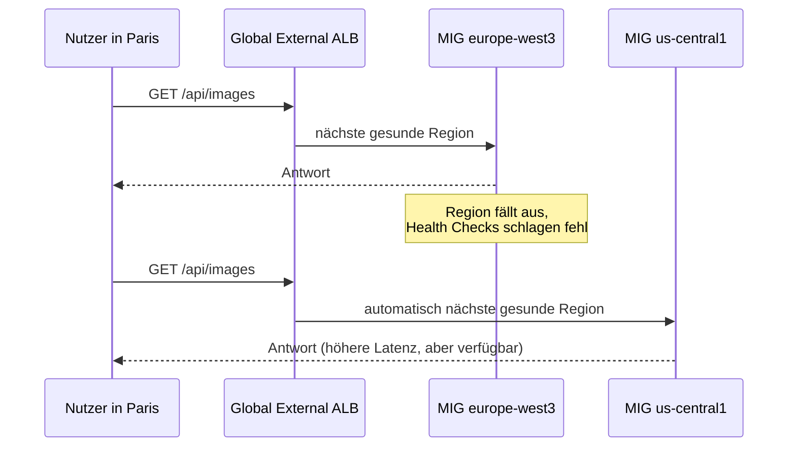

**Innerhalb einer Region.** Eine **regionale MIG über drei Zonen** hinter einem (regionalen oder globalen) Load
Balancer übersteht den Ausfall einer Zone. Für Anwendungen ohne HTTP und ohne Clustering (z. B. ein TCP-Dienst mit
Dateien auf der Platte) gibt es ein klassisches Muster: aktive und Standby-VM in zwei Zonen, eine **Regional
Persistent Disk** (synchron in zwei Zonen gespiegelt) und ein **Passthrough Network Load Balancer** davor.

**Sitzungen und WebSockets.** Application Load Balancer unterstützen WebSockets. Hält eine Anwendung Sitzungen im
Speicher eines Servers, hilft **Session-Affinität** (nach Client-IP, generiertem Cookie, eigenem Cookie oder Header).
Robuster ist es, Sitzungen aus dem Server herauszulegen (z. B. in Memorystore), damit jede Anfrage an jedes Backend
gehen kann.

**DNS als Alternative.** Cloud DNS kann mit **Routing-Richtlinien** (geolocation, gewichtet, Failover) ebenfalls
Verkehr verteilen. Das ist gröber (Clients cachen DNS-Antworten) und kennt keine Health-Checks auf Anfrage-Ebene;
für Web-Anwendungen ist der globale Load Balancer meist die bessere Antwort.

---

## 13. Statische Inhalte und Cloud CDN

**Backend Buckets.** Ein Cloud-Storage-Bucket kann direkt Backend eines Application Load Balancers sein. Statische
Dateien kommen dann ohne VM aus, unter derselben Domain wie die API.

**Cloud CDN** speichert Antworten an Googles Edge-Standorten nahe beim Nutzer. Man schaltet es pro Backend Service oder
Backend Bucket am globalen externen Application Load Balancer ein. Beim nächsten Abruf kommt die Datei vom Edge, das
Backend wird nicht gefragt.

**Cache Key und Trefferquote.** Der Cache merkt sich jede Antwort unter einem Schlüssel, der standardmäßig Protokoll,
Host, Pfad und Query-String enthält. Ein Bild, das einmal über `http://` und einmal über `https://` abgerufen wird,
liegt dann zweimal im Cache, und jeder erste Abruf geht ans Backend. Wer Teile aus dem Cache Key entfernt, die für
den Inhalt keine Rolle spielen (Protokoll, irrelevante Query-Parameter), erhöht die **Trefferquote**.

Weitere Hebel: Cache-Modus und TTL (wie lange ein Objekt gilt), `Cache-Control`-Header der Anwendung,
**Invalidierung** bei geänderten Inhalten, **Signed URLs** für zeitlich begrenzten Zugriff auf private Inhalte. Für
große Medien und Video-Streaming gibt es **Media CDN**.

**Typische Kombination für schnelle Seiten:** Cloud CDN für statische Inhalte und Bilder, Memorystore als Cache für
dynamische Daten der Anwendung.

---

## 14. Sicherheit: TLS, Cloud Armor, IAP

**TLS.** Der Target Proxy beendet HTTPS mit einem Zertifikat. Bequem sind **Google-verwaltete Zertifikate** (über
Certificate Manager), die Google ausstellt und erneuert. **SSL-Policies** legen fest, welche TLS-Versionen und
Cipher erlaubt sind. Für **Ende-zu-Ende-Verschlüsselung** stellt man zusätzlich das Protokoll zwischen Load Balancer
und Backend auf HTTPS (oder HTTP/2 mit TLS).

**Cloud Armor** hängt als Sicherheitsrichtlinie am Backend Service:

- **L3/L4-DDoS-Schutz** ist für Backends hinter den unterstützten Load Balancern **immer aktiv**.
- **L7-Schutz** (z. B. HTTP-Floods, SQL-Injection) braucht eine **eigene Richtlinie**: vorkonfigurierte WAF-Regeln
  gegen die OWASP Top 10, eigene Regeln (nach IP, Land, Header), Ratenbegrenzung.
- **Adaptive Protection** erkennt L7-Angriffe am Verkehrsmuster und schlägt Regeln vor; sie setzt **Cloud Armor
  Enterprise** voraus.
- Unterstützt werden u. a. alle externen Application Load Balancer, der regionale interne Application Load Balancer,
  der globale externe Proxy Network Load Balancer und der regionale externe Passthrough Network Load Balancer, dazu
  VMs mit externer IP.

**Damit niemand Cloud Armor umgeht**, darf das Backend nur über den Load Balancer erreichbar sein. Bei Cloud Run heißt
das: Ingress-Einstellung **„Internal and Cloud Load Balancing“** und den Dienst über eine Serverless NEG anbinden.
Sonst ruft ein Angreifer einfach die `run.app`-URL direkt auf.

**Identity-Aware Proxy (IAP)** am Application Load Balancer prüft vor dem Backend, ob ein Nutzer angemeldet und
berechtigt ist. Das ersetzt ein VPN für interne Web-Anwendungen.

---

## 15. Backends: Instanzgruppen, NEGs, Cloud Run, GKE

| Backend | Was dahinter steht | typisch |
|---|---|---|
| **Managed Instance Group** | VMs aus einer Vorlage, mit Autoscaling und Autohealing | klassische Web- und API-Server |
| **Zonale NEG** (`GCE_VM_IP_PORT`) | einzelne IP:Port-Paare, z. B. GKE-Pods | Container-natives Load Balancing (siehe [gke.md](gke.md)) |
| **Serverless NEG** | Cloud Run, App Engine, Cloud Run Functions | Serverless-Dienste hinter globaler IP, Cloud Armor, CDN |
| **Internet NEG** | ein Ziel außerhalb von Google Cloud | externer Ursprung hinter dem Load Balancer |
| **Hybrid NEG** | IP:Port im Rechenzentrum (über VPN/Interconnect) | On-Prem-Dienste hinter demselben Load Balancer |
| **Backend Bucket** | Cloud-Storage-Bucket | statische Inhalte, mit Cloud CDN |

**Cloud Run in mehreren Regionen:** pro Region eine Serverless NEG, alle im selben Backend Service eines globalen
externen Application Load Balancers. Nutzer landen in der nächstgelegenen Region, fällt eine aus, übernimmt die
andere.

**GKE:** Ein Ingress oder Gateway legt automatisch einen Application Load Balancer mit NEGs an. Für mehrere Cluster
in mehreren Regionen gibt es das **Multi-Cluster Gateway** (früher Multi Cluster Ingress, noch früher `kubemci`).

---

## 16. Kosten

| Hebel | Was er bringt |
|---|---|
| **Datenverkehr verstehen** | eingehender Verkehr ist kostenlos; ausgehender ins Internet und zwischen Regionen kostet, Verkehr zwischen Zonen einer Region ebenfalls. Gesprächige Dienste deshalb in dieselbe Zone oder Region legen |
| **Netzwerk-Tier** | Standard Tier ist günstiger als Premium, aber nur regional und mit schwankender Latenz |
| **Cloud CDN** | Antworten aus dem Cache entlasten das Backend und sparen ausgehenden Verkehr vom Ursprung |
| **Interconnect statt VPN bei großen Mengen** | Verkehr über Interconnect wird günstiger abgerechnet als über das Internet; VPN-Tunnel kosten pro Stunde plus Verkehr |
| **Cloud NAT** | kostet pro Gateway und pro verarbeiteter Datenmenge; Google-APIs besser über Private Google Access statt über NAT erreichen |
| **Load Balancer** | Kosten für Weiterleitungsregeln und verarbeitete Daten; mehrere Dienste hinter einem Load Balancer mit URL Map bündeln |
| **Cloud Armor** | Kosten pro Richtlinie, Regel und Anfrage; Adaptive Protection nur mit Cloud Armor Enterprise |
| **Private Service Connect** | Endpunkte kosten pro Stunde und pro Datenmenge |

---

## 17. Prüfungssignale: Spickzettel

Die Tabellen fassen typische Fragemuster zusammen, nach Themen getrennt.

**Schichten**

| Wenn die Frage sagt … | … ist die Antwort meist |
|---|---|
| nach URL-Pfad oder Host verteilen | L7: Application Load Balancer mit URL Map |
| SQL-Injection, XSS, OWASP Top 10 abwehren | L7: Cloud Armor mit WAF-Regeln (nicht die VPC-Firewall) |
| UDP verteilen oder Client-IP erhalten | L4 passthrough: Passthrough Network Load Balancer |
| nur bestimmte Adressen und Ports zulassen | L3/L4: VPC-Firewall-Regel |

**Netz und Verbindungen**

| Wenn die Frage sagt … | … ist die Antwort meist |
|---|---|
| Verkehr zwischen Schichten erlauben, ohne feste IPs | Firewall-Regeln mit Network Tags (oder Service Accounts) |
| Schichten streng und sicher trennen | Firewall-Regeln auf **Service Accounts** pro Schicht |
| nur ein Ziel erlauben, sonst nichts ausgehend | allow mit kleiner Prioritätszahl, deny all mit größerer |
| Wirkung von Firewall-Regeln auswerten | Firewall Rules Logging einschalten (Grundlage für Firewall Insights) |
| externe IPs organisationsweit verbieten | Organization Policy `compute.vmExternalIpAccess` |
| VM ohne externe IP soll Dateien aus Cloud Storage laden | Private Google Access am Subnetz |
| VM oder GKE-Node ohne externe IP braucht Internet | Cloud NAT |
| SSH ohne externe IP und ohne VPN | IAP TCP Forwarding plus Rolle IAP-secured Tunnel User |
| Netzwerk-Team verwaltet Netz, Entwickler nur VMs | Shared VPC: Host-Projekt mit Network Admin, Service-Projekt für die Entwickler |
| Netz mit Partner in anderer Organisation verbinden | VPC Network Peering |
| Umgebungen getrennt, gemeinsame Dienste erreichbar | Peering jeder Umgebung mit einem Shared-Services-VPC |
| eine VM in drei VPCs | mehrere Netzwerkkarten |
| zwei Shared VPCs aus verschiedenen Organisationen verbinden | Cloud VPN zwischen den Netzen |
| überschneidende Bereiche nach Übernahme | Cloud VPN mit Cloud Router und custom route advertisements |
| App Engine oder Cloud Functions sollen ins VPC | Serverless VPC Access (bei Cloud Run: Direct VPC egress) |
| Cloud Run erreicht private Datenbank nicht | Direct VPC egress |
| BigQuery nur aus dem Rechenzentrum, kein Datenabfluss | VPC Service Controls plus Private Google Access für On-Prem |
| private Verbindung mit 20 Gbps oder mehr | Dedicated Interconnect |
| hohe Bandbreite, aber keine Colocation | Partner Interconnect |
| privates Netz mit 99,99 %, über Internet | HA VPN mit zwei Tunneln |
| Interconnect mit 99,99 % | vier Verbindungen in zwei Metros, verschiedene Edge Availability Domains |
| VPC in zwei Regionen, beide per VPN ins Rechenzentrum | VPN-Gateway mit Tunnel in jeder Region |
| Migration mit VPN, Adressen planen | Google-Bereich ohne Überschneidung mit On-Prem |
| globaler Load Balancer, Verkehr über Googles Netz | Premium Tier |

**Load Balancing**

| Wenn die Frage sagt … | … ist die Antwort meist |
|---|---|
| alte und neue API-Version unter derselben IP, demselben Zertifikat | URL Map mit eigenem Backend Service pro Pfad |
| globales Routing nach URL-Pfad, verschlüsselt bis zum Backend | globaler externer Application LB (HTTPS) mit URL Map, Backend-Protokoll HTTPS |
| Load Balancer meldet alle Backends krank, VMs laufen aber | Firewall-Regel für die Health-Check-Bereiche fehlt |
| VMs der MIG starten ständig neu | Autohealing-Check bzw. Initial Delay prüfen; zur Diagnose Check vorübergehend abschalten |
| Anwendung in zwei Regionen, automatisches Failover | MIGs in beiden Regionen hinter globalem externem Application LB |
| hochverfügbar über Zonen in einer Region | regionale MIG über alle Zonen, davor Load Balancer |
| TCP-Anwendung ohne Clustering, Daten auf Platte, hochverfügbar | aktive und Standby-VM in zwei Zonen, Regional Persistent Disk, Passthrough Network LB |
| UDP oder echte Client-IP nötig | Passthrough Network Load Balancer |
| Trefferquote im CDN erhöhen | Cache Key anpassen (z. B. Protokoll weglassen) |
| statische Dateien und Medien schnell weltweit ausliefern | Cloud CDN am externen Application LB, Backend Bucket |
| Seiten schneller, dynamische Daten und Bilder | Cloud CDN plus Memorystore |
| DDoS auf L3/L4 und L7 | Cloud Armor mit vorkonfigurierten und eigenen Regeln |
| aller Verkehr zu Cloud Run muss durch Cloud Armor | Cloud-Run-Ingress „Internal and Cloud Load Balancing“, Serverless NEG am Load Balancer |
| Microservices auf Cloud Run in mehreren Regionen hinter einer IP | Serverless NEGs pro Region im Backend Service eines globalen Application LB |
| GKE-App in mehreren Regionen, ein Einstiegspunkt | Multi-Cluster Gateway |
| interne Web-App ohne VPN für Mitarbeitende | Identity-Aware Proxy am Application LB |
| lange laufende Anfragen brechen nach 30 s ab | Timeout des Backend Service erhöhen |

---

## 18. Alte und neue Namen

| In älteren Fragen | Heute |
|---|---|
| Cloud VPN mit statischem Routing | Classic VPN (HA VPN wird empfohlen) |
| Serverless VPC Access als einziger Weg | bei Cloud Run zusätzlich Direct VPC egress (ohne Connector) |
| Cloud Functions | Cloud Run Functions |
| „private cluster“ bei GKE | Private Nodes plus Control-Plane-Endpunkte (siehe [gke.md](gke.md)) |
|---|---|
| HTTP(S) Load Balancer, HTTPS Load Balancer | (global oder regional) external Application Load Balancer |
| Internal HTTP(S) Load Balancer | internal Application Load Balancer |
| TCP Proxy, SSL Proxy Load Balancer | Proxy Network Load Balancer |
| Network Load Balancer (Target Pools) | external Passthrough Network Load Balancer (mit Backend Service) |
| Internal TCP/UDP Load Balancer | internal Passthrough Network Load Balancer |
| kubemci, Multi Cluster Ingress | Multi-Cluster Gateway |
| Health-Check-Bereiche `130.211.0.0/22` und `35.191.0.0/16` | aktuelle Doku: `35.191.0.0/16` (plus Sonderbereiche für externe Passthrough-LBs) |

---

## 19. Quellen

**VPC und Verbindungen**

- [VPC overview](https://docs.cloud.google.com/vpc/docs/vpc) · [Subnets](https://docs.cloud.google.com/vpc/docs/subnets) ·
  [Routes](https://docs.cloud.google.com/vpc/docs/routes)
- [VPC firewall rules](https://docs.cloud.google.com/firewall/docs/firewalls) ·
  [Hierarchical firewall policies](https://docs.cloud.google.com/firewall/docs/firewall-policies)
- [Shared VPC](https://docs.cloud.google.com/vpc/docs/shared-vpc) ·
  [VPC Network Peering](https://docs.cloud.google.com/vpc/docs/vpc-peering)
- [Private access options](https://docs.cloud.google.com/vpc/docs/private-access-options)
  (geprüft 2026-11-15: nur Private Services Access nutzt Peering, PSC nutzt Endpunkte)
- [Private Google Access for on-premises hosts](https://docs.cloud.google.com/vpc/docs/private-google-access-hybrid) ·
  [Private Service Connect](https://docs.cloud.google.com/vpc/docs/private-service-connect)
- [Cloud NAT](https://docs.cloud.google.com/nat/docs/overview) ·
  [IAP TCP forwarding](https://docs.cloud.google.com/iap/docs/using-tcp-forwarding)
- [Cloud VPN overview](https://docs.cloud.google.com/network-connectivity/docs/vpn/concepts/overview)
  (geprüft 2026-11-15: HA VPN 99,99 %, Classic 99,9 %, 250.000 Pakete/s pro Tunnel, Gateways regional)
- [Cloud Interconnect overview](https://docs.cloud.google.com/network-connectivity/docs/interconnect/concepts/overview)
  (geprüft 2026-11-15: Partner 50 Mbps bis 50 Gbps, keine Verschlüsselung ab Werk) ·
  [99,99 % mit Dedicated Interconnect](https://docs.cloud.google.com/network-connectivity/docs/interconnect/tutorials/dedicated-creating-9999-availability)
- [VPC Service Controls](https://docs.cloud.google.com/vpc-service-controls/docs/overview) ·
  [Organization policy constraints](https://docs.cloud.google.com/resource-manager/docs/organization-policy/org-policy-constraints)

**Load Balancing**

- [Choose a load balancer](https://docs.cloud.google.com/load-balancing/docs/choosing-load-balancer)
  (geprüft 2026-11-15: drei Familien, Proxy vs. Passthrough, global vs. regional, Premium Tier)
- [Load balancing overview](https://docs.cloud.google.com/load-balancing/docs/load-balancing-overview) ·
  [Backend services](https://docs.cloud.google.com/load-balancing/docs/backend-service) ·
  [URL maps](https://docs.cloud.google.com/load-balancing/docs/url-map-concepts)
- [Health checks](https://docs.cloud.google.com/load-balancing/docs/health-check-concepts)
  (geprüft 2026-11-15: Quellbereiche) ·
  [Autohealing for MIGs](https://docs.cloud.google.com/compute/docs/instance-groups/autohealing-instances-in-migs)
- [Cloud CDN overview](https://docs.cloud.google.com/cdn/docs/overview) ·
  [Cache keys](https://docs.cloud.google.com/cdn/docs/caching#cache-keys)
- [Cloud Armor overview](https://docs.cloud.google.com/armor/docs/cloud-armor-overview)
  (geprüft 2026-11-15: unterstützte Load Balancer, L3/L4 immer an, Adaptive Protection nur mit Enterprise)
- [Serverless NEGs](https://docs.cloud.google.com/load-balancing/docs/negs/serverless-neg-concepts) ·
  [Cloud Run ingress settings](https://docs.cloud.google.com/run/docs/securing/ingress)
- [Identity-Aware Proxy](https://docs.cloud.google.com/iap/docs/concepts-overview) ·
  [Cloud DNS routing policies](https://docs.cloud.google.com/dns/docs/routing-policies-overview)
