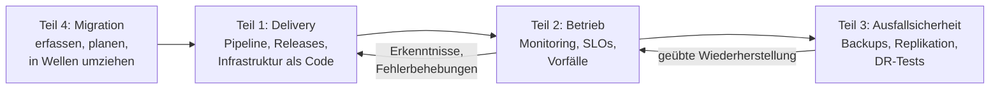
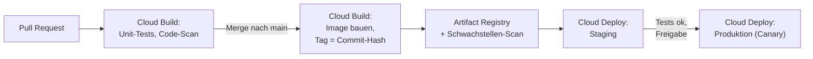
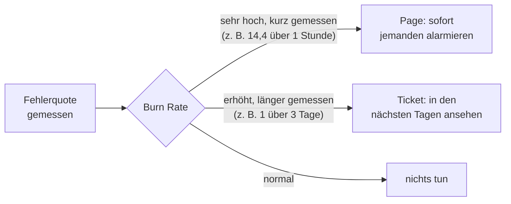
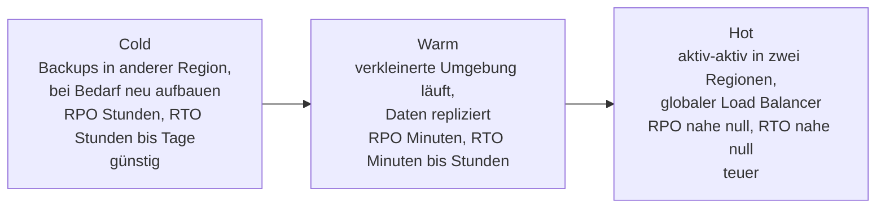
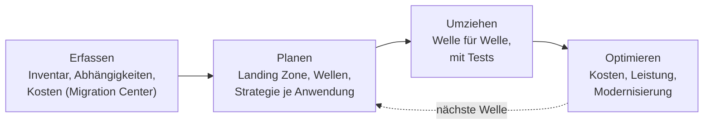

# Operations: Delivery, Betrieb, Ausfallsicherheit und Migration

Lernnotiz zur Prüfung Professional Cloud Architect (PCA). Hier geht es nicht um einzelne Dienste, sondern um den
Lebenslauf einer Anwendung: Sie wird **migriert**, mit einer Pipeline **ausgeliefert**, im Betrieb **beobachtet** und
gegen Ausfälle **abgesichert**. Viele Prüfungsfragen testen genau diese Abläufe („Was tust du zuerst?“).

*Stand 2026-11-15. Turbo Replication und der Backup and DR Service am selben Tag an der Google-Cloud-Doku geprüft
(siehe [Quellen](#13-quellen)). Die Rechenbeispiele zu Error Budget und RPO sind eigene Rechnungen.*

---

## Inhalt

**Grundlagen**

- [0. Das Bild zuerst: der Lebenslauf einer Anwendung](#0-das-bild-zuerst-der-lebenslauf-einer-anwendung)

**Teil 1: Delivery**

- [1. CI/CD-Pipeline](#1-cicd-pipeline)
- [2. Release-Strategien](#2-release-strategien)
- [3. Infrastructure as Code](#3-infrastructure-as-code)

**Teil 2: Betrieb**

- [4. Observability: Metriken, Logs, Traces, Profile](#4-observability-metriken-logs-traces-profile)
- [5. SRE: SLIs, SLOs und Error Budgets](#5-sre-slis-slos-und-error-budgets)
- [6. Vorfälle und Resilienztests](#6-vorfälle-und-resilienztests)

**Teil 3: Ausfallsicherheit**

- [7. RPO, RTO und DR-Muster](#7-rpo-rto-und-dr-muster)
- [8. Werkzeuge für Backup und Wiederherstellung](#8-werkzeuge-für-backup-und-wiederherstellung)

**Teil 4: Migration**

- [9. Migration: Phasen, Strategien, Werkzeuge](#9-migration-phasen-strategien-werkzeuge)

**Zum Nachschlagen**

- [10. Kosten](#10-kosten)
- [11. Prüfungssignale: Spickzettel](#11-prüfungssignale-spickzettel)
- [12. Alte und neue Namen](#12-alte-und-neue-namen)
- [13. Quellen](#13-quellen)

---

## 0. Das Bild zuerst: der Lebenslauf einer Anwendung

Ein Händler zieht seine Bestellplattform aus dem eigenen Rechenzentrum nach Google Cloud. Danach soll sie mehrmals pro
Woche neue Versionen bekommen, rund um die Uhr laufen und einen Regionsausfall überstehen. Das sind vier Aufgaben, und
jede hat ihre eigenen Werkzeuge:

| Frage | Teil |
|---|---|
| Wie kommt die Anwendung in die Cloud, ohne den Betrieb zu stören? | 4 |
| Wie kommt eine neue Version sicher in Produktion, und wie zurück? | 1 |
| Woran merken wir, dass etwas schiefläuft, bevor es die Kunden merken? | 2 |
| Wie viele Daten dürfen wir verlieren, und wie schnell sind wir wieder da? | 3 |

---

## 1. CI/CD-Pipeline

**CI (Continuous Integration):** Jede Änderung wird automatisch gebaut und getestet. **CD (Continuous Delivery bzw.
Deployment):** Das geprüfte Ergebnis wird automatisch durch die Umgebungen bis in Produktion gebracht.

**Grundregeln, die in vielen Fragen stecken:**

- **Einmal bauen, überall dasselbe Artefakt.** Staging und Produktion bekommen dasselbe Image, getaggt mit dem
  Commit-Hash; in Produktion wird nicht neu gebaut.
- **Auslöser:** Cloud Build verbindet sich über die GitHub-App mit dem Repository; Trigger reagieren auf Pull Requests
  (testen) und Merges (bauen und ausrollen).
- **Sicherheit in der Pipeline:** Quellcode-Analyse und Schwachstellen-Scans als Schritte in CI, damit Fehler früh
  auffallen statt nach dem Release ([gke.md](gke.md#6-sicherheit-und-supply-chain) zeigt die Kette bis Binary
  Authorization).
- **Rollback über die Pipeline:** Geht ein Release schief, macht man die Änderung im Repository rückgängig und lässt
  die Pipeline erneut laufen. Manuelle Änderungen an Produktionsservern umgehen alle Prüfungen und sind beim nächsten
  Deployment wieder weg.
- **Private Ziele:** Ein Cluster mit privatem Endpunkt ist aus dem Internet nicht erreichbar; Cloud Build braucht dann
  einen **Private Pool** im selben VPC.
- **Datenbank-Änderungen getrennt ausrollen.** Schema-Migrationen laufen in einer eigenen Pipeline und
  **rückwärtskompatibel** (erst Spalte hinzufügen, dann Code umstellen, erst viel später die alte Spalte entfernen).
  So kann die neue App-Version schrittweise ausgerollt und notfalls zurückgenommen werden, ohne dass die Datenbank
  zurück muss.

Alternativen aus älteren Fragen: Jenkins, das auf Tags im Repository reagiert (Staging-Tag → Staging, nach Tests
Produktions-Tag → Produktion), und Spinnaker. Das Prinzip ist dasselbe.

---

## 2. Release-Strategien

| Strategie | Wie | Vorteil | Preis |
|---|---|---|---|
| **Recreate** | alles stoppen, neue Version starten | einfach | Ausfallzeit |
| **Rolling** | Instanzen schrittweise ersetzen | keine Ausfallzeit, keine doppelte Kapazität | alte und neue Version laufen eine Weile parallel; Rückweg dauert |
| **Blue/Green** | neue Umgebung („green“) komplett aufbauen, Verkehr auf einen Schlag umschalten | sofortiger Rückweg: zurückschalten | doppelte Kapazität während des Wechsels |
| **Canary** | erst wenige Prozent des Verkehrs auf die neue Version, beobachten, dann steigern | Fehler treffen nur wenige Nutzer, echte Produktionsdaten | braucht gute Metriken und Traffic-Splitting |
| **A/B-Test** | Varianten gezielt an Nutzergruppen | misst Geschäftswirkung | eher Produktfrage als Betrieb |

Wer weniger ungeplante Rollbacks will, nimmt **Blue/Green** (schneller Rückweg) oder ersetzt eine QA-Umgebung, die nie
echte Last sieht, durch **Canary-Releases**. Traffic-Splitting bieten Cloud Run (Revisionen), App Engine (Versionen),
der Load Balancer (gewichtete Backends) und Cloud Deploy (Canary-Phasen) an
([compute.md](compute.md#9-serverless-cloud-run-functions-app-engine), [networking.md](networking.md#12-routing-pfade-regionen-failover)).

**Feature Flags** trennen *ausrollen* von *freischalten*: Der Code ist in Produktion, aber die neue Funktion ist erst
für ausgewählte Nutzer an.

---

## 3. Infrastructure as Code

Infrastruktur wird in Dateien beschrieben (Netze, VMs, Buckets, IAM) und von einem Werkzeug angelegt. Vorteile: Jede
Umgebung ist reproduzierbar, Änderungen laufen durch Code-Review, und eine Testumgebung für DR-Übungen entsteht auf
Knopfdruck.

- **Terraform** ist der Standard. Der **State** liegt in einem Cloud-Storage-Bucket (nicht auf einem Laptop). Muster
  für eine zentrale Pipeline: `terraform plan` bei jedem Pull Request, `terraform apply` erst nach manueller Freigabe,
  und Cloud Build arbeitet per **Service-Account-Impersonation** statt mit einer Schlüsseldatei
  ([security.md](security.md#5-service-accounts-identitäten-für-programme)).
- **Infrastructure Manager** führt Terraform als verwalteten Dienst aus.
- **Config Connector / Config Controller** beschreiben Google-Cloud-Ressourcen als Kubernetes-Objekte
  ([gke.md](gke.md)).
- **Service Catalog** bietet Teams geprüfte Bausteine (z. B. Terraform-Module für ein Standard-Projekt) zum
  Selbstbedienen an, ohne dass jedes Team die Details kennen muss.
- **Labels und Tags** von Anfang an mitdefinieren (Team, Umgebung, Kostenstelle): für Kostenzuordnung und Richtlinien.

---

## 4. Observability: Metriken, Logs, Traces, Profile

| Signal | Frage | Werkzeug |
|---|---|---|
| **Metriken** | Wie viel, wie schnell, wie oft? (CPU, Latenz, Fehlerquote) | Cloud Monitoring, Managed Service for Prometheus |
| **Logs** | Was ist genau passiert? | Cloud Logging |
| **Traces** | Wo in der Kette von Diensten geht die Zeit verloren? | Cloud Trace |
| **Profile** | Welche Funktion im Code verbraucht CPU und Speicher? | Cloud Profiler |
| **Fehler** | Welche Ausnahmen treten auf, wie oft? | Error Reporting |

### Cloud Monitoring

- **Dashboards:** vordefinierte Dashboards (z. B. für GKE) als Start, eigene Metriken hinzufügen. Dashboards lassen sich
  als JSON exportieren und in einem anderen Projekt importieren.
- **Alerting Policies** benachrichtigen bei Schwellen oder Trends; **Uptime Checks** prüfen von außen, ob eine URL
  antwortet. Ein fehlgeschlagener Uptime Check kann über Pub/Sub eine Function auslösen, die z. B. eine hängende
  Altanwendung neu startet.
- **Eigene Metriken** schreibt die Anwendung selbst (z. B. Spieler pro Minute auf einem Game-Server).
- **Managed Service for Prometheus** sammelt Prometheus-Metriken aus Google Cloud, anderen Clouds und On-Prem, ohne dass
  man Prometheus selbst skalieren muss.
- Metriken werden nur begrenzt lange aufbewahrt; wer sie über Jahre analysieren will, exportiert sie (z. B. nach
  BigQuery oder Cloud Storage).

### Cloud Logging

- Der **Log Router** schickt jeden Eintrag über **Sinks** an Ziele: Log-Buckets (auch in anderen Projekten),
  **Cloud Storage** (lange und günstig aufbewahren), **BigQuery** (mit anderen Daten verknüpfen und auswerten),
  **Pub/Sub** (an andere Systeme weiterleiten, z. B. ein SIEM oder eine Function).
- **Log Analytics** macht einen Log-Bucket per **verknüpftem BigQuery-Dataset** mit SQL abfragbar, ohne die Logs zu
  kopieren; Visualisierung z. B. mit Looker Studio.
- **Log-basierte Metriken** zählen Logeinträge (z. B. Fehler pro Minute) und machen sie alarmierbar.
- **Audit Logs** beantworten „wer hat das Netzwerk angelegt“: im Logs Explorer nach dem Ressourcentyp und der
  `insert`-Operation filtern ([security.md](security.md#10-erkennen-und-nachweisen-audit-logs-und-security-command-center)).
- Systemlogs aus VMs (z. B. eines neuen Kernel-Moduls) kommen über den **Ops Agent**; bootet eine VM gar nicht mehr,
  hilft die **serielle Konsole**.

### Traces über Microservices

Eine langsame Anfrage durchläuft fünf Dienste. Welcher ist schuld? **Cloud Trace** zeichnet jeden Schritt als *Span*
auf. Damit die Spans aller Dienste zu einem Trace zusammenfinden, muss jeder Dienst den Header **`traceparent`** an den
nächsten weiterreichen. Dann sieht man die Zeit pro Dienst auf einer Zeitachse.

---

## 5. SRE: SLIs, SLOs und Error Budgets

**Die drei Begriffe an einem Beispiel:**

- **SLI** (Indikator): eine gemessene Größe, z. B. „Anteil der Anfragen, die erfolgreich in unter 300 ms beantwortet
  werden“.
- **SLO** (Ziel): der angestrebte Wert dieses Indikators, z. B. „99,9 % über 30 Tage“.
- **SLA** (Vertrag): eine Zusage an Kunden mit Folgen bei Verfehlung; liegt bewusst unter dem SLO.

**Error Budget:** Ein SLO von 99,9 % erlaubt 0,1 % schlechte Anfragen oder Zeit. Über 30 Tage sind das 30 × 24 × 60 =
43.200 Minuten, davon 0,1 % = **43,2 Minuten**. Dieses Budget darf „verbraucht“ werden, durch Ausfälle, aber auch durch
riskante Releases. Ist es aufgebraucht, gilt eine **Error-Budget-Policy**: z. B. keine neuen Features, nur
Zuverlässigkeitsarbeit, bis das Budget sich erholt.

**Alarmieren nach Burn Rate.** Nicht jeder Fehler soll jemanden nachts wecken. Die **Burn Rate** sagt, wie schnell das
Budget gerade verbraucht wird: Burn Rate 1 heißt, das Budget reicht genau 30 Tage; Burn Rate 14,4 heißt, es ist in
30 / 14,4 ≈ 2 Tagen weg (eine Stunde mit dieser Rate kostet 14,4 / 720 = 2 % des Monatsbudgets).

Prüfungsmuster: Das Team wird zu oft nachts für Kleinigkeiten geweckt. Antwort: SLO und Error-Budget-Policy
definieren, **Page-Alarm nur, wenn die Burn Rate ein Aufbrauchen des Budgets in kurzer Zeit voraussagt**, sonst
Tickets. SLOs lassen sich in Cloud Monitoring direkt definieren; mit einem Service Mesh kommen die SLIs für
Microservices automatisch.

---

## 6. Vorfälle und Resilienztests

**Bei einem Vorfall zuerst die Nutzer, dann die Ursache.** Läuft nach einem Release alles langsam, rollt man zuerst auf
die letzte funktionierende Version zurück und analysiert danach in Ruhe (Trace, Logs) in einer Test-Umgebung. Danach
ein **Postmortem ohne Schuldzuweisung**: Was ist passiert, warum, was ändern wir?

**Resilienz testen, bevor es ernst wird:**

- **Lasttests** mit realistischer Last (simulierte Nutzer) bis das Autoscaling auf jeder Schicht greift.
- **Chaos-Tests:** absichtlich Instanzen oder Zonen ausfallen lassen und beobachten, ob das System sich fängt.
- **Geplante Failover-Übungen:** Eine Replika, die nie befördert wurde, funktioniert im Ernstfall vielleicht nicht.
  Regelmäßige, geplante Failover der Datenbank zeigen das vorher.
- **DR-Übungen** in einer per Infrastructure as Code aufgebauten Umgebung, überwacht mit Cloud Monitoring.

---

## 7. RPO, RTO und DR-Muster

**Zwei Zahlen bestimmen jede DR-Architektur:**

- **RPO** (Recovery Point Objective): Wie viele Daten dürfen höchstens verloren gehen, gemessen in Zeit? Ein Backup
  einmal pro Nacht heißt RPO bis zu 24 Stunden: Fällt das System kurz vor dem nächsten Backup aus, ist fast ein Tag weg.
- **RTO** (Recovery Time Objective): Wie lange darf die Wiederherstellung höchstens dauern? Dauert das Einspielen des
  Backups vier Stunden, ist das RTO mindestens vier Stunden.

Je kleiner beide Zahlen, desto teurer die Lösung. Daraus ergeben sich drei Muster:

| Muster | Beispiel in Google Cloud |
|---|---|
| **Cold** | Snapshots und Backups in einer anderen Region, Infrastruktur per Terraform im Notfall aufbauen |
| **Warm** | Cloud SQL mit Cross-Region-Replica, kleine MIG in der zweiten Region, im Notfall Replica befördern und hochskalieren |
| **Hot** | MIGs in zwei Regionen hinter dem globalen Load Balancer, Spanner multi-regional oder Datenbank mit Replika in beiden Regionen |

Wichtig: Hochverfügbarkeit in einer Region (regionale MIG, Cloud SQL HA) schützt vor **Zonen**ausfällen, nicht vor dem
Ausfall einer **Region**. Für Regionsausfälle braucht man eine zweite Region.

---

## 8. Werkzeuge für Backup und Wiederherstellung

| Werkzeug | Schützt | Hinweis |
|---|---|---|
| **Persistent-Disk-Snapshots** | Platten von VMs | inkrementell, zeitgesteuert per Snapshot Schedule, standardmäßig über Regionen hinweg gespeichert; aus einem Snapshot entsteht eine Platte in jeder Region (so kopiert man eine VM in eine andere Region) |
| **Machine Images** | eine ganze VM (alle Platten, Konfiguration) | vollständige Kopie zum Wiederherstellen oder Klonen |
| **Backup and DR Service** | Compute Engine, Persistent Disk, Filestore, Cloud SQL, AlloyDB, selbstverwaltete Datenbanken (Oracle, SQL Server, SAP HANA …) | zentrale **Backup-Pläne** (Häufigkeit, Aufbewahrung); **Backup-Vaults** sind unveränderlich (WORM) und vor Ablauf der Frist nicht löschbar, Schutz auch gegen Ransomware |
| **Cloud SQL** | Datenbank | automatische Backups plus Point-in-Time-Recovery; HA gegen Zonenausfall; **Cross-Region-Replica**, die im Notfall zur Primären befördert wird |
| **Cloud Storage Dual-Region** | Objekte | Standard-Replikation mit RPO 12 Stunden; mit **Turbo Replication** RPO 15 Minuten |
| **Spanner multi-regional** | Datenbank | synchron repliziert, 99,999 % Verfügbarkeit ([data.md](data.md#5-relational-cloud-sql-alloydb-spanner)) |
| **Backup for GKE** | Cluster-Konfiguration und Volumes | für zustandsbehaftete Workloads auf GKE |

**SQL Server ohne Ausfall bei Rechenzentrumsausfall:** entweder Cloud SQL for SQL Server mit HA, oder selbst betriebene
Always-On-Verfügbarkeitsgruppen über Windows-Failover-Cluster auf Compute Engine.

**Ein Backup, das nie wiederhergestellt wurde, ist kein Backup.** Wiederherstellungen gehören in die regelmäßigen
DR-Übungen (Abschnitt 6).

---

## 9. Migration: Phasen, Strategien, Werkzeuge

### Phasen

1. **Erfassen:** Das **Migration Center** findet Server und Anwendungen im Rechenzentrum automatisch, erkennt
   Abhängigkeiten und schätzt die Kosten in Google Cloud (TCO). Erst wissen, was man hat.
2. **Planen:** eine **Landing Zone** (Organisation, Ordner, Netz, IAM, Logging, per Infrastructure as Code, mit Labels)
   und **Wellen**: Anwendungen, die eng zusammenarbeiten, ziehen gemeinsam um; die erste Welle ist klein und
   unkritisch.
3. **Umziehen:** Welle für Welle, mit Leistungstests nach jeder Welle.
4. **Optimieren:** Größen anpassen, Rabatte nutzen, schrittweise modernisieren.

### Strategien je Anwendung

| Strategie | Was passiert | wann |
|---|---|---|
| **Lift and Shift** (Rehost) | VM unverändert nach Compute Engine | schnell raus aus dem Rechenzentrum, wenig Risiko |
| **Improve and Move** (Replatform) | kleine Anpassungen, z. B. Datenbank nach Cloud SQL, Anwendung in Container | spürbarer Nutzen ohne Neuschreiben |
| **Remove and Replace** (Rebuild) | neu bauen, cloud-nativ | wenn die Altanwendung ohnehin ersetzt werden muss |

Bei einer großen Altanwendung hilft das **Strangler-Muster**: Eine API-Fassade (z. B. Apigee) nimmt alle Aufrufe
entgegen und leitet sie anfangs an den Altkern weiter; Funktion für Funktion wird dahinter durch neue Dienste ersetzt,
oft ereignisgetrieben über Pub/Sub.

### Werkzeuge

| Aufgabe | Werkzeug |
|---|---|
| Inventar, Abhängigkeiten, Kostenschätzung | **Migration Center** |
| VMs (VMware, AWS, Azure, physisch) nach Compute Engine | **Migrate to Virtual Machines** |
| MySQL, PostgreSQL, SQL Server, Oracle nach Cloud SQL oder AlloyDB | **Database Migration Service** (mit fortlaufender Replikation bis zum Umschalten) |
| Data Warehouse (z. B. Teradata) nach BigQuery | **BigQuery Migration Service** |
| Dateien und Objekte | `gcloud storage`, Storage Transfer Service, Transfer Appliance ([data.md](data.md#3-daten-nach-google-cloud-bringen)) |

**Daten nach dem Upload prüfen:** Prüfsummen (CRC32C) der Dateien vor Ort berechnen und mit den Prüfsummen der Objekte
in Cloud Storage vergleichen. Große Exporte vor dem Upload komprimieren und parallel hochladen.

**Sicherheitslücken in Google-Diensten (CVEs):** Die Google Cloud Security Bulletins lesen; bei Fragen einen
Support-Fall eröffnen.

---

## 10. Kosten

| Hebel | Was er bringt |
|---|---|
| **Logs filtern** | Ausschlussfilter für laute, wertlose Logs; lange Aufbewahrung in Cloud Storage statt in Log-Buckets |
| **Data Access Logs gezielt** | nur dort einschalten, wo man sie braucht ([security.md](security.md#12-kosten)) |
| **DR-Muster passend zum RTO** | hot kostet doppelte Kapazität; cold kostet fast nur Speicher |
| **Snapshots** | sind inkrementell; alte per Aufbewahrungsregel löschen |
| **Testumgebungen per IaC** | für Tests und DR-Übungen aufbauen und danach wieder abreißen |
| **Kosten vor der Migration** | Migration Center schätzt die Kosten in Google Cloud, bevor man umzieht |
| **Labels von Anfang an** | Kosten pro Team und Umgebung im Billing Export auswerten |

---

## 11. Prüfungssignale: Spickzettel

| Wenn die Frage sagt … | … ist die Antwort meist |
|---|---|
| weniger ungeplante Rollbacks | Blue/Green-Deployments, Canary statt reiner QA-Umgebung |
| fehlerhaftes Release in Produktion | Änderung im Repository zurücknehmen, Pipeline erneut laufen lassen |
| Releases aus Git-Tags | Pipeline reagiert auf Tags (Staging-Tag, dann Produktions-Tag) |
| GitHub-Repository mit Cloud Build verbinden | Cloud-Build-GitHub-App, Trigger auf Merge |
| Sicherheit früh im Prozess | Code-Analyse und Schwachstellen-Scan als CI-Schritte |
| App- und Schema-Änderungen sicher ausrollen | getrennte Pipelines, rückwärtskompatible Migrationen, schrittweiser Rollout |
| Terraform zentral und sicher | Impersonation in Cloud Build, plan im PR, apply nach Freigabe |
| Teams sollen geprüfte Bausteine selbst nutzen | Service Catalog mit Terraform-Modulen |
| langsame Anfragen über viele Microservices | Cloud Trace (mit `traceparent`-Propagation) |
| Leistung einzelner Funktionen im Code | Cloud Profiler |
| Metriken 5 Jahre aufbewahren | Monitoring einrichten und Metriken exportieren (BigQuery oder Cloud Storage) |
| Logs mit SQL analysieren, Dashboards | Log Analytics mit verknüpftem BigQuery-Dataset, Looker Studio |
| Logs an ein externes System weiterleiten | Sink nach Pub/Sub |
| Logs ein Jahr günstig aufbewahren | Sink mit Filter nach Cloud Storage |
| Prometheus über Hybrid und Multi-Cloud | Managed Service for Prometheus |
| Dashboard an anderes Team weitergeben | als JSON exportieren und dort importieren |
| eigene KPIs eines Game-Servers | eigene Metriken an Cloud Monitoring, Dashboard |
| hängende Altanwendung automatisch neu starten | Uptime Check → Pub/Sub → Function |
| zu viele nächtliche Alarme | SLO mit Error-Budget-Policy, Page nur bei hoher Burn Rate |
| nach Release plötzlich langsam | erst zurückrollen, dann mit Trace und Logs analysieren |
| Replika wurde im Notfall nie befördert | regelmäßige, geplante Failover-Übungen |
| Resilienz vor dem Start prüfen | Lasttest bis zum Autoscaling plus Chaos-Tests |
| Cloud SQL gegen Zonenausfall | HA-Konfiguration (Standby in anderer Zone) |
| Cloud SQL gegen Regionsausfall | Cross-Region-Replica, im Notfall befördern |
| tägliche Backups einer VM, unveränderlich | Backup and DR Service mit Backup-Plan und Vault |
| VM in eine andere Region kopieren | Snapshot der Platte, daraus VM in der Zielregion |
| Anwendung muss Regionsausfall ohne Unterbrechung überstehen | aktive MIGs in zwei Regionen hinter globalem LB, Datenbank-Replika in der zweiten Region |
| Migration beginnen | Erfassen mit Migration Center (Inventar, Abhängigkeiten, Kosten) |
| viele voneinander abhängige Anwendungen | Abhängigkeiten kartieren, in Wellen gruppieren, testen |
| VMware-VMs nach Compute Engine | Migrate to Virtual Machines |
| MySQL nach Cloud SQL | Database Migration Service |
| Dateien nach dem Upload prüfen | CRC32C-Prüfsummen vergleichen |
| Landing Zone vorbereiten | Infrastructure as Code, Labels und Tags |

---

## 12. Alte und neue Namen

| In älteren Fragen | Heute |
|---|---|
| Stackdriver (Monitoring, Logging, Trace, Debugger) | Cloud Monitoring, Cloud Logging, Cloud Trace (Debugger eingestellt) |
| Deployment Manager | Terraform, Infrastructure Manager |
| Migrate for Compute Engine (Velostrata) | Migrate to Virtual Machines |
| Container Registry | Artifact Registry |
| Cloud SQL „failover replica“ | Cloud-SQL-HA-Konfiguration (Standby) |
| Actifio GO | Backup and DR Service |
| `gsutil -m cp` | `gcloud storage cp` (parallel ohne Schalter) |

---

## 13. Quellen

- [Cloud Build](https://docs.cloud.google.com/build/docs/overview) ·
  [Cloud Deploy](https://docs.cloud.google.com/deploy/docs/overview) ·
  [Application deployment and testing strategies](https://docs.cloud.google.com/architecture/application-deployment-and-testing-strategies)
- [Terraform on Google Cloud](https://docs.cloud.google.com/docs/terraform) ·
  [Infrastructure Manager](https://docs.cloud.google.com/infrastructure-manager/docs/overview) ·
  [Service Catalog](https://docs.cloud.google.com/service-catalog/docs)
- [Cloud Monitoring](https://docs.cloud.google.com/monitoring/docs/monitoring-overview) ·
  [Managed Service for Prometheus](https://docs.cloud.google.com/stackdriver/docs/managed-prometheus) ·
  [Uptime checks](https://docs.cloud.google.com/monitoring/uptime-checks)
- [Log routing and sinks](https://docs.cloud.google.com/logging/docs/routing/overview) ·
  [Log Analytics](https://docs.cloud.google.com/logging/docs/log-analytics) ·
  [Cloud Trace](https://docs.cloud.google.com/trace/docs/overview) ·
  [Cloud Profiler](https://docs.cloud.google.com/profiler/docs/about-profiler)
- [SLOs in Cloud Monitoring](https://docs.cloud.google.com/stackdriver/docs/solutions/slo-monitoring) ·
  [Alerting on burn rate](https://docs.cloud.google.com/stackdriver/docs/solutions/slo-monitoring/alerting-on-budget-burn-rate) ·
  [Google SRE book](https://sre.google/books/)
- [Disaster recovery planning guide](https://docs.cloud.google.com/architecture/dr-scenarios-planning-guide) ·
  [Backup and DR Service](https://docs.cloud.google.com/backup-disaster-recovery/docs/concepts/backup-dr)
  (geprüft 2026-11-15: unterstützte Workloads, unveränderliche Vaults) ·
  [Snapshots](https://docs.cloud.google.com/compute/docs/disks/snapshots)
- [Cloud Storage availability and turbo replication](https://docs.cloud.google.com/storage/docs/availability-durability)
  (geprüft 2026-11-15: RPO 12 Stunden Standard, 15 Minuten mit Turbo Replication, nur Dual-Region)
- [Migration to Google Cloud](https://docs.cloud.google.com/architecture/migration-to-gcp-getting-started) ·
  [Migration Center](https://docs.cloud.google.com/migration-center/docs/migration-center-overview) ·
  [Migrate to Virtual Machines](https://docs.cloud.google.com/migrate/virtual-machines/docs/5.0/getting-started) ·
  [Database Migration Service](https://docs.cloud.google.com/database-migration/docs/overview)
