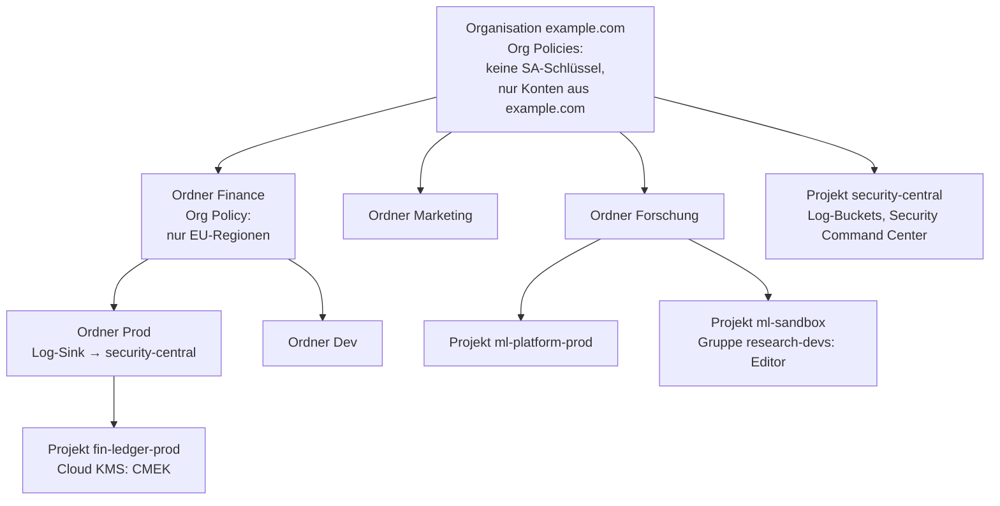
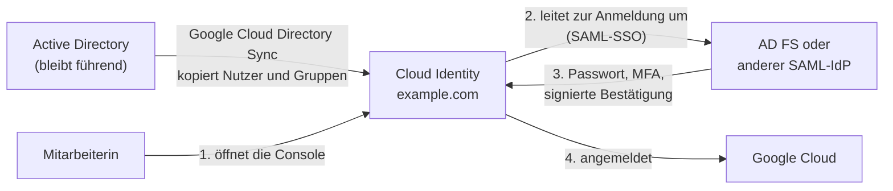
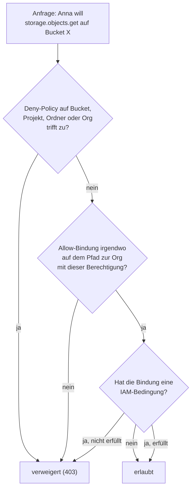
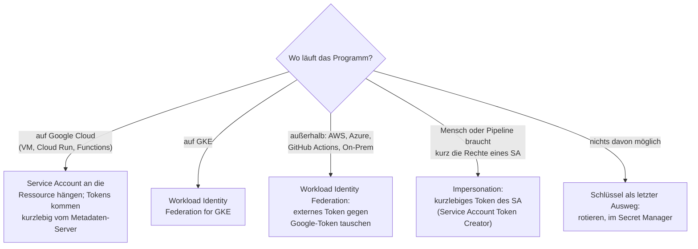
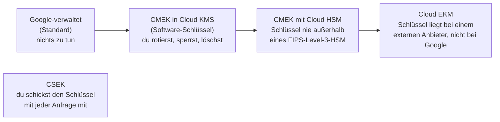
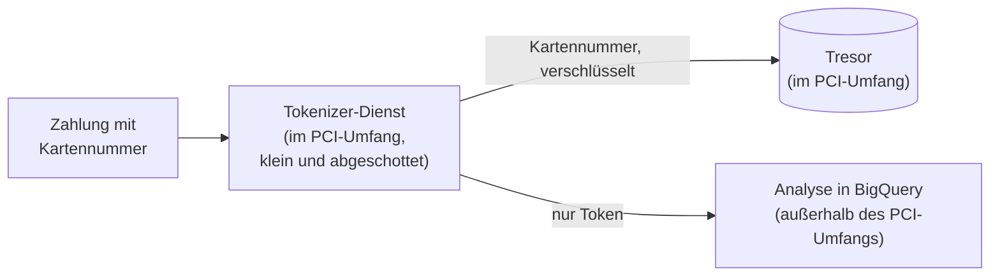
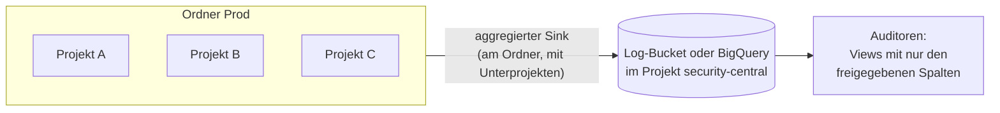

# IAM und Security

Lernnotiz zur Prüfung Professional Cloud Architect (PCA). Sicherheit steckt in fast jeder Prüfungsfrage, oft als
Nebenbedingung („mit minimalen Rechten“, „ohne Schlüssel“, „compliant“). Diese Notiz ordnet die Bausteine entlang von
fünf Fragen: Wer bist du? Wo liegt was? Was darfst du? Wie sind die Daten geschützt? Wie weist man das nach?

*Stand 2026-11-15. Audit-Log-Typen, Cloud HSM und die Standard-Richtlinien neuer Organisationen am selben Tag an der
Google-Cloud-Doku geprüft (siehe [Quellen](#15-quellen)). Netzwerksicherheit (Firewall, VPC Service Controls, Cloud
Armor) steht in [networking.md](networking.md), GKE-Sicherheit in [gke.md](gke.md), Tokens und Authentifizierung von
Agents in [authentification.md](authentification.md).*

---

## Inhalt

- [0. Das Bild zuerst: ein Unternehmen mit drei Abteilungen](#0-das-bild-zuerst-ein-unternehmen-mit-drei-abteilungen)
- [1. Zwei Fragen: Wer bist du, und was darfst du?](#1-zwei-fragen-wer-bist-du-und-was-darfst-du)
- [2. Identitäten: Menschen und Gruppen](#2-identitäten-menschen-und-gruppen)
- [3. Ressourcenhierarchie und Vererbung](#3-ressourcenhierarchie-und-vererbung)
- [4. Rollen, Bindungen und Bedingungen](#4-rollen-bindungen-und-bedingungen)
- [5. Service Accounts: Identitäten für Programme](#5-service-accounts-identitäten-für-programme)
- [6. Organization Policies: was überhaupt erlaubt ist](#6-organization-policies-was-überhaupt-erlaubt-ist)
- [7. Verschlüsselung und Schlüssel](#7-verschlüsselung-und-schlüssel)
- [8. Secrets](#8-secrets)
- [9. Sensible Daten schützen](#9-sensible-daten-schützen)
- [10. Erkennen und nachweisen: Audit Logs und Security Command Center](#10-erkennen-und-nachweisen-audit-logs-und-security-command-center)
- [11. Compliance und Souveränität](#11-compliance-und-souveränität)
- [12. Kosten](#12-kosten)
- [13. Prüfungssignale: Spickzettel](#13-prüfungssignale-spickzettel)
- [14. Alte und neue Namen](#14-alte-und-neue-namen)
- [15. Quellen](#15-quellen)

---

## 0. Das Bild zuerst: ein Unternehmen mit drei Abteilungen

Ein Unternehmen zieht nach Google Cloud. Es hat drei Abteilungen: **Finance**, **Marketing** und **Forschung** (mit
einer ML-Plattform). Die Anforderungen:

1. Mitarbeitende melden sich weiter mit ihrem **Active-Directory-Konto** an.
2. Jede Abteilung verwaltet ihre Projekte selbst, die **Sicherheitsabteilung** setzt aber zentrale Regeln.
3. Finance-Daten dürfen **die EU nicht verlassen** und werden mit **eigenen Schlüsseln** verschlüsselt.
4. Keine VM in Produktion bekommt eine **externe IP**, und niemand erzeugt **Service-Account-Schlüssel**.
5. Alle Logs aus Produktion landen **zentral** bei der Sicherheitsabteilung.



| Anforderung | Baustein | Abschnitt |
|---|---|---|
| Anmeldung mit Active Directory | Cloud Identity mit Google Cloud Directory Sync und SAML-SSO | 2 |
| Abteilungen getrennt, zentral steuerbar | Ordner pro Abteilung, Rollen an Gruppen auf Ordner-Ebene | 3, 4 |
| Daten nur in der EU, eigene Schlüssel | Org Policy `gcp.resourceLocations`, Cloud KMS mit CMEK | 6, 7 |
| keine externen IPs, keine SA-Schlüssel | Org Policies `compute.vmExternalIpAccess`, `iam.managed.disableServiceAccountKeyCreation` | 6 |
| Logs zentral | aggregierter Log-Sink am Prod-Ordner | 10 |

---

## 1. Zwei Fragen: Wer bist du, und was darfst du?

Jeder Zugriff in Google Cloud läuft durch zwei Prüfungen:

- **Authentifizierung:** *Wer bist du?* Ein Mensch meldet sich an, ein Programm weist sich mit einem Token aus.
- **Autorisierung:** *Was darfst du?* IAM prüft, ob diese Identität für diese Aktion an dieser Ressource eine Rolle
  hat.

Fehlt der Nachweis, kommt **401**; ist er gültig, aber die Rolle fehlt, kommt **403**. (Ausführlich, mit Tokens, in
[authentification.md](authentification.md).)

Eine dritte Ebene wird oft verwechselt: **Organization Policies** fragen nicht *wer*, sondern *was überhaupt*. IAM sagt
„Anna darf VMs anlegen“. Eine Organization Policy sagt „in dieser Organisation hat keine VM eine externe IP, egal wer
sie anlegt“. Beide gelten zusammen:

| | IAM | Organization Policy |
|---|---|---|
| Frage | Wer darf welche Aktion ausführen? | Welche Konfigurationen sind überhaupt erlaubt? |
| bezieht sich auf | Identitäten (Nutzer, Gruppen, Service Accounts) | Ressourcen und ihre Einstellungen |
| Beispiel | Gruppe `ml-devs` darf in `ml-sandbox` VMs anlegen | keine VM mit externer IP, nur Regionen in der EU |

---

## 2. Identitäten: Menschen und Gruppen

Google Cloud verwaltet selbst keine Passwörter für Mitarbeitende. Menschen kommen aus **Cloud Identity** oder
**Google Workspace** (dasselbe Verzeichnis; Workspace bringt zusätzlich Gmail, Docs usw. mit). Zu einer Domain wie
`example.com` gehört genau eine **Organisation** in Google Cloud.

**Gruppen statt Einzelpersonen.** Rollen gibt man Google-Gruppen (`finance-admins@example.com`), nicht einzelnen
Konten. Wer die Abteilung wechselt, wechselt die Gruppe; an den IAM-Richtlinien ändert sich nichts.

### Vorhandenes Active Directory weiter nutzen

Die meisten Unternehmen haben schon ein Verzeichnis. Die Standardantwort verbindet zwei Mechanismen:



- **Google Cloud Directory Sync (GCDS)** gleicht Nutzer und Gruppen aus AD einseitig nach Cloud Identity ab.
  Passwörter werden nicht kopiert.
- **SAML 2.0 SSO** schickt die eigentliche Anmeldung an den bestehenden Identity Provider (z. B. AD FS, Entra ID,
  Okta). Passwortregeln und MFA bleiben dort.
- **Workforce Identity Federation** ist die Variante ganz ohne Synchronisation: Nutzer aus dem externen IdP erhalten
  direkt Zugriff auf Google Cloud, ohne Konto in Cloud Identity.

**Starke Anmeldung:** 2-Schritt-Verifizierung erzwingen, für Admins Sicherheitsschlüssel. Super-Admin-Konten nur für
die Notfall-Verwaltung von Cloud Identity, nicht für die tägliche Arbeit in Google Cloud.

---

## 3. Ressourcenhierarchie und Vererbung

```
Organisation (example.com)
└── Ordner (z. B. Abteilung, darunter Umgebung)
    └── Projekt (Abrechnungs- und Isolationseinheit)
        └── Ressourcen (VMs, Buckets, Datasets, …)
```

**Projekte** sind die Grundeinheit: Jede Ressource gehört zu genau einem Projekt, APIs werden pro Projekt
eingeschaltet, Kosten pro Projekt abgerechnet. **Ordner** gruppieren Projekte, z. B. nach Abteilung und darunter nach
Umgebung (prod, dev). Die **Organisation** ist die Wurzel.

**Vererbung: Rechte werden nach unten addiert.** Die wirksame IAM-Richtlinie einer Ressource ist die **Vereinigung**
aus ihrer eigenen Richtlinie und allen Richtlinien darüber. Daraus folgt eine wichtige Konsequenz:

> Ein Recht, das weiter oben vergeben wurde, kann man weiter unten **nicht wegnehmen** (außer mit einer Deny-Policy,
> Abschnitt 4). Rollen deshalb so tief wie möglich vergeben.

**Beispiel:** Die Gruppe `dev-team` hat *Project Owner* auf der Organisation und damit auf allen Projekten, auch in
Finance. Soll sie nur an Shopping-Projekten arbeiten, reicht es nicht, ihr in Finance etwas zu verweigern. Richtig
ist: die Rolle auf der Organisation **entfernen** und auf dem Ordner Shopping **neu vergeben**.

**Typische Muster:**

- **Ein Ordner pro Abteilung**, Rollen an die Gruppe der Abteilung auf dem Ordner: Jede Abteilung verwaltet sich
  selbst, alles bleibt in einer Organisation und damit zentral steuerbar.
- **Projekte, die außerhalb der Organisation entstanden sind** (z. B. von Entwicklern mit privatem Konto angelegt),
  in die Organisation umziehen. Entwickler bekommen *Project Creator* nur auf einem Ordner `Development`, damit neue
  Projekte gleich an der richtigen Stelle entstehen.
- **Sandbox-Projekte** für Experimente automatisch anlegen: nur die nötigen APIs eingeschaltet, niedrigere Quotas,
  Budget mit Alarm.

Labels (`team: finance`) helfen bei Kostenzuordnung und Filtern, regeln aber keinen Zugriff.

---

## 4. Rollen, Bindungen und Bedingungen

Eine **Rolle** ist eine Sammlung von Berechtigungen (z. B. `storage.objects.get`). Eine **Bindung** verbindet in der
IAM-Richtlinie einer Ressource eine Rolle mit Principals (Nutzer, Gruppe, Service Account, Domain).

| Rollentyp | Beispiele | Einsatz |
|---|---|---|
| **Basic** (früher primitive) | Owner, Editor, Viewer | zu breit für Produktion; Editor darf fast alles ändern |
| **Predefined** | `roles/storage.objectViewer`, `roles/bigquery.dataViewer` | Standardwahl: von Google gepflegt, auf einen Dienst zugeschnitten |
| **Custom** | eigene Auswahl an Berechtigungen | wenn keine vordefinierte Rolle schmal genug ist; muss man selbst pflegen |

**Least Privilege in der Praxis:** vordefinierte Rollen, an Gruppen, auf der tiefsten passenden Ebene. Für den
Überblick der Sicherheitsabteilung über alle Projekte reichen Lese-Rollen auf Organisationsebene (z. B. *Organization
Viewer* plus *Viewer*, oder *Security Reviewer* für die IAM-Richtlinien).

### Wie IAM entscheidet



- **IAM Conditions** knüpfen eine Bindung an Bedingungen: Zeit (Zugriff für externe Auditoren automatisch ab einem
  Datum ungültig), Ressourcenname oder -typ, Tags.
- **Deny Policies** werden *vor* den Allow-Bindungen geprüft und schlagen sie. Damit kann man Rechte sperren, die
  weiter oben vergeben wurden, z. B. „niemand außer der Gruppe `break-glass` darf Projekte löschen“.
- **Privileged Access Manager (PAM)** vergibt erhöhte Rechte nur auf Antrag und befristet (Just-in-Time), mit
  Genehmigung und Audit-Spur. Statt dauerhaft Owner zu sein, beantragt man die Rolle für zwei Stunden.

### Werkzeuge zum Aufräumen (Policy Intelligence)

- **IAM Recommender** schlägt vor, Rollen zu verkleinern, deren Berechtigungen seit Wochen ungenutzt sind. (Andere
  Recommender finden z. B. ungenutzte VMs.)
- **Policy Analyzer** beantwortet „Wer hat Zugriff auf diese Ressource?“ und „Worauf hat diese Gruppe Zugriff?“.
- **Policy Troubleshooter** erklärt, warum eine bestimmte Anfrage erlaubt oder verweigert wurde.

---

## 5. Service Accounts: Identitäten für Programme

Ein **Service Account** ist die Identität eines Programms: einer VM, eines Cloud-Run-Dienstes, einer Pipeline. Wie
bei Menschen bekommt er Rollen, z. B. *Pub/Sub Publisher* für eine Anwendung, die Nachrichten veröffentlicht.

**Das Problem mit Schlüsseln.** Ein Service-Account-Schlüssel ist eine JSON-Datei mit einem privaten Schlüssel, der
lange gilt. Er landet in Repositories, Images und Laptops und ist damit das häufigste Einfallstor. Neue Organisationen
verbieten das Anlegen von Schlüsseln deshalb inzwischen standardmäßig (Abschnitt 6).

Es gibt bessere Wege, je nachdem, wo das Programm läuft:



- **Angehängter Service Account:** Die Anwendung auf der VM fragt den Metadaten-Server und bekommt ein Token, das
  nach etwa einer Stunde abläuft. Nichts muss gespeichert werden. Standardantwort auf „wie authentifiziert sich die
  Anwendung auf der VM gegenüber Pub/Sub“.
- **Workload Identity Federation:** Ein Programm, das schon eine Identität bei einem anderen Anbieter hat (AWS-Rolle,
  Azure Managed Identity, GitHub-OIDC-Token, Active Directory), tauscht dessen Token beim Security Token Service
  gegen ein Google-Token. Kein Schlüssel verlässt Google. Für GKE siehe [gke.md](gke.md#6-sicherheit-und-supply-chain).
- **Impersonation:** Eine CI/CD-Pipeline (z. B. Terraform in Cloud Build) oder ein Admin nimmt für eine Aktion die
  Identität eines Service Accounts mit genau den nötigen Rechten an. Dazu braucht der Aufrufer die Rolle *Service
  Account Token Creator* auf diesem Service Account.

**Weitere Regeln:**

- Ein Service Account **pro Anwendung** mit genau den nötigen Rollen. Die **Standard-Service-Accounts** von Compute
  Engine und App Engine hatten früher automatisch *Editor*; neue Organisationen verhindern das per Org Policy.
- **Service Agents** sind von Google verwaltete Service Accounts, mit denen ein Dienst in deinem Projekt arbeitet
  (z. B. Cloud Storage beim Zugriff auf einen KMS-Schlüssel). Ihnen gibt man Rollen, man meldet sich aber nie mit
  ihnen an.

> **Anknüpfung an ML-Praxis.** Ein Notebook, das mit einem heruntergeladenen Schlüssel auf Trainingsdaten zugreift, ist
> genau das Muster, das man vermeiden will. Besser: lokal mit den eigenen Nutzerdaten (Application Default
> Credentials), in der Cloud mit dem angehängten Service Account des Vertex-AI-Jobs oder der Workbench-Instanz.

---

## 6. Organization Policies: was überhaupt erlaubt ist

Eine **Organization Policy** setzt einen **Constraint** an Organisation, Ordner oder Projekt. Er vererbt sich nach
unten; ein Ordner oder Projekt kann eine Ausnahme bekommen, wenn die Richtlinie das zulässt. Neue Constraints lassen
sich erst im **Dry-Run** testen.

| Constraint | Wirkung | typischer Anlass |
|---|---|---|
| `iam.allowedPolicyMemberDomains` | nur Konten aus erlaubten Domains in IAM-Richtlinien (*Domain Restricted Sharing*) | niemand teilt Projekte mit privaten Gmail-Konten |
| `iam.managed.disableServiceAccountKeyCreation` | keine neuen Service-Account-Schlüssel | Schlüssel als Einfallstor schließen |
| `iam.automaticIamGrantsForDefaultServiceAccounts` | Standard-Service-Accounts bekommen nicht mehr automatisch *Editor* | Least Privilege |
| `compute.vmExternalIpAccess` | nur aufgelistete VMs dürfen externe IPs haben | Backend-Server nie öffentlich |
| `gcp.resourceLocations` | Ressourcen nur in erlaubten Regionen | Datenresidenz, z. B. nur EU |
| `storage.uniformBucketLevelAccess` | Buckets nur mit IAM, ohne Objekt-ACLs | einheitliche, prüfbare Rechte |
| `compute.requireOsLogin` | SSH-Zugang über IAM statt über SSH-Schlüssel in Metadaten | Zugang zentral steuern |

**Secure by default:** Für Organisationen, die **seit dem 3. Mai 2024** angelegt wurden, setzt Google eine
Sicherheits-Grundlinie automatisch durch, darunter Domain Restricted Sharing, das Verbot von
Service-Account-Schlüsseln (Erstellen und Hochladen), kein automatisches *Editor* für Standard-Service-Accounts und
Uniform Bucket-Level Access. Ältere Organisationen sollten diese Constraints selbst setzen.

Netzwerkregeln für die ganze Organisation (hierarchische Firewall-Richtlinien) stehen in
[networking.md](networking.md#3-firewall-wer-darf-mit-wem-sprechen).

---

## 7. Verschlüsselung und Schlüssel

**Grundsatz:** Google Cloud verschlüsselt **alle gespeicherten Daten immer**, ohne dass man etwas tun muss, mit von
Google verwalteten Schlüsseln. Auch Verkehr zwischen Google-Rechenzentren ist verschlüsselt. Die Frage ist also nie
*ob*, sondern **wer den Schlüssel kontrolliert**.



*Von links nach rechts: mehr Kontrolle, mehr Aufwand, höhere Kosten. CSEK ist ein Sonderweg nur für Cloud Storage und
Compute Engine.*

| Variante | Wer hält den Schlüssel | Wann |
|---|---|---|
| **Google-managed** | Google | Standard, wenn keine Vorgabe besteht |
| **CMEK** (customer-managed, Cloud KMS) | du, in Cloud KMS | Vorgabe „eigene Schlüssel“, Rotation nach eigenem Plan, Daten durch Sperren des Schlüssels unlesbar machen |
| **CMEK mit HSM-Schutzstufe** (Cloud HSM) | du, in Hardware-Sicherheitsmodulen nach FIPS 140-2 Level 3 | Compliance verlangt Hardware-Schutz der Schlüssel |
| **Cloud EKM** | ein externer Key Manager außerhalb von Google | Schlüssel dürfen Google nie erreichen (Souveränität) |
| **CSEK** (customer-supplied) | du, außerhalb von Google; nur für Cloud Storage und Compute Engine | eigener Schlüssel bei jedem Zugriff; geht er verloren, sind die Daten verloren |

**So funktioniert CMEK:** In Cloud KMS legt man einen **Key Ring** (in einer Region) und darin einen **Schlüssel** an.
Jede **Rotation** erzeugt eine neue Schlüsselversion; neue Daten nutzen die neue Version, alte bleiben lesbar. Der
Dienst (z. B. Cloud Storage) greift über seinen **Service Agent** zu, der dafür die Rolle *Cloud KMS CryptoKey
Encrypter/Decrypter* auf genau diesem Schlüssel braucht. Wird eine Schlüsselversion deaktiviert oder zerstört, sind
die damit verschlüsselten Daten nicht mehr lesbar (*Crypto-Shredding*).

**Prüfungsmuster:** „Der Schlüssel des Buckets muss aus regulatorischen Gründen rotiert werden können“ heißt: Schlüssel
in Cloud KMS anlegen und am Bucket als Standard-Schlüssel eintragen (CMEK). „Schlüssel müssen in einem HSM erzeugt und
gespeichert werden“ heißt: Cloud-KMS-Schlüssel mit Schutzstufe HSM.

**Daten während der Verarbeitung.** Verschlüsselung at rest und in transit schützt nicht den Arbeitsspeicher.
**Confidential Computing** (Confidential VMs, Confidential GKE Nodes) verschlüsselt auch den Speicher einer laufenden
Maschine, z. B. beim Training auf sensiblen Daten.

---

## 8. Secrets

Passwörter, API-Schlüssel und Zertifikate gehören in den **Secret Manager**, nicht in Code, Container-Images oder
Umgebungsvariablen in Konfigurationsdateien.

- Jedes Secret hat **Versionen**; eine neue Version ersetzt die alte, ohne dass sich die Anwendung ändert.
- Zugriff regelt IAM **pro Secret** (*Secret Manager Secret Accessor*), z. B. nur für den Service Account der
  Anwendung, die die Datenbank braucht.
- Jeder Zugriff landet im Audit Log; Rotation lässt sich mit Benachrichtigungen automatisieren.

Bei 30 Microservices mit je eigenen Datenbank-Zugangsdaten ist das die Standardantwort. Noch besser ist, wo möglich,
gar kein Passwort zu brauchen, z. B. mit IAM-Authentifizierung bei Cloud SQL.

---

## 9. Sensible Daten schützen

### Sensitive Data Protection (früher Cloud DLP)

Der Dienst **findet** sensible Daten (Kreditkartennummern, Namen, Ausweisnummern; dafür gibt es vordefinierte *infoTypes*)
in Cloud Storage, BigQuery und Datenströmen und **entschärft** sie:

| Methode | Aus `4111 1111 1111 1111` wird | umkehrbar |
|---|---|---|
| Maskieren | `**** **** **** 1111` | nein |
| Entfernen | (leer) | nein |
| Tokenisieren (Pseudonymisieren) | `TOKEN_8f3a…`, mit Schlüssel umkehrbar | ja, mit Schlüssel |
| formaterhaltende Verschlüsselung | `5320 9184 2207 6631` (sieht aus wie eine Kartennummer) | ja, mit Schlüssel |

Prüfungsmuster: Chat-Protokolle in Bigtable sollen von persönlichen Daten bereinigt werden; Antwort: mit Sensitive
Data Protection de-identifizieren.

### PCI-Umfang klein halten

Jedes System, das Kartennummern sieht, fällt unter PCI DSS. Wer analysieren will, ohne das Analysesystem in den
PCI-Umfang zu ziehen, **tokenisiert** am Eingang:



### Zugriff auf Daten fein steuern

- **BigQuery:** pro Zielgruppe ein Dataset mit **autorisierten Views**, die nur freigegebene Spalten zeigen (z. B.
  ohne personenbezogene Daten); **Policy Tags** für Spalten-Sicherheit, **Row-Level Security** für Zeilen.
- **Cloud Storage:** **Uniform Bucket-Level Access** (nur IAM, keine Objekt-ACLs), vordefinierte Storage-Rollen an
  Gruppen; **Public Access Prevention** gegen versehentlich öffentliche Buckets.
- **Signed URLs** geben jemandem ohne Google-Konto befristet Zugriff auf genau ein Objekt, z. B. Upload für 24 Stunden.
  Für Uploads aus dem Browser zusätzlich **CORS** am Bucket erlauben.

---

## 10. Erkennen und nachweisen: Audit Logs und Security Command Center

### Cloud Audit Logs

| Typ | Was | Standard |
|---|---|---|
| **Admin Activity** | Konfigurationsänderungen (VM anlegen, IAM ändern) | immer an, nicht abschaltbar |
| **System Event** | Aktionen von Google-Systemen (z. B. Live-Migration) | immer an, nicht abschaltbar |
| **Policy Denied** | Zugriffe, die eine Sicherheitsrichtlinie (z. B. VPC Service Controls) blockiert hat | an, nicht abschaltbar; Speicher kostet |
| **Data Access** | Lesen von Konfiguration und Daten (wer hat welches Objekt gelesen, welche Abfrage ausgeführt) | **aus**, außer bei BigQuery; erzeugt viel Volumen und kostet |

Prüfungsmuster: „Wie viele Abfragen hat jeder Nutzer in BigQuery ausgeführt?“ steht in den Data Access Logs von
BigQuery (die dort standardmäßig an sind). Für Auswertungen exportiert man sie per Sink nach BigQuery.

### Logs zentral sammeln



- Ein **aggregierter Sink** am Ordner oder an der Organisation erfasst die Logs aller Projekte darunter, auch künftiger.
  Ziel: ein Log-Bucket, ein BigQuery-Dataset oder Pub/Sub in einem zentralen Projekt.
- **Gesperrte Aufbewahrung** (Bucket Lock bei Cloud Storage, gesperrte Log-Buckets) verhindert, dass Logs vor Ablauf
  der Frist gelöscht werden.
- Für jährliche Prüfungen: Export nach BigQuery und Auditoren nur über Views berechtigen.

### Weitere Werkzeuge

- **Security Command Center:** zentrale Übersicht über Fehlkonfigurationen (z. B. öffentliche Buckets, offene
  Firewall-Ports), Schwachstellen und erkannte Bedrohungen in der ganzen Organisation.
- **Access Transparency** protokolliert, wenn Google-Mitarbeitende auf deine Inhalte zugreifen (z. B. bei einem
  Support-Fall); **Access Approval** verlangt vorher deine Zustimmung.
- **VPC Service Controls** gegen Datenabfluss über Google-APIs: siehe
  [networking.md](networking.md#5-private-wege-zu-google-und-zu-diensten).

---

## 11. Compliance und Souveränität

**Geteilte Verantwortung.** Google sichert die Infrastruktur und lässt sie zertifizieren (ISO/IEC 27001, SOC 2, PCI DSS
usw.). Der Kunde ist dafür verantwortlich, *seine* Anwendung und Konfiguration konform zu bauen. Eine Frage wie „Ist
GKE PCI-konform?“ beantwortet sich deshalb so: Google Cloud liefert die Bausteine für eine PCI-konforme Umgebung; die
Konformität selbst baut der Kunde.

| Vorgabe | Was man tut |
|---|---|
| Nachweise zu ISO 27001, SOC usw. | Berichte im **Compliance Reports Manager** abrufen |
| HIPAA (Gesundheitsdaten, USA) | nur Dienste aus der Liste HIPAA-fähiger Produkte nutzen und ein **Business Associate Agreement (BAA)** mit Google abschließen |
| PCI DSS | Umfang klein halten (Tokenisierung, eigenes Projekt oder VPC für den Kartenbereich), Bausteine aus diesem Dokument |
| DSGVO | Datenschutz in der Architektur entwerfen: Datenminimierung, Zugriffskontrolle, Verschlüsselung, Datenresidenz, Löschkonzepte |
| Daten nur in bestimmten Regionen | Org Policy `gcp.resourceLocations` |
| Souveränität, regulierte Umgebungen | **Assured Workloads** setzt Kontrollen eines Regelwerks (z. B. EU-Datengrenze, Zugriffe nur durch Personal in der Region) automatisch durch; dazu CMEK oder EKM |

---

## 12. Kosten

Die meisten Bausteine dieser Notiz kosten wenig oder nichts (IAM, Organization Policies, Admin Activity Logs). Kosten
entstehen vor allem hier:

- **Cloud KMS:** pro aktiver Schlüsselversion und Monat und pro kryptografischer Operation. HSM- und EKM-Schlüssel
  kosten mehr als Software-Schlüssel. Häufige Rotation erzeugt mehr aktive Versionen.
- **Data Access Logs:** können sehr viel Volumen erzeugen; nur dort einschalten, wo man sie braucht, und mit
  Ausschlussfiltern arbeiten.
- **Security Command Center:** die Basisstufe ist kostenlos, erweiterte Stufen (Bedrohungserkennung, Posture) werden
  pro Ressource oder Volumen abgerechnet.
- **Secret Manager:** pro aktiver Secret-Version und pro Zugriff; Anwendungen sollten Secrets beim Start laden und
  cachen, nicht bei jeder Anfrage.
- **Sensitive Data Protection:** nach gescannter Datenmenge; vor einem großen Scan mit Stichproben arbeiten.

---

## 13. Prüfungssignale: Spickzettel

| Wenn die Frage sagt … | … ist die Antwort meist |
|---|---|
| bestehendes Active Directory für die Anmeldung behalten | Google Cloud Directory Sync plus SAML-SSO zum bestehenden IdP |
| Abteilungen unabhängig, aber zentral steuern | eine Organisation mit einem Ordner pro Abteilung |
| wie wirken Richtlinien auf mehreren Ebenen | Vereinigung: eigene Richtlinie plus alle geerbten |
| Gruppe soll nur noch an einem Bereich arbeiten | Rolle oben entfernen, auf dem passenden Ordner neu vergeben |
| Abteilungen mit gleichen Rechten pro Person | Google-Gruppe pro Abteilung, Rollen an die Gruppe auf dem Ordner |
| Sicherheitsteam soll alles sehen, nichts ändern | Organization Viewer plus Viewer (oder Security Reviewer) |
| Projekte außerhalb der Organisation | in die Organisation umziehen, Project Creator nur auf Dev-Ordner |
| nur Konten der eigenen Domain in IAM | Org Policy Domain Restricted Sharing |
| externe IPs nur für bestimmte VMs | Org Policy `compute.vmExternalIpAccess` mit Liste |
| Ressourcen nur in bestimmten Regionen | Org Policy `gcp.resourceLocations` |
| externe Prüfer brauchen befristeten Zugriff | IAM-Bindung an eine Gruppe mit zeitbasierter IAM Condition |
| Anwendung auf der VM soll Pub/Sub nutzen | Service Account der VM mit passender Pub/Sub-Rolle |
| Terraform in CI/CD ohne Schlüsseldatei | Service-Account-Impersonation, plan im Pull Request, apply nach Freigabe |
| Workloads außerhalb von Google Cloud ohne Schlüssel | Workload Identity Federation (z. B. mit Active Directory) |
| Zugangsdaten für viele Microservices | Secret Manager |
| Bucket-Schlüssel muss rotierbar sein | CMEK: Schlüssel in Cloud KMS, am Bucket eintragen |
| Schlüssel muss in einem HSM liegen | Cloud-KMS-Schlüssel mit Schutzstufe HSM |
| eigene Schlüssel beim Upload mitgeben | CSEK (nur Cloud Storage und Compute Engine) |
| personenbezogene Daten aus Texten entfernen | Sensitive Data Protection (DLP) zum De-identifizieren |
| Kartendaten analysieren, PCI-Umfang klein | Tokenizer-Dienst, nur Tokens speichern |
| Data Scientists ohne Zugriff auf PII | eigenes Dataset mit autorisierten Views ohne PII-Spalten |
| sensible Berichte in Cloud Storage | Uniform Bucket-Level Access, vordefinierte Storage-Rollen an Gruppen |
| Nutzer ohne Google-Konto sollen hoch- oder herunterladen | Signed URL mit Ablaufzeit (plus CORS für den Browser) |
| Logs aller Prod-Projekte zentral | aggregierter Sink am Prod-Ordner in ein zentrales Projekt |
| wer hat wie viele BigQuery-Abfragen ausgeführt | Data Access Logs (bei BigQuery standardmäßig an), per Sink nach BigQuery |
| nicht abstreitbarer Audit-Trail | Cloud Audit Logs (Admin Activity immer an), Aufbewahrung sperren |
| ISO-27001-Nachweise | Compliance Reports Manager |
| HIPAA-Audit | nur konforme Produkte nutzen, BAA abschließen |
| ungenutzte Rechte oder Ressourcen finden | Recommender (IAM Recommender bzw. `gcloud recommender`) |

---

## 14. Alte und neue Namen

| In älteren Fragen | Heute |
|---|---|
| primitive roles | basic roles (Owner, Editor, Viewer) |
| G Suite | Google Workspace |
| Cloud DLP, Data Loss Prevention API | Sensitive Data Protection (DLP API heißt weiter so) |
| Stackdriver Logging | Cloud Logging |
| `iam.disableServiceAccountKeyCreation` | zusätzlich verwalteter Constraint `iam.managed.disableServiceAccountKeyCreation` |
| restrict identities by domain | Domain Restricted Sharing (`iam.allowedPolicyMemberDomains`) |
| Workload Identity (GKE) | Workload Identity Federation for GKE |
| Cloud Functions | Cloud Run Functions |

---

## 15. Quellen

- [Resource hierarchy](https://docs.cloud.google.com/resource-manager/docs/cloud-platform-resource-hierarchy) ·
  [IAM overview](https://docs.cloud.google.com/iam/docs/overview) ·
  [Roles and permissions](https://docs.cloud.google.com/iam/docs/roles-overview)
- [IAM Conditions](https://docs.cloud.google.com/iam/docs/conditions-overview) ·
  [Deny policies](https://docs.cloud.google.com/iam/docs/deny-overview) ·
  [Privileged Access Manager](https://docs.cloud.google.com/iam/docs/pam-overview)
- [Service accounts](https://docs.cloud.google.com/iam/docs/service-account-overview) ·
  [Best practices for service accounts](https://docs.cloud.google.com/iam/docs/best-practices-service-accounts) ·
  [Workload Identity Federation](https://docs.cloud.google.com/iam/docs/workload-identity-federation) ·
  [Workforce Identity Federation](https://docs.cloud.google.com/iam/docs/workforce-identity-federation)
- [Federating with Active Directory](https://docs.cloud.google.com/architecture/identity/federating-gcp-with-active-directory-introduction)
- [Organization policy constraints](https://docs.cloud.google.com/resource-manager/docs/organization-policy/org-policy-constraints) ·
  [Secure-by-default organizations](https://docs.cloud.google.com/resource-manager/docs/secure-by-default-organizations)
  (geprüft 2026-11-15: Grundlinie für Organisationen ab 2024-05-03)
- [Default encryption at rest](https://docs.cloud.google.com/docs/security/encryption/default-encryption) ·
  [CMEK](https://docs.cloud.google.com/kms/docs/cmek) ·
  [Cloud HSM](https://docs.cloud.google.com/kms/docs/hsm) (geprüft 2026-11-15: FIPS 140-2 Level 3) ·
  [Cloud EKM](https://docs.cloud.google.com/kms/docs/ekm) ·
  [CSEK](https://docs.cloud.google.com/storage/docs/encryption/customer-supplied-keys)
- [Secret Manager](https://docs.cloud.google.com/secret-manager/docs/overview) ·
  [Sensitive Data Protection](https://docs.cloud.google.com/sensitive-data-protection/docs/sensitive-data-protection-overview)
- [Cloud Audit Logs](https://docs.cloud.google.com/logging/docs/audit)
  (geprüft 2026-11-15: Typen und Standards) ·
  [Aggregated sinks](https://docs.cloud.google.com/logging/docs/export/aggregated_sinks) ·
  [Security Command Center](https://docs.cloud.google.com/security-command-center/docs/security-command-center-overview) ·
  [Access Transparency](https://docs.cloud.google.com/assured-workloads/access-transparency/docs/overview)
- [Compliance Reports Manager](https://cloud.google.com/security/compliance/compliance-reports-manager) ·
  [Assured Workloads](https://docs.cloud.google.com/assured-workloads/docs/overview)
