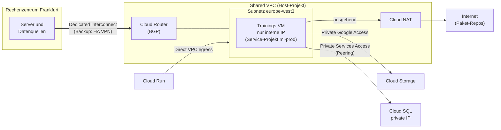
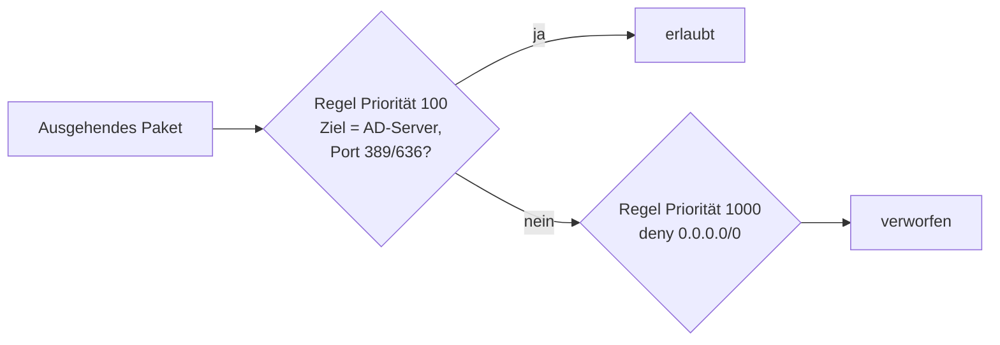
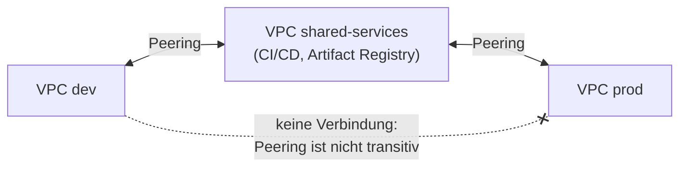
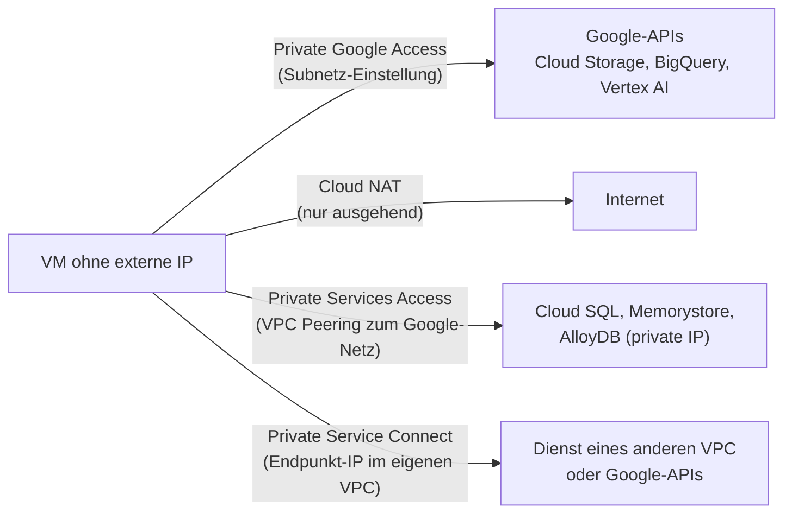
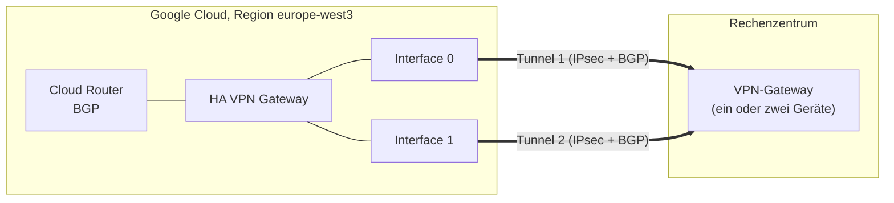
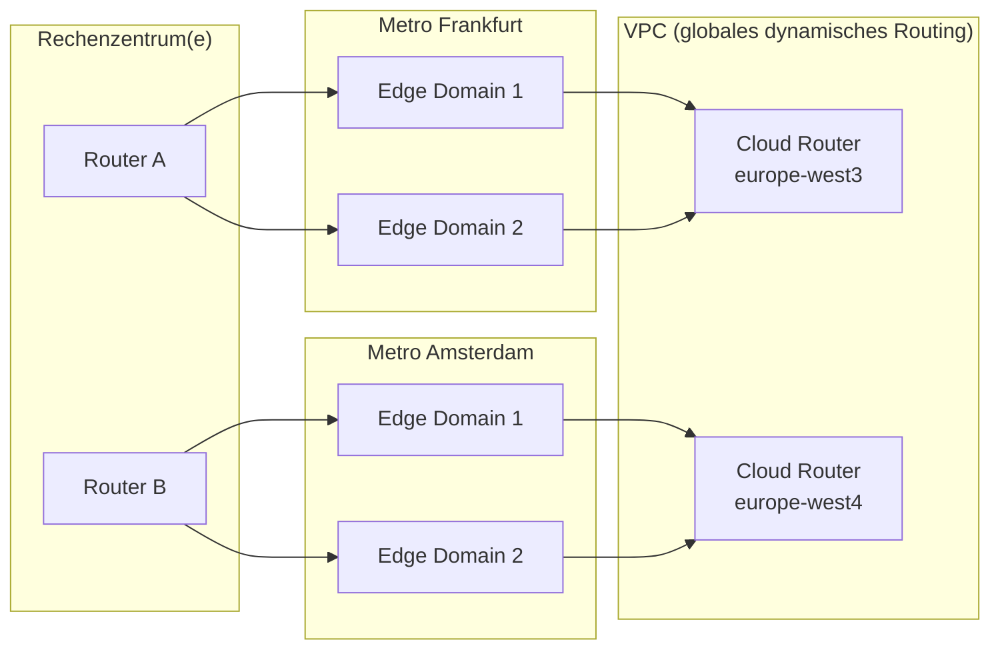
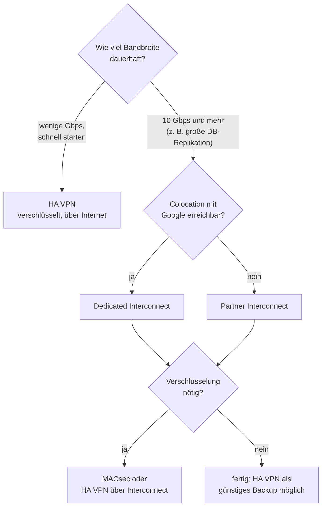

# VPC: Netzwerke und private Verbindungen

Lernnotiz zur Prüfung Professional Cloud Architect (PCA). Netzwerk ist dort zusammen mit GKE und Storage eines der
größten Themen. Diese Notiz behandelt das VPC-Netz selbst, Firewall-Regeln, das Verbinden mehrerer Netze, private
Wege zu Google-Diensten und hybride Verbindungen ins eigene Rechenzentrum. Load Balancing bekommt eine eigene Notiz.

*Stand 2026-11-15. Zahlen zu VPN, Interconnect und den privaten Zugängen am selben Tag an der Google-Cloud-Doku
geprüft (siehe [Quellen](#9-quellen)).*

---

## Inhalt

- [0. Das Bild zuerst: eine ML-Plattform mit Rechenzentrum](#0-das-bild-zuerst-eine-ml-plattform-mit-rechenzentrum)
- [1. Das Grundmodell: globales Netz, regionale Subnetze](#1-das-grundmodell-globales-netz-regionale-subnetze)
- [2. Firewall: wer darf mit wem sprechen](#2-firewall-wer-darf-mit-wem-sprechen)
- [3. Mehrere Netze verbinden: Shared VPC, Peering und mehr](#3-mehrere-netze-verbinden-shared-vpc-peering-und-mehr)
- [4. Private Wege zu Google und zu Diensten](#4-private-wege-zu-google-und-zu-diensten)
- [5. Hybride Verbindungen: VPN und Interconnect](#5-hybride-verbindungen-vpn-und-interconnect)
- [6. Leitplanken für die ganze Organisation](#6-leitplanken-für-die-ganze-organisation)
- [7. Prüfungssignale: Spickzettel](#7-prüfungssignale-spickzettel)
- [8. Alte und neue Namen](#8-alte-und-neue-namen)
- [9. Quellen](#9-quellen)

---

## 0. Das Bild zuerst: eine ML-Plattform mit Rechenzentrum

Ein Unternehmen hat ein Rechenzentrum in Frankfurt und baut eine ML-Plattform auf Google Cloud. Die Anforderungen:

1. Ein **Netzwerk-Team** verwaltet das Netz zentral; die ML-Teams sollen VMs anlegen, aber keine Firewall-Regeln
   ändern.
2. Keine VM hat eine **externe IP-Adresse**. Trotzdem müssen Trainings-VMs Daten aus Cloud Storage lesen und Pakete
   aus dem Internet laden.
3. Eine **Cloud-SQL-Datenbank** und ein **Cloud-Run-Dienst** sollen nur über private IPs erreichbar sein.
4. Das **Rechenzentrum** schickt große Datenmengen nach Google Cloud, privat und hochverfügbar.

Jede Anforderung hat ihren eigenen Baustein. So hängen sie zusammen:

| Anforderung | Baustein | Abschnitt |
|---|---|---|
| zentrales Netz, Teams ohne Netzrechte | Shared VPC | 3 |
| Google-APIs ohne externe IP | Private Google Access | 4 |
| Internet nur ausgehend | Cloud NAT | 4 |
| Cloud SQL nur privat | Private Services Access | 4 |
| Cloud Run ins VPC | Direct VPC egress | 4 |
| Rechenzentrum anbinden | Interconnect, HA VPN, Cloud Router | 5 |

---

## 1. Das Grundmodell: globales Netz, regionale Subnetze

**Ein VPC-Netz ist global, ein Subnetz ist regional.** Ein einziges VPC kann Subnetze in Frankfurt und in Iowa haben,
und VMs in beiden sprechen über interne IPs miteinander, ohne VPN dazwischen. Der Verkehr läuft über Googles eigenes
Netz. Das unterscheidet Google Cloud von anderen Clouds, in denen ein Netz an eine Region gebunden ist.

**Subnetze und IP-Bereiche.** Jedes Subnetz hat einen primären IP-Bereich (für VMs) und optional sekundäre Bereiche
(z. B. für GKE-Pods und -Services, siehe [gke.md](gke.md)). Ein Subnetz kann man später vergrößern, aber nicht
verkleinern.

- **Auto-Mode-VPC:** legt in jeder Region automatisch ein Subnetz aus einem festen Bereich (`10.128.0.0/9`) an.
  Bequem zum Ausprobieren, aber die Bereiche überschneiden sich mit jedem anderen Auto-Mode-VPC.
- **Custom-Mode-VPC:** Du legst die Subnetze selbst an. Für Produktion die richtige Wahl, weil sich nur so
  Überschneidungen mit On-Prem und anderen Netzen vermeiden lassen.

**IP-Planung ist die Entscheidung, die man später am schwersten ändert.** Überschneiden sich Bereiche, funktionieren
Peering und VPN nicht oder nur mit Umwegen. Deshalb: vor der ersten VM einen Adressplan machen, der On-Prem, alle
VPCs und das Wachstum von GKE einschließt.

**Routen.** Jedes VPC hat automatisch eine Route pro Subnetz und eine Standardroute ins Internet (`0.0.0.0/0`).
Dazu kommen eigene statische Routen und **dynamische Routen**, die ein Cloud Router per BGP von On-Prem lernt. Der
**dynamische Routing-Modus** des VPC entscheidet, ob gelernte Routen nur in der Region des Cloud Routers gelten
(regional) oder im ganzen VPC (global).

**Netzwerk-Tiers.** *Premium Tier* (Standard) führt den Verkehr so weit wie möglich über Googles Backbone und ist
Voraussetzung für globale Load Balancer. *Standard Tier* übergibt den Verkehr früh ans öffentliche Internet: billiger,
aber nur regional und mit schwankender Latenz.

---

## 2. Firewall: wer darf mit wem sprechen

### Wie eine Regel aussieht

Eine VPC-Firewall-Regel hat sechs Teile: **Richtung** (ingress oder egress), **Priorität** (0 bis 65535, die
*kleinere* Zahl gewinnt, Standard ist 1000), **Aktion** (allow oder deny), **Ziel** (alle VMs, VMs mit einem
Network Tag oder VMs mit einem Service Account), **Quelle bzw. Ziel-Bereich** und **Protokoll mit Ports**.

Zwei Eigenschaften muss man kennen:

- **Zustandsbehaftet (stateful):** Ist eine Verbindung in eine Richtung erlaubt, sind die Antwortpakete automatisch
  erlaubt. Man braucht keine Regel für den Rückweg.
- **Implizite Regeln** mit der niedrigsten Priorität 65535: *ausgehend alles erlaubt*, *eingehend alles verboten*.
  Ein neues Custom-VPC lässt also nichts herein, bis man es erlaubt. (Das `default`-Netz bringt zusätzlich Regeln
  für internen Verkehr, SSH, RDP und ICMP mit.)

### Ein Beispiel mit Prioritäten

Aufgabe: Alle VMs dürfen nur zum Active-Directory-Server sprechen (Ports 389 und 636), sonst nirgends hin. Weil
ausgehend implizit alles erlaubt ist, braucht man zwei Regeln:

| Priorität | Richtung | Aktion | Ziel | Wohin |
|---|---|---|---|---|
| 100 | egress | allow | alle VMs | AD-Server, TCP 389 und 636 |
| 1000 | egress | deny | alle VMs | `0.0.0.0/0`, alles |

Ein Paket zum AD-Server trifft zuerst Regel 100 und ist erlaubt. Jedes andere Paket fällt durch bis Regel 1000 und
wird verworfen. Mit vertauschten Prioritäten würde die Deny-Regel alles blockieren, auch den AD-Verkehr.

### Network Tags oder Service Accounts als Ziel

In einer Drei-Schichten-Anwendung (Web, API, Datenbank) bekommt jede Schicht ihr Ziel, und die Regeln erlauben nur
Web → API → Datenbank. IP-Adressen eignen sich dafür nicht, weil VMs beim Skalieren neue IPs bekommen.

| Ziel | Vorteil | Nachteil |
|---|---|---|
| **Network Tag** (z. B. `web`) | einfach, sofort änderbar | jeder mit Rechten an der VM kann das Tag ändern und sich damit Zugang verschaffen |
| **Service Account** der VM | an IAM gebunden: Wechseln erfordert Rechte am Service Account und ein Stoppen der VM | etwas mehr Aufwand |

Für strenge Trennung sind Service Accounts die sicherere Wahl; Prüfungsfragen mit „Sicherheit“ im Vordergrund
zielen oft darauf. In einer einzelnen Regel kann man Tags und Service Accounts nicht als Ziel mischen.

### Regeln für die ganze Organisation

- **Hierarchische Firewall-Richtlinien** hängen an Organisation oder Ordner und werden *vor* den Regeln im VPC
  ausgewertet. Neben allow und deny gibt es `goto_next` (an die nächste Ebene weiterreichen). So setzt ein
  Sicherheitsteam Regeln durch, die kein Projekt überschreiben kann.
- **Netzwerk-Firewall-Richtlinien** (global oder regional) bündeln Regeln pro VPC und können **sichere Tags**
  (Resource-Manager-Tags) verwenden, deren Vergabe per IAM kontrolliert ist.

**Kontrolle und Aufräumen:** *Firewall Rules Logging* protokolliert, welche Regel welche Verbindung erlaubt oder
blockiert hat. Darauf baut *Firewall Insights* im Network Intelligence Center auf und zeigt ungenutzte oder
verdeckte Regeln. Ohne Logging hat Firewall Insights keine Daten.

### Anmelden ohne externe IP: IAP

Wie kommt ein Admin per SSH auf eine VM ohne externe IP, ohne VPN? Mit **IAP TCP Forwarding**: Identity-Aware Proxy
prüft die Identität und tunnelt die Verbindung. Nötig sind die Rolle *IAP-secured Tunnel User* und eine
Firewall-Regel, die eingehend Port 22 aus dem IAP-Bereich `35.235.240.0/20` erlaubt. Dann reicht
`gcloud compute ssh vm-name --tunnel-through-iap`.

---

## 3. Mehrere Netze verbinden: Shared VPC, Peering und mehr

### Shared VPC: ein Netz, viele Projekte

**Problem:** Viele Teams mit eigenen Projekten, aber das Netz (Subnetze, Firewall, Verbindung ins Rechenzentrum) soll
an einer Stelle verwaltet werden.

**Lösung:** Ein **Host-Projekt** besitzt das VPC. **Service-Projekte** werden angehängt und legen ihre VMs, GKE-Cluster
usw. in die Subnetze des Host-Projekts. Netz und Anwendungen sind so administrativ getrennt:

| Wer | Rolle | Wo |
|---|---|---|
| Netzwerk-Team | *Network Admin* (und *Security Admin* für Firewall) | Host-Projekt |
| Organisations-Admin | *Shared VPC Admin* (hängt Projekte an) | Organisation oder Ordner |
| Entwicklerteams | *Network User* (darf Subnetze benutzen) plus z. B. *Compute Instance Admin* | Host-Projekt bzw. einzelne Subnetze; Service-Projekt |

Shared VPC funktioniert nur **innerhalb einer Organisation**.

### VPC Network Peering: zwei Netze direkt verbinden

Peering verbindet zwei VPCs, sodass VMs über interne IPs sprechen. Es funktioniert auch **zwischen Projekten und
Organisationen** (z. B. mit einem Partner). Jede Seite verwaltet ihr VPC und ihre Firewall weiter selbst.
Voraussetzung: Die Subnetz-Bereiche dürfen sich **nicht überschneiden**.

Die wichtigste Eigenschaft: **Peering ist nicht transitiv.**

*dev und prod erreichen beide die gemeinsamen Dienste, aber nicht einander. Genau das ist oft gewünscht: Umgebungen
getrennt, gemeinsame Dienste erreichbar.*

Routen zu On-Prem (statisch oder per BGP gelernt) kann ein VPC über das Peering an den Partner exportieren. Ein
drittes gepeertes VPC erreicht man aber nie über ein Peering hinweg.

### Welcher Weg wann

| Situation | Weg |
|---|---|
| ein zentral verwaltetes Netz für viele Projekte derselben Organisation | **Shared VPC** |
| zwei VPCs, auch über Organisationsgrenzen, ohne Überschneidung | **VPC Network Peering** |
| Umgebungen getrennt, aber alle erreichen gemeinsame Dienste | Peering jeder Umgebung mit einem Shared-Services-VPC |
| eine VM muss in mehreren VPCs stehen (z. B. Firewall-Appliance) | **mehrere Netzwerkkarten** (eine pro VPC, beim Anlegen festgelegt) |
| zwei Netze mit überschneidenden Bereichen oder zwei Shared VPCs in verschiedenen Organisationen | **Cloud VPN** zwischen den Netzen, mit Cloud Router und gezielten Route-Advertisements |
| viele VPCs und Standorte sternförmig verbinden | **Network Connectivity Center** (Hub mit VPC- und Hybrid-Spokes) |

---

## 4. Private Wege zu Google und zu Diensten

Eine VM ohne externe IP will an vier Arten von Zielen. Für jedes gibt es einen eigenen Mechanismus, und genau diese
Zuordnung prüfen viele Fragen.

| Ziel | Mechanismus | Wie es technisch geht |
|---|---|---|
| Google-APIs | **Private Google Access** | pro Subnetz einschalten; die VM erreicht die APIs ohne externe IP |
| Internet, nur ausgehend | **Cloud NAT** | regional, am Cloud Router konfiguriert, ohne eigene Proxy-VM; man wählt, welche Subnetze NAT nutzen. Von außen kommt keine Verbindung herein |
| verwaltete Dienste mit privater IP (Cloud SQL, Memorystore, AlloyDB) | **Private Services Access** | man reserviert einen IP-Bereich; Google verbindet sein Dienst-VPC per **VPC Peering** |
| Dienst eines anderen Anbieters oder Teams, oder Google-APIs über eine eigene IP | **Private Service Connect (PSC)** | eine **Endpunkt-IP** im eigenen Subnetz leitet an den Dienst weiter; kein Peering, Überschneidungen egal |
| Cloud Run, App Engine Standard, Cloud Run Functions ins VPC | **Direct VPC egress** (bei Cloud Run empfohlen) oder **Serverless VPC Access Connector** | der Dienst bekommt einen Weg zu internen IPs im VPC |

**Warum PSC oft besser ist als Peering:** Peering verbindet ganze Netze und verlangt überschneidungsfreie Bereiche.
PSC veröffentlicht genau *einen* Dienst als eine IP im Netz des Konsumenten. Der Anbieter sieht das Netz des Kunden
nicht, und beide Seiten dürfen dieselben Adressbereiche verwenden.

**Typischer Fehler mit Serverless:** Ein Cloud-Run-Dienst erreicht eine AlloyDB oder Cloud SQL mit privater IP nicht.
Der Grund: Cloud Run läuft standardmäßig außerhalb des VPC. Lösung: Direct VPC egress einschalten.

### Private Google Access von On-Prem und VPC Service Controls

Auch Server im **Rechenzentrum** können Google-APIs über VPN oder Interconnect erreichen statt über das Internet.
Dafür gibt es zwei feste Adressbereiche, die man per DNS und Route-Advertisement ins Rechenzentrum bringt:

- `private.googleapis.com` (`199.36.153.8/30`): die meisten Google-APIs.
- `restricted.googleapis.com` (`199.36.153.4/30`): nur Dienste, die **VPC Service Controls** unterstützen.

**VPC Service Controls (VPC-SC)** ist keine Firewall für VMs. Es zieht einen **Perimeter um Projekte** und kontrolliert,
von wo aus Google-APIs wie BigQuery oder Cloud Storage benutzt werden dürfen. Ziel ist Schutz vor
**Datenabfluss**: Selbst ein gestohlenes Token kann Daten nicht in ein Projekt außerhalb des Perimeters kopieren.
Prüfungsmuster: „BigQuery-Daten dürfen nur aus dem Rechenzentrum über das VPN erreichbar sein“ heißt
**VPC Service Controls plus Private Google Access für On-Prem-Hosts** (über `restricted.googleapis.com`).

> **Anknüpfung an ML-Praxis.** Trainings-VMs und GKE-Nodes ohne externe IP lesen ihre Daten über Private Google
> Access aus Cloud Storage und laden Pakete über Cloud NAT. Ein Vertex-AI-Endpunkt lässt sich per Private Service
> Connect privat erreichbar machen. Und VPC Service Controls um die Projekte mit Trainingsdaten verhindert, dass ein
> Notebook die Daten in einen privaten Bucket außerhalb kopiert.

---

## 5. Hybride Verbindungen: VPN und Interconnect

### Cloud Router: das Bindeglied

Ein **Cloud Router** spricht BGP mit dem Router im Rechenzentrum. Beide Seiten tauschen ihre Netze aus; ändert sich
ein Subnetz, lernt die andere Seite das automatisch. Man kann gezielt steuern, welche Bereiche er ankündigt
(*custom route advertisements*). Das hilft z. B., wenn sich nach einer Firmenübernahme Bereiche überschneiden: Man
kündigt die überschneidenden Bereiche einfach nicht an.

### Cloud VPN

IPsec-verschlüsselte Tunnel über das Internet. Schnell eingerichtet, günstig, aber begrenzt in der Bandbreite.

| | **HA VPN** (empfohlen) | Classic VPN |
|---|---|---|
| SLA | **99,99 %** (bei richtiger Topologie) | 99,9 % |
| Aufbau | Gateway mit **zwei Interfaces** und zwei externen IPs; mindestens zwei Tunnel zum Peer | ein Interface, eine IP |
| Routing | nur dynamisch (BGP über Cloud Router) | nur statisch |
| Bandbreite | pro Tunnel bis 250.000 Pakete/s, je nach Paketgröße etwa 1–3 Gbps; mehr Tunnel für mehr Bandbreite | dasselbe Limit pro Tunnel |

*Fällt ein Tunnel oder ein Interface aus, läuft der Verkehr über den anderen weiter. Erst zwei Tunnel ergeben die
99,99 %.*

**Ein VPN-Gateway ist regional.** Läuft eine Anwendung in einem VPC in zwei Regionen und beide sollen ins
Rechenzentrum, braucht man ein Gateway mit Tunneln in **jeder Region** (oder globales dynamisches Routing, dann
nutzen beide Regionen die Tunnel einer Region, mit dem Umweg über die Region).

### Cloud Interconnect

Eine **physische, private Verbindung** zu Googles Netz, ohne Internet dazwischen. Für große Datenmengen und
gleichmäßige Latenz.

| | **Dedicated Interconnect** | **Partner Interconnect** |
|---|---|---|
| Verbindung | eigene Leitung in einer Colocation-Einrichtung, in der Google präsent ist | über einen Netzanbieter, der schon mit Google verbunden ist |
| Bandbreite | Leitungen mit 10 oder 100 Gbps, bündelbar | 50 Mbps bis 50 Gbps pro VLAN-Attachment |
| wann | sehr viel Bandbreite und das Rechenzentrum erreicht eine Colocation | keine Colocation in Reichweite, oder weniger Bandbreite nötig |

Dazu kommt **Cross-Cloud Interconnect** für eine direkte Leitung zu einer anderen Cloud.

**Interconnect verschlüsselt nicht.** Der Verkehr ist privat, aber nicht verschlüsselt. Wer Verschlüsselung braucht,
nimmt **MACsec** oder **HA VPN über Interconnect**.

**Verfügbarkeit hängt von der Topologie ab** (Dedicated Interconnect):

- **99,9 %:** zwei Verbindungen in einer Metro, in verschiedenen *Edge Availability Domains* (getrennte
  Wartungszonen).
- **99,99 %:** mindestens **vier Verbindungen**, zwei in jeder von **zwei Metros**, in jeder Metro auf beide Edge
  Availability Domains verteilt; mindestens **zwei Cloud Router** in zwei Regionen; das VPC im **globalen**
  dynamischen Routing-Modus. (Seit Kurzem gibt es auch eine Variante mit vier Verbindungen in einer Metro und einer
  Region.)

### Welche Verbindung wann

**Zwei Muster aus der Praxis:**

- **Interconnect plus VPN als Backup:** Für Disaster Recovery prüft man, dass die Replikation über Interconnect
  läuft *und* dass das VPN die Verbindung übernimmt, wenn der Interconnect ausfällt.
- **Überschneidungsfreie Bereiche** sind Voraussetzung für jede hybride Verbindung. In einer schrittweisen Migration
  bekommt Google Cloud einen Bereich, den das Rechenzentrum nicht benutzt.

---

## 6. Leitplanken für die ganze Organisation

Manche Regeln sollen in allen Projekten gelten, egal was ein Projekt-Admin tut. Dafür gibt es **Organization
Policies** (Constraints) an Organisation oder Ordner:

- `constraints/compute.vmExternalIpAccess`: nur die aufgelisteten VMs dürfen externe IPs haben, alle anderen nicht.
- `constraints/gcp.resourceLocations`: Ressourcen nur in erlaubten Regionen (z. B. nur EU).
- `constraints/compute.restrictSharedVpcHostProjects` und Verwandte: welche Projekte Shared VPC nutzen dürfen.

Zusammen mit hierarchischen Firewall-Richtlinien (Abschnitt 2) und VPC Service Controls (Abschnitt 4) ergibt das die
Leitplanken, die ein zentrales Team setzt und die einzelne Projekte nicht aufweichen können.

---

## 7. Prüfungssignale: Spickzettel

| Wenn die Frage sagt … | … ist die Antwort meist |
|---|---|
| Verkehr zwischen Schichten erlauben, ohne feste IPs | Firewall-Regeln mit Network Tags (oder Service Accounts) |
| Schichten streng und sicher trennen | Firewall-Regeln auf **Service Accounts** pro Schicht |
| nur ein Ziel erlauben, sonst nichts ausgehend | allow mit kleiner Prioritätszahl, deny all mit größerer |
| Wirkung von Firewall-Regeln auswerten | Firewall Rules Logging einschalten (Grundlage für Firewall Insights) |
| externe IPs organisationsweit verbieten | Organization Policy `compute.vmExternalIpAccess` |
| VM ohne externe IP soll Dateien aus Cloud Storage laden | Private Google Access am Subnetz |
| VM oder GKE-Node ohne externe IP braucht Internet | Cloud NAT |
| SSH ohne externe IP und ohne VPN | IAP TCP Forwarding plus Rolle IAP-secured Tunnel User |
| Netzwerk-Team verwaltet Netz, Entwickler nur VMs | Shared VPC: Host-Projekt mit Network Admin, Service-Projekt für die Entwickler |
| Netz mit Partner in anderer Organisation verbinden | VPC Network Peering |
| Umgebungen getrennt, gemeinsame Dienste erreichbar | Peering jeder Umgebung mit einem Shared-Services-VPC |
| eine VM in drei VPCs | mehrere Netzwerkkarten |
| zwei Shared VPCs aus verschiedenen Organisationen verbinden | Cloud VPN zwischen den Netzen |
| überschneidende Bereiche nach Übernahme | Cloud VPN mit Cloud Router und custom route advertisements |
| App Engine oder Cloud Functions sollen ins VPC | Serverless VPC Access (bei Cloud Run: Direct VPC egress) |
| Cloud Run erreicht private Datenbank nicht | Direct VPC egress |
| BigQuery nur aus dem Rechenzentrum, kein Datenabfluss | VPC Service Controls plus Private Google Access für On-Prem |
| private Verbindung mit 20 Gbps oder mehr | Dedicated Interconnect |
| hohe Bandbreite, aber keine Colocation | Partner Interconnect |
| privates Netz mit 99,99 %, über Internet | HA VPN mit zwei Tunneln |
| Interconnect mit 99,99 % | vier Verbindungen in zwei Metros, verschiedene Edge Availability Domains |
| VPC in zwei Regionen, beide per VPN ins Rechenzentrum | VPN-Gateway mit Tunnel in jeder Region |
| Migration mit VPN, Adressen planen | Google-Bereich ohne Überschneidung mit On-Prem |
| globaler Load Balancer, Verkehr über Googles Netz | Premium Tier |

---

## 8. Alte und neue Namen

| In älteren Fragen | Heute |
|---|---|
| Cloud VPN mit statischem Routing | Classic VPN (HA VPN wird empfohlen) |
| Serverless VPC Access als einziger Weg | bei Cloud Run zusätzlich Direct VPC egress (ohne Connector) |
| Cloud Functions | Cloud Run Functions |
| „private cluster“ bei GKE | Private Nodes plus Control-Plane-Endpunkte (siehe [gke.md](gke.md)) |

---

## 9. Quellen

- [VPC overview](https://docs.cloud.google.com/vpc/docs/vpc) · [Subnets](https://docs.cloud.google.com/vpc/docs/subnets) ·
  [Routes](https://docs.cloud.google.com/vpc/docs/routes)
- [VPC firewall rules](https://docs.cloud.google.com/firewall/docs/firewalls) ·
  [Hierarchical firewall policies](https://docs.cloud.google.com/firewall/docs/firewall-policies)
- [Shared VPC](https://docs.cloud.google.com/vpc/docs/shared-vpc) ·
  [VPC Network Peering](https://docs.cloud.google.com/vpc/docs/vpc-peering)
- [Private access options](https://docs.cloud.google.com/vpc/docs/private-access-options)
  (geprüft 2026-11-15: nur Private Services Access nutzt Peering, PSC nutzt Endpunkte)
- [Private Google Access for on-premises hosts](https://docs.cloud.google.com/vpc/docs/private-google-access-hybrid) ·
  [Private Service Connect](https://docs.cloud.google.com/vpc/docs/private-service-connect)
- [Cloud NAT](https://docs.cloud.google.com/nat/docs/overview) ·
  [IAP TCP forwarding](https://docs.cloud.google.com/iap/docs/using-tcp-forwarding)
- [Cloud VPN overview](https://docs.cloud.google.com/network-connectivity/docs/vpn/concepts/overview)
  (geprüft 2026-11-15: HA VPN 99,99 %, Classic 99,9 %, 250.000 Pakete/s pro Tunnel, Gateways regional)
- [Cloud Interconnect overview](https://docs.cloud.google.com/network-connectivity/docs/interconnect/concepts/overview)
  (geprüft 2026-11-15: Partner 50 Mbps bis 50 Gbps, keine Verschlüsselung ab Werk) ·
  [99,99 % mit Dedicated Interconnect](https://docs.cloud.google.com/network-connectivity/docs/interconnect/tutorials/dedicated-creating-9999-availability)
- [VPC Service Controls](https://docs.cloud.google.com/vpc-service-controls/docs/overview) ·
  [Organization policy constraints](https://docs.cloud.google.com/resource-manager/docs/organization-policy/org-policy-constraints)
