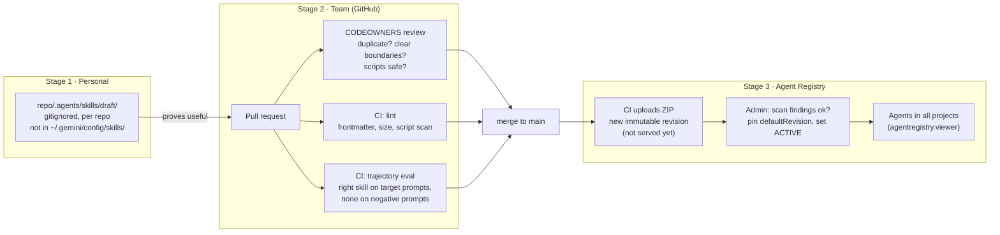
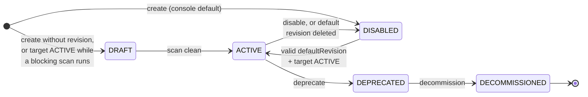
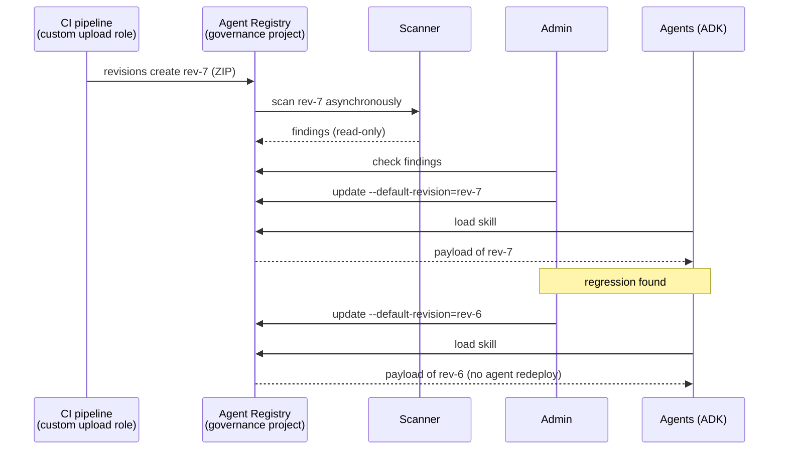
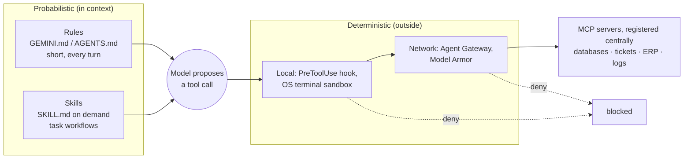
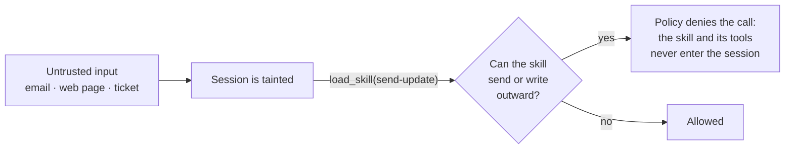
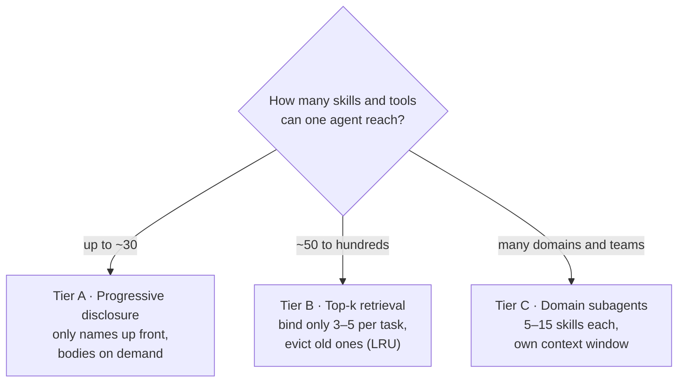
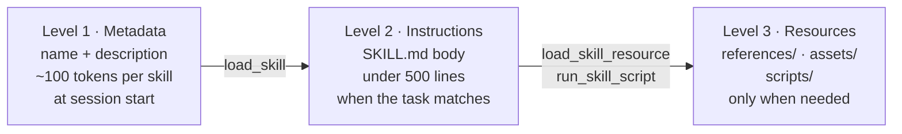
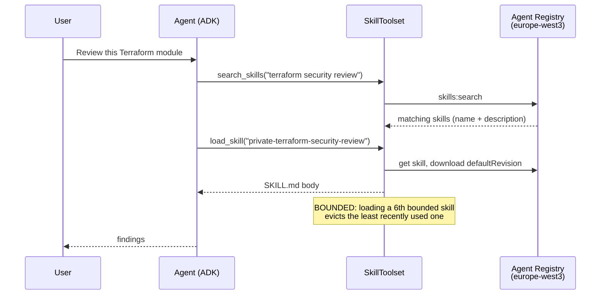
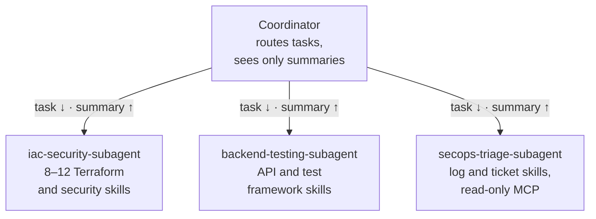

# Agent Skills at Scale

**Learning note.** How an engineering organization keeps agent skills from sprawling, and how an agent finds the right skill among hundreds without flooding its context window.

> **"Skills guide, hooks enforce."**
> A skill changes what the model is *likely* to do. Only hooks, sandboxes and gateways change what it *can* do. Almost every design decision below follows from keeping these two apart.

*Based on a customer architecture guide I wrote at Google Cloud (November 2026), rewritten as a learning note with Claude on 2026-11-15. Customer names, project IDs and the vendor comparison were made generic. Product claims were checked the same day against the public docs and the locally installed ADK 2.13.0; passages marked `> **Update**` were corrected or added during that check (full list in the [editor's notes](#editors-notes-corrections-and-checks)).*

> **Preview.** Skill Registry (Agent Platform) and Semantic Governance Policies are Preview (Pre-GA terms, limited support). Check the launch stage of Agent Registry skills before you build production processes on them.

---

## Contents

- [Quick reference](#quick-reference)
- [1. The two problems](#1-the-two-problems)
- [2. What a skill is](#2-what-a-skill-is)
- [3. Where skills live: two registries](#3-where-skills-live-two-registries)
- [4. Governance: the three-stage pipeline](#4-governance-the-three-stage-pipeline)
- [5. The four primitives](#5-the-four-primitives)
- [6. Runtime: finding the right skill among hundreds](#6-runtime-finding-the-right-skill-among-hundreds)
- [7. Chat-first SaaS vs. GitOps plus registry](#7-chat-first-saas-vs-gitops-plus-registry)
- [8. Core terms for your glossary](#8-core-terms-for-your-glossary)
- [9. Hands-on](#9-hands-on)
- [10. Checkpoint](#10-checkpoint)
- [11. References](#11-references)
- [Editor's notes: corrections and checks](#editors-notes-corrections-and-checks)

---

## Quick reference

**Against skill sprawl: three stages.**

1. **Personal:** draft skills locally, inside the repo (`<repo>/.agents/skills/`, gitignored). Never install project skills globally in the home directory.
2. **Team:** share them through a pull request with Tech Lead review (CODEOWNERS), automated `SKILL.md` linting and short ADK trajectory evals in CI.
3. **Organization:** publish from CI as an immutable revision into a central governance project in Google Cloud Agent Registry (`eu` or `europe-west3`). New skills are not served until an admin pins a revision and sets them `ACTIVE`; production agents get a fixed revision; duplicates are retired via `DEPRECATED` → `DECOMMISSIONED`. A central GitHub skills monorepo is the second-best option, and the natural GitOps source for this stage.

**Four primitives, strictly separated.**

| Primitive | Holds | Loaded |
|---|---|---|
| **Rules** (`GEMINI.md`, `AGENTS.md`) | short, always-valid repo conventions | every turn |
| **Skills** (`SKILL.md`) | task-specific workflows | on demand |
| **MCP servers** (registered centrally) | live access to databases, tickets, ERP, logs | when bound as tools |
| **Hooks, sandbox, gateway** | hard safety rules | deterministically, outside the model |

**Finding the right skill: three tiers by catalog size.**

- **Tier A, up to ~30 skills:** progressive disclosure. The agent sees name and description; it loads the body and resources only when needed.
- **Tier B, ~50 to hundreds:** retrieve the top 3–5 skills per task, bind only those, evict old ones (LRU cap).
- **Tier C, organization-wide:** domain subagents with 5–15 skills each and their own context window, instead of one "God agent".

---

## 1. The two problems

Teams adopt local coding agents (Antigravity, Gemini CLI, Claude Code) and build their own agents with ADK. Two problems follow, one organizational and one technical.

**Skill sprawl.** Engineers prototype useful workflows on their laptops, copy `SKILL.md` files between repositories and keep duplicate API helper scripts. Nobody reviews them, nobody scans the scripts, no version is pinned, and there is no central switch to turn a bad skill off.

**Runtime scaling.** Binding dozens of MCP tool schemas or hundreds of skills statically into the system prompt causes three failures at once:

1. **Token cost:** every turn pays for every schema, used or not.
2. **Latency:** a longer prompt means a later first token (TTFT).
3. **Selection accuracy:** with many similar schemas, the model picks the wrong tool or invents parameters.

Two obvious fixes do not work. Chaining tools sequentially does not make the schemas any shorter. Raising the model's thinking budget adds thinking tokens on top of an already bloated prompt. The fix is to change *what is in the prompt*, which is what sections 4 to 6 do.

---

## 2. What a skill is

A skill follows the open, vendor-neutral [Agent Skills specification](https://agentskills.io/specification): a plain, Git-versionable directory that runs unchanged in Antigravity (IDE and CLI), ADK, Gemini CLI, Claude Code and Agent Registry.

```
terraform-security-review/
├── SKILL.md        # required: YAML frontmatter + Markdown instructions
├── references/     # optional: API specs, standards, schemas (read on demand)
├── scripts/        # optional: deterministic checks the agent runs instead of rewriting them
└── assets/         # optional: templates, JSON schemas, config boilerplate
```

**Frontmatter rules** (from the spec):

| Field | Required | Constraint |
|---|---|---|
| `name` | yes | 1–64 characters, lowercase `a-z`, `0-9` and hyphens; no hyphen at the start, at the end or doubled; must match the folder name |
| `description` | yes | 1–1024 characters; says *what* the skill does and *when* to use it |
| `metadata` | no (yes for Agent Registry) | flat map from string to string |
| `license`, `compatibility` (≤ 500 chars), `allowed-tools` (experimental) | no | |

**Trigger hygiene.** At scale, the typical failure is not "no skill matches" but "two skills match". A description therefore needs both halves: *Use when …* and *Don't use for …*. The negative half is what separates a skill from its neighbours.

```yaml
---
name: terraform-security-review
description: >-
  Audits Terraform modules (.tf) for least-privilege IAM, CMEK encryption,
  VPC Service Controls and regional guardrails (eu / europe-west3).
  Use when creating, reviewing or refactoring Terraform infrastructure modules
  or GCP IAM bindings. Don't use for Kubernetes runtime debugging, application
  unit tests or live production deployments.
metadata:
  owner: platform-security
---
```

**Packaging for Agent Registry.** The directory is zipped with `SKILL.md` at the archive root and validated on upload: at most 8 directory levels, and the frontmatter must define `name`, `description` and `metadata`.

> **Update.** The compressed ZIP may be up to **1 MB** (the original said 500 KB). The limits of 10 MB uncompressed in total and 1 MB per file apply only when security scanning is enabled; otherwise revision creation fails with `INVALID_ARGUMENT` or the scan status becomes `UNSUPPORTED_FORMAT`.

Because the spec requires `metadata` to be a flat string map (Agent Registry stores it as `map<string, string>`), ADK-specific list fields such as `metadata.adk_additional_tools` only work for skills that ADK loads locally, not for skills published to Agent Registry. ADK 2.13 validates exactly this: `adk_additional_tools` must be a list of strings.

---

## 3. Where skills live: two registries

Google Cloud has two services with "skill registry" in the description. They solve different problems.

| | **Agent Registry** (skills) | **Skill Registry** (Agent Platform) |
|---|---|---|
| Purpose | governance and distribution catalog for the whole organization | runtime repository with semantic retrieval |
| API | `agentregistry.googleapis.com` | `aiplatform.googleapis.com/v1beta1` |
| Discovery | `skills:search` (used by ADK's `GCPSkillRegistry`) | `skills:retrieve` with `top_k`, over display name and description |
| Versioning | immutable `SkillRevision`, `defaultRevision` pointer, five lifecycle states | skill plus immutable revisions, default revision |
| EU locations | `eu` multi-region, `europe-west3` (Frankfurt), `europe-west10` (Berlin) and more | `europe-west4` (Netherlands); also `us-central1`, `us-east5` |
| Notes | malware and vulnerability scanning of uploads; `constraints/gcp.resourceLocations` enforced on regional create | data residency US and EU supported; CMEK and VPC-SC not supported |

**Agent Registry** knows two kinds of skills:

- **Standalone skills:** versioned ZIP bundles (instructions plus scripts) that an agent downloads into its own context. Governed across projects, independent of any single agent deployment.
- **Inline A2A skills:** the `skills` array inside a remote agent's `agent-card.json`. They advertise what a remote agent can do, so that another agent can delegate a task to it over A2A (see [a2a.ipynb](a2a.ipynb)). They are versioned with the Agent Card.

Skill IDs tell you who published a skill. Google-managed skills come from verified publishers (`FIRST_PARTY`, for example `urn:skill:cloud.google.com:…`) and are visible in every project. Your own skills get the prefix `private-` automatically (`private-terraform-security-review`), so they cannot collide with verified ones. You use the prefixed ID in all later commands.

**Skill Registry** provisions a built-in system skill, `gcp-skill-registry`, with which agents can create, search and manage skills. It appears from the second API call on; the first response does not list it yet.

> **Update.** The organization policy `constraints/gcp.resourceLocations` is enforced when you create regional `Skill` and `SkillRevision` resources. It is not retroactive, and the docs do not say whether it also applies to `eu` or `global`.

**Consequence for strict in-country requirements (Frankfurt):** use Agent Registry in `europe-west3` as the catalog and let ADK search it lazily (section 6.2). Skill Registry is not offered in `europe-west3`.

---

## 4. Governance: the three-stage pipeline

The goal is to keep experimentation fast without letting unreviewed skills spread. Each stage adds a gate.



*Each arrow to the right is a promotion; each gate is a place where a bad skill stops.*

### Stage 1: personal sandbox

Engineers draft and test new skills in the project repository under `<repo>/.agents/skills/`, excluded from Git while they are personal experiments. The crucial rule: **scope project skills to the repository**, never install them in `~/.gemini/config/skills/`. Global skills are visible in every project on the machine, so dozens of unrelated skills pile up and compete for the model's attention everywhere.

> **Update.** Antigravity also reads `.agents/skills/` in every parent folder up to the repository root. A monorepo can therefore hold shared skills at the root and package-specific ones further down.

### Stage 2: team review in Git

When a skill proves useful, it goes into the repository through a pull request. For engineering standards that span repositories, it goes into a central skills repository instead (for example `company-agent-skills`), which each repo installs, for example with `npx skills add <org>/company-agent-skills` or as an Antigravity plugin (`agy plugin install <plugin>`).

Tech Leads review via CODEOWNERS: Is this a duplicate of an existing skill? Are the boundaries in the description clear? Are the scripts safe? CI adds two automated gates before the merge:

1. **Schema and security lint:** frontmatter valid (`skills-ref validate ./my-skill` checks the spec), size limits respected, static analysis of `scripts/`.
2. **Trajectory evaluation:** a short eval set (`trajectory.evalset.json`) checks that the agent calls `load_skill` for the right skill on target prompts, ignores it on neighbouring prompts, and that nothing regressed. In `adk eval` this is the metric `tool_trajectory_avg_score`; the Gen AI Evaluation Service has an equivalent tool-use metric.

> **Update.** The original ran these evals "against the Frankfurt Gemini endpoint". In this repo, Gemini 3.x was only available on `global` (October 2026, see [a2a.ipynb](a2a.ipynb)). Run the evals against whichever model endpoint satisfies your residency requirement, and check the model's location table first (section 6.2).

### Stage 3: organization-wide publishing

On merge to `main`, a CI/CD pipeline zips the skill and uploads it as a new immutable revision into a central **governance project** in Agent Registry. The point of this stage is an IAM split, so that the pipeline that uploads cannot also put things into production:

| Who | Role | May |
|---|---|---|
| CI pipeline | **custom role** with only create and read permissions on skills and skill revisions | create skills (not served) and upload revisions (not served until pinned) |
| Platform and security admins | `roles/agentregistry.editor` or `roles/agentregistry.admin` | review scan findings, move `defaultRevision`, set `ACTIVE`, retire skills, curate MCP servers |
| Consuming teams and agent service accounts | `roles/agentregistry.viewer` | discover and load approved skills, nothing else |

Why a custom role for CI: the predefined `roles/agentregistry.user` can also update skills, change their lifecycle state and delete them. A pipeline with that role could activate its own upload, and the four-eyes principle would be gone.

#### Lifecycle: five states



| State | Served at runtime? | Meaning |
|---|---|---|
| `DRAFT` | no | being prepared; also the waiting state while the initial revision's blocking scan runs |
| `DISABLED` | no, resolution and download fail immediately | kill switch; reached automatically when the default revision is deleted |
| `ACTIVE` | yes | requires `defaultRevision` to point to an active revision |
| `DEPRECATED` | yes, still resolvable and downloadable | signals retirement after a grace period |
| `DECOMMISSIONED` | no, permanently | terminal and irreversible; only reachable from `DEPRECATED` |

> **Update.** The original described four states. The docs list a fifth, `DRAFT`. Scanning has three modes: `DISABLED`, `ENABLED_NONBLOCKING` and `ENABLED_BLOCKING` (the default). Under blocking scanning, a skill created with target `ACTIVE` stays in `DRAFT` until the scan of its initial revision is clean, and pinning a revision with findings or a pending scan fails with `FAILED_PRECONDITION`.

#### Release, pin, roll back



*Rollback is just moving a pointer. ADK's `GCPSkillRegistry` always loads the skill's `defaultRevision`, so every agent picks up the change on its next load.*

The same workflow with `gcloud` against a central governance project in Frankfurt:

```bash
PROJECT=agent-governance-prod   # central governance project
LOCATION=europe-west3
SKILL=terraform-security-review # stored as private-terraform-security-review

# 1. Package: SKILL.md must sit at the archive root
(cd skills/$SKILL && zip -r ../../$SKILL.zip .)

# 2a. First release only (CI service account): create the skill, not served yet
gcloud agent-registry skills create $SKILL \
    --project=$PROJECT --location=$LOCATION \
    --display-name="Terraform Security Review" \
    --description="Audits .tf modules for IAM, CMEK, VPC-SC and EU guardrails." \
    --target-state=DISABLED \
    --payload=./$SKILL.zip

# 2b. Every later release: a new immutable revision (the default does not move)
gcloud agent-registry skills revisions create REVISION_ID \
    --skill=private-$SKILL \
    --project=$PROJECT --location=$LOCATION \
    --payload=./$SKILL.zip

# Revision IDs, including the one created in step 2a
gcloud agent-registry skills revisions list \
    --skill=private-$SKILL --project=$PROJECT --location=$LOCATION

# 3. Admin, after checking the scan findings: pin the revision, then activate
gcloud agent-registry skills update private-$SKILL \
    --project=$PROJECT --location=$LOCATION \
    --default-revision=FULL_REVISION_NAME   # projects/…/skills/private-…/revisions/REVISION_ID, as listed

gcloud agent-registry skills update private-$SKILL \
    --project=$PROJECT --location=$LOCATION \
    --target-state=ACTIVE

# Rollback: the same --default-revision update with an older revision
```

> **Update.** The original used `gcloud alpha agent-registry skills`. The current docs show the GA group `gcloud agent-registry skills`. The local gcloud 585.0.0 (2026-11-15) does not have `skills` in the GA group yet, and alpha is not installed; according to the original, the GA commands arrived in gcloud 591.0.0, so update the CLI first. Instead of `--payload`, `--gcs-source-uri=gs://…` uploads from Cloud Storage.

---

## 5. The four primitives

Most skill sprawl, and almost every accidental safety incident with agents, starts the same way: a team puts into `SKILL.md` or into the global prompt something that belongs in another layer.



*Everything on the left can be ignored by the model. Everything on the right cannot.*

| Primitive | Put here | Typical misuse |
|---|---|---|
| **Rules** | build and test commands, language standards, module boundaries | a 300-line incident runbook in `GEMINI.md` that every prompt pays for |
| **Skills** | playbooks, review checklists, templates, helper scripts | a skill as a security boundary ("never call DELETE") |
| **MCP servers** | live, authenticated access to systems | the same REST wrapper script copied into twenty team skills |
| **Hooks, sandbox, gateway** | hard rules: block destructive calls, scan for secrets, lint after every edit | a safety rule written as a sentence in a prompt |

**1. Rules** are loaded into every session in the repository. Reserve them for short, universally valid conventions. Antigravity truncates any single rule file above 24,000 bytes (after `@`-includes are expanded); global and `always_on` rules share a budget of 20,000 tokens, and above it the largest files are replaced by pointers.

> **Update.** Besides `GEMINI.md` and `AGENTS.md`, Antigravity reads `.agents/rules/*.md` with a `trigger` in the frontmatter: `always_on`, `model_decision` (only path and description up front, the full rule when the task matches), `glob` (when matching files are touched) or `manual` (only when `@`-mentioned). A `model_decision` rule is progressive disclosure for rules, close to a skill. A missing or invalid trigger silently discards the rule.

**2. Skills** hold task-specific procedures that are loaded on demand. They steer the model *probabilistically*. They are never a hard security boundary.

**3. MCP servers** provide live, authenticated access to databases, Cloud Logging, issue trackers and wikis (Jira, Confluence) or ERP systems. Instead of copying brittle wrapper scripts across skills, register vetted MCP servers centrally in Agent Registry, control access with IAM (`roles/mcp.toolUser` for Google Cloud MCP servers) or with Agent Gateway authorization policies (for third-party and custom servers), and default to **read-only modes** for analysis and triage. See [mcp.ipynb](mcp.ipynb) and [gateway.ipynb](gateway.ipynb).

**4. Hooks, sandbox and gateway** run outside the model, so the model cannot talk its way around them. Examples: block `DELETE` calls or space and table drops in Confluence and databases, screen prompts and responses for secrets and PII (Model Armor), run the linter after every file edit (`PostToolUse`). Locally in Antigravity this is the OS-level terminal sandbox plus `.agents/hooks.json`; centrally, for all MCP and agent traffic, it is Agent Gateway with Model Armor.

> **Update.** Antigravity hooks live in `.agents/hooks.json` (workspace) and `~/.gemini/config/hooks.json` (global). Events: `SessionStart`, `PreToolUse`, `PostToolUse`, `PreInvocation`, `PostInvocation`, `Stop`. A `PreToolUse` hook blocks a call by printing JSON with `"decision": "deny"` on stdout. Claude Code blocks with exit code 2 instead (see [sdlc.md, Module 2](sdlc.md#module-2--the-inner-loop-static-analysis--hooks)); the idea is the same, the mechanics differ per tool.

### Semantic governance: protecting tainted sessions

A session becomes *tainted* when it has taken in untrusted content: an email, a web page, an uploaded document, an issue ticket. Such content can carry injected instructions. Semantic Governance Policies then stop the agent from loading skills that can act outward:



The policy intercepts the ADK skill tools (`list_skills`, `load_skill`, `load_skill_resource`, `run_skill_script`) and checks each call against constraints written in natural language. This is the "lethal trifecta" defense from [sdlc.md, Module 10](sdlc.md#module-10--reviewing-ai-code-critically-security--verification-debt): cut the outward-acting leg once untrusted content is in the context.

> **Update.** The policy is evaluated by an LLM, and the docs say its verdicts "may not be accurate". It is therefore a probabilistic layer. It adds to hooks and gateways but does not replace them.

---

## 6. Runtime: finding the right skill among hundreds

Which approach fits depends on how many skills and tools one agent can reach. The tiers build on each other: Tier C agents use Tier B search, and Tier B still loads skills via Tier A's levels.



### 6.1 Tier A (up to ~30 skills): progressive disclosure

Antigravity and ADK never inject full skill files up front. They disclose in three levels:



1. **Metadata:** at the start the agent only sees name and description of each skill. Unused skills cost almost nothing.
2. **Instructions:** only when a task matches does the agent pull the `SKILL.md` body into context. Keep it focused (the spec recommends under 500 lines and under ~5,000 tokens) and move long reference tables into separate files.
3. **Resources:** detailed docs and scripts are read or run on demand. The source code of a script never has to enter the context window, only its short stdout.

How the levels map to the tools:

- **Antigravity** shows the list of names and descriptions on every turn and reads the full `SKILL.md` when a skill looks relevant. The tool names are not exposed.
- **ADK** (`SkillToolset`) has two discovery modes. `LAZY` (the default) offers a `list_skills` tool, which costs one model turn before the first `load_skill` but keeps the system instruction free of skill names; it is the better choice for large or changing catalogs. `EAGER` injects the catalog into the system instruction as XML and drops `list_skills`; it is the better choice for small, stable catalogs. Registry skills are only reachable through `search_skills` in both modes.

> **Update.** ADK offers `run_skill_script` only if scripts can actually run: a `code_executor` or an `environment` on the `SkillToolset`, or a `code_executor` on the agent.

### 6.2 Tier B (~50 to hundreds): top-k retrieval, lazy search, eviction

From about 50 tools, or with hundreds of skills across the organization, even the Level 1 list should no longer sit in the system prompt. The pattern is **RAG for skills and tools**: before the reasoning loop starts, match the current request against an index, take only the top 3 to 5 skills or tools, and bind only this small subset for the turn. Token use and latency stay small and predictable, and all capabilities remain reachable.

**ADK with Agent Registry (works in `europe-west3`).** `SkillToolset` plus `GCPSkillRegistry` puts **no** registry skill into the base prompt. That keeps the prompt prefix stable, so the prefix cache keeps working. The agent calls `search_skills` (backed by Agent Registry's `skills:search`), loads only what it needs, and old skills are evicted:



Skill lifecycle modes in ADK (`SkillLifecycleConfig`):

| Mode | Stays active | Counts against `max_active_skills` |
|---|---|---|
| `PERSISTENT` (default) | for the rest of the session, unless unloaded | no |
| `BOUNDED` | like persistent, but the least recently loaded one is evicted beyond the cap | yes (default cap 5) |
| `EPHEMERAL` | until the end of the turn that loaded it | no (under `run_live` it behaves like persistent) |

The lifecycle feature is still **experimental**: set `ADK_ENABLE_SKILL_LIFECYCLE=1` to get the `unload_skill` tool and to prune evicted `SKILL.md` bodies from the request. Without the flag, eviction only deactivates the skill's dynamic tools.

For skills loaded locally, `metadata.adk_additional_tools` activates skill-specific tools only when the skill is loaded. That changes the tool declaration list and therefore invalidates the prefix cache once at activation time. Grouping related steps keeps cache hit rates high.

```python
# Names checked against google-adk 2.13.0. Environment:
#   GOOGLE_GENAI_USE_VERTEXAI=TRUE
#   GOOGLE_CLOUD_PROJECT=agent-governance-prod
#   GOOGLE_CLOUD_LOCATION=global   # model endpoint (see the note below)
#   ADK_ENABLE_SKILL_LIFECYCLE=1   # experimental: unload_skill + pruning of evicted bodies

from google.adk.agents import Agent
from google.adk.integrations.skill_registry.gcp_skill_registry import GCPSkillRegistry
from google.adk.tools.skill_toolset import (
    SkillDiscoveryMode,
    SkillLifecycleConfig,
    SkillLifecycleMode,
    SkillToolset,
)

# 1. The governance catalog in Frankfurt; its location is independent of the model's
registry = GCPSkillRegistry(
    project_id="agent-governance-prod",
    location="europe-west3",
)

# 2. Lazy discovery (no registry skill in the base prompt) + LRU cap of 5 bounded skills
skill_toolset = SkillToolset(
    registry=registry,
    discovery_mode=SkillDiscoveryMode.LAZY,  # default; registry skills are always searched on demand
    lifecycle_config=SkillLifecycleConfig(
        enabled=True,
        default_mode=SkillLifecycleMode.BOUNDED,
        max_active_skills=5,  # also the default
    ),
)

engineering_agent = Agent(
    name="platform_engineering_assistant",
    model="gemini-3.5-flash",
    instruction=(
        "Use search_skills to discover approved enterprise skills matching the "
        "current task, and load only the specific reference files required."
    ),
    tools=[skill_toolset],
)
```

> **Update.** The original set `GOOGLE_CLOUD_LOCATION=europe-west3` for the registry and the model together. `GCPSkillRegistry` takes its location as a parameter, so the two can differ, and they had to here: in this repo Gemini 3.x ran only on `global` (October 2026). The docs warn: "Don't use the global endpoint if you have ML processing requirements." So a catalog in Frankfurt is easy; fully in-country processing additionally needs a model that is served on a regional or `eu` endpoint. Check the model's location table before promising it.

**Custom router with Skill Registry (`europe-west4`).** If you build your own pre-loop router, Skill Registry returns the top-k skills directly:

```python
import agentplatform

client = agentplatform.Client(project="sandbox-project", location="europe-west4")

# Only the 5 best-matching skills for the current request
response = client.skills.retrieve(
    query=user_prompt,
    config={"top_k": 5},
)
selected_skills = [s.skill_name for s in response.retrieved_skills]
```

> **Update.** The original said the service generates vector embeddings automatically. The docs only say that `RetrieveSkills` searches over the skill's display name and description, which makes trigger hygiene (section 2) the lever for retrieval quality too.

### 6.3 Tier C (organization-wide): domain subagents instead of a "God agent"

Even with top-k search, one agent should not do Terraform audits, SecOps triage, ERP finance queries and frontend unit tests at the same time. Split broad workflows into **domain subagents**:



- **Small search space:** each subagent searches only its own 5–15 skills, so selection is precise.
- **Context isolation:** long logs, tool traces and loaded `SKILL.md` bodies stay in the subagent's disposable context; the coordinator gets only a short structured summary.
- **Least privilege per agent:** each subagent runs under its own identity (SPIFFE-based Agent Identity, see [identity.ipynb](identity.ipynb)) with IAM grants only for its domain's skills and MCP servers.

In ADK, subagents are `LlmAgent`s with `include_contents="none"`, wired via `sub_agents=[...]` or wrapped in `AgentTool`. In Antigravity, subagents start without the parent's conversation history and run asynchronously in the background.

> **Update.** In Antigravity, the parent chooses the workspace when it calls `invoke_subagent`: `inherit` (the parent's workspace), `branch` (an isolated Git worktree, for concurrent code edits) or `share` (shared directory storage). The original wrote this as `Workspace="branch"`.

---

## 7. Chat-first SaaS vs. GitOps plus registry

Chat-first SaaS platforms for "AI employees" take a different approach to skills: very low friction for non-technical users. The trade-off is worth knowing, because both sides solve a real problem.

| Dimension | Where chat-first SaaS excels | Where GitOps plus Agent Registry is stronger |
|---|---|---|
| **Authoring** | zero boilerplate: "turn this workflow into a skill" in the chat, no `SKILL.md`, YAML or ZIP | engineers also generate skills by prompt, but get Git-versioned artifacts, runnable `scripts/` and CI evals; for business users a no-code agent builder inside the same governed cloud boundary can close the gap |
| **Sharing** | one click between personal, team and organization tabs, no IAM setup | team skills only via pull request (CODEOWNERS, no shadow sprawl); org skills via a governance project, pinned revisions and IAM roles |
| **Write protection** | read vs. write separated per connector, one-click approval requests | defense in depth: OS sandbox and `PreToolUse` hooks, script scanning, read-only MCP modes, Agent Gateway and Model Armor, semantic governance for tainted sessions |
| **Residency and portability** | multi-tenant SaaS, often a US or EU region per tenant; skills stored in the platform; model processing wherever the model is hosted | catalog in `eu` or `europe-west3`, VPC Service Controls, CMEK where the service supports it; the same open `SKILL.md` runs in Antigravity, ADK, Gemini CLI and Agent Registry |

**Takeaway.** SaaS workspaces optimize for fast, click-based sharing among business teams. The GitOps-plus-registry approach treats skills like production software: review, pinned revisions, automated evals, data residency and an open format without lock-in.

---

## 8. Core terms for your glossary

Skill sprawl · Agent Skills specification · `SKILL.md` · Frontmatter · Trigger hygiene ("Use when / Don't use for") · Progressive disclosure · Standalone skill vs. inline A2A skill · `SkillRevision` · `defaultRevision` · Lifecycle states (`DRAFT`, `DISABLED`, `ACTIVE`, `DEPRECATED`, `DECOMMISSIONED`) · Governance project · Four-eyes principle · Trajectory evaluation · Rules vs. skills vs. MCP vs. hooks · `PreToolUse` · Tainted session · Semantic governance · Top-k retrieval · Lazy vs. eager discovery · LRU eviction · Prefix cache · Domain subagent · Context isolation

---

## 9. Hands-on

**H1: Write one skill (~20 minutes).** Take a task you repeat (for example "set up a new agent notebook in this repo") and write it as a skill under `.agents/skills/<name>/`. Validate it with `skills-ref validate ./<name>`. Check: does `name` match the folder, and does the description have both halves?

**H2: Test the trigger.** Write five prompts that should load the skill and five neighbouring prompts that should not. Run them in Antigravity or Claude Code and count hits and false hits. Rewrite the description until both are right. This is the manual version of the CI gate in stage 2.

**H3: Lazy vs. eager in ADK.** Build a `SkillToolset` with three local skills, once with `SkillDiscoveryMode.LAZY` and once with `EAGER`. Compare the system instruction (eager contains the catalog as XML) and the number of model turns until the first `load_skill`.

**H4: Lifecycle in a sandbox project.** In a throwaway project: create a skill, upload two revisions, pin the first and set it `ACTIVE`, pin the second, roll back to the first, then deprecate. Do not decommission anything you still need: it is irreversible. Update gcloud first (section 4).

**H5: A hook that says no.** Write an Antigravity `PreToolUse` hook that denies `rm -rf` and any `DELETE` request to an API, and test it. Then compare with the Claude Code variant from [sdlc.md, Module 2](sdlc.md#module-2--the-inner-loop-static-analysis--hooks).

---

## 10. Checkpoint

1. A team puts its 300-line incident runbook into `GEMINI.md`. Which two costs does that cause, and where does the runbook belong?
2. "Never call DELETE on Confluence" is written into a skill. Why is that not a safety control, and which layer should enforce it?
3. A skill is `DEPRECATED`. Can agents still load it? What must happen before it can be `DECOMMISSIONED`, and what can never happen afterwards?
4. The CI service account has `roles/agentregistry.user`. Why does that break the four-eyes principle, and what is the fix?
5. An agent can reach 400 skills. Why does neither a bigger thinking budget nor tool chaining help, and what does?
6. Why does activating a skill's `adk_additional_tools` cause one prefix-cache miss, and how do you keep such misses rare?
7. The skill catalog is in `europe-west3` and the agent uses a Gemini 3.x model. Is the workload processed entirely in Frankfurt?

---

## 11. References

**Agent Registry (central governance catalog)**

- [Overview and governance projects](https://docs.cloud.google.com/agent-registry/overview)
- [Skills architecture: standalone vs. inline A2A skills, lifecycle](https://docs.cloud.google.com/agent-registry/skills-architecture)
- [Register standalone skills (console, gcloud, REST)](https://docs.cloud.google.com/agent-registry/register-skills)
- [Manage skills: lifecycle, default revision, IAM](https://docs.cloud.google.com/agent-registry/manage-skills)
- [Manage skill revisions](https://docs.cloud.google.com/agent-registry/manage-skill-revisions)
- [Locations](https://docs.cloud.google.com/agent-registry/locations)
- [IAM roles and permissions](https://docs.cloud.google.com/agent-registry/roles-permissions)

**Gemini Enterprise Agent Platform (Skill Registry, governance, evaluation)**

- [Skill Registry overview](https://docs.cloud.google.com/gemini-enterprise-agent-platform/build/skill-registry)
- [Create, manage and retrieve skills (`skills:retrieve`)](https://docs.cloud.google.com/gemini-enterprise-agent-platform/build/skill-registry/create-manage)
- [Govern agent skills: semantic governance policies](https://docs.cloud.google.com/gemini-enterprise-agent-platform/govern/policies/govern-agent-skills)
- [Agent evaluation](https://docs.cloud.google.com/gemini-enterprise-agent-platform/optimize/evaluation/agent-evaluation)
- [Model locations (global, multi-region, regional)](https://docs.cloud.google.com/vertex-ai/generative-ai/docs/learn/locations)

**Antigravity, ADK and open standards**

- [Antigravity: skills](https://antigravity.google/docs/skills) · [rules](https://antigravity.google/docs/rules) · [hooks](https://antigravity.google/docs/hooks) · [sandbox](https://antigravity.google/docs/sandbox) · [subagents](https://antigravity.google/docs/subagents) · [MCP](https://antigravity.google/docs/mcp)
- [Admin settings for AI developer tools](https://docs.cloud.google.com/gemini/enterprise/docs/ai-developer-tools-settings)
- [ADK: skills and `SkillToolset`](https://adk.dev/skills/) · [function tools](https://adk.dev/tools-custom/function-tools/)
- [Dynamic tool search in ADK (Google Cloud Community, Medium)](https://medium.com/google-cloud/implementing-anthropic-style-dynamic-tool-search-tool-f39d02a35139)
- [Agent Skills specification](https://agentskills.io/specification)
- [Google's open-source skills (google/skills)](https://github.com/google/skills) · [agents-cli (google/agents-cli)](https://github.com/google/agents-cli)

**In this repo:** [mcp.ipynb](mcp.ipynb) (MCP server, Agent Registry) · [identity.ipynb](identity.ipynb) (Agent Identity) · [gateway.ipynb](gateway.ipynb) (Agent Gateway, Model Armor) · [a2a.ipynb](a2a.ipynb) (A2A, Agent Card) · [evaluations.md](evaluations.md) (evaluating agents) · [sdlc.md](sdlc.md) (hooks, harness, lethal trifecta)

---

## Editor's notes: corrections and checks

Changes made while turning the customer guide into this note (2026-11-15). The four images of the original are not in the repo; the three-stage pipeline was redrawn in Mermaid, the two platform-stack images were dropped, and further diagrams were added for the lifecycle, the release flow, the four primitives, the tiers and the subagents.

**Made generic.** Customer name, customer project IDs and data-residency wording specific to the customer; the named SaaS vendor in section 7 (the comparison now describes the category).

**Corrections (all marked `> **Update**` inline)**

| Topic | Original | Checked 2026-11-15 |
|---|---|---|
| ZIP limits | 500 KB compressed | 1 MB compressed; 10 MB total and 1 MB per file only with scanning enabled |
| Lifecycle | four states | five: also `DRAFT`; blocking scanning (the default) holds a new skill with target `ACTIVE` in `DRAFT` |
| gcloud | `gcloud alpha agent-registry skills` | docs show the GA group; local gcloud 585.0.0 has no `skills` yet |
| Skill Registry retrieval | automatic vector embeddings | docs: search over display name and description; embeddings not mentioned |
| Skill Registry, EU | `europe-west4` with Access Transparency | `europe-west4` (also `us-central1`, `us-east5`); data residency US/EU supported; CMEK and VPC-SC not supported; Access Transparency not on the page |
| Model endpoint | registry and model both in `europe-west3`; CI evals against "the Frankfurt Gemini endpoint" | Gemini 3.x only on `global` in this repo (October 2026); registry location set separately |
| `run_skill_script` | offered when the toolset has a code executor or environment | a `code_executor` on the agent also counts |
| Antigravity subagents | `Workspace="branch"` | `invoke_subagent` with `inherit`, `branch` or `share` |
| Antigravity plugins | `agy plugin install <repo-url>` | docs: `agy plugin install <plugin-name>` from the marketplace |
| Semantic governance | listed as defense in depth | LLM-evaluated, "may not be accurate": a probabilistic layer |
| ADK version | "requires google-adk >= 2.10" | names checked against 2.13.0; the minimum version was not checked |

**Checked and unchanged.** Spec limits (`name`, `description`, flat `metadata`); `private-` prefix and URN formats; immutable revisions and `defaultRevision`; `DEPRECATED` still served, `DECOMMISSIONED` terminal and only reachable from `DEPRECATED`; `roles/agentregistry.user` can update, change state and delete; Agent Registry in `eu`, `europe-west3`, `europe-west10`; Antigravity rule limits (24,000 bytes per file, 20,000 tokens shared), skill paths and hook events; ADK: `SkillToolset`, `LAZY` default, `EAGER`, `PERSISTENT`/`BOUNDED`/`EPHEMERAL`, default cap 5, `ADK_ENABLE_SKILL_LIFECYCLE` (experimental, off by default), `search_skills` only with a registry, `GCPSkillRegistry` → `agentregistry.googleapis.com` `skills:search` and download of the `defaultRevision`, `include_contents="none"`, `tool_trajectory_avg_score`.

**Things to verify yourself before relying on them**

- Launch stage of Agent Registry skills (Preview or GA) and the gcloud version that brings the GA `skills` group.
- `roles/mcp.toolUser` as the role for Google Cloud MCP servers.
- The name of the tool-use metric in the Gen AI Evaluation Service (the original says `TOOL_USE_QUALITY`).
- The response fields of `client.skills.retrieve` (`retrieved_skills`, `skill_name`); the docs show the call but not the response.
- `npx skills add` syntax for installing skills from a central repository.
- Which Gemini models are served in `europe-west3` or `eu` at the time you read this.
